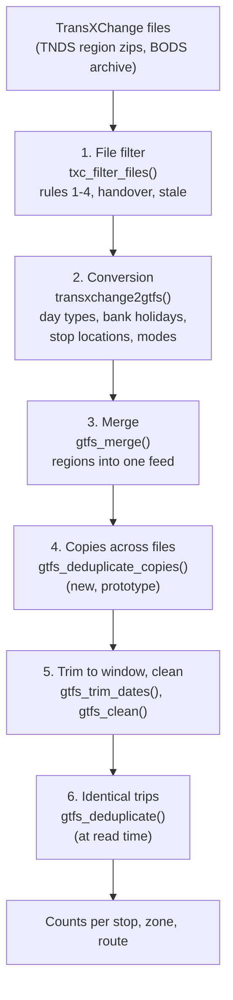
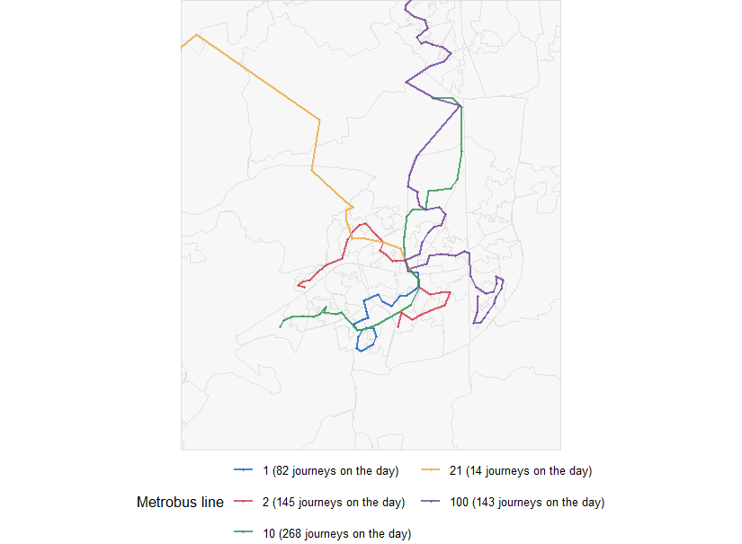
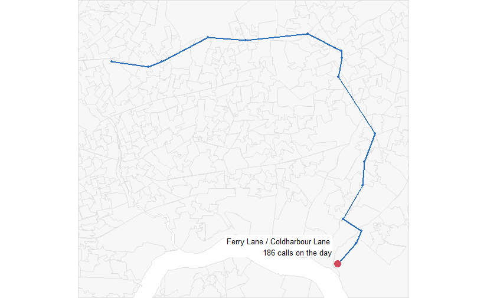
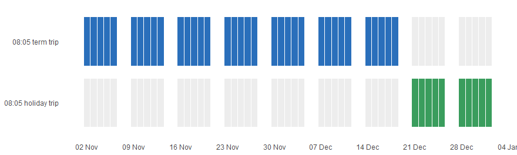
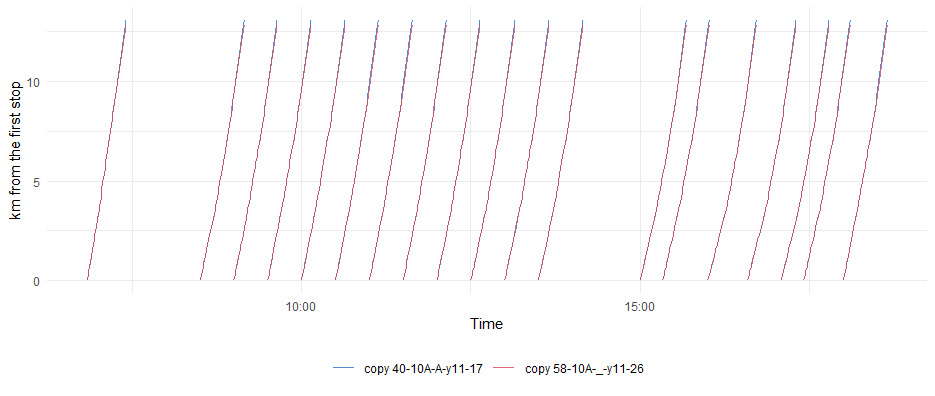

This report explains every rule UK2GTFS and the pipeline apply between a
timetable as published and the trips that are counted: what each rule
removes, what it keeps, and the real case that made it necessary. It ends with
the newest rule, the one for one timetable published by two files, and
measures it on the November 2026 data.

Every rule here exists because of a real case. Each was found by comparing a
source with its own raw files, with another source, or with operators' printed
timetables. The examples are the cases in the code's own comments and tests,
so each can be checked against UK2GTFS.

## Why filtering is needed, and the two ways it can fail

A TransXChange archive is not a timetable. It is a set of files, each
declaring a service, an operating period and its journeys, and an archive
routinely holds several files that describe the same bus:

* **versions:** a new edition is uploaded, and the old one stays in the
  archive, often still declaring an open-ended operating period;
* **re-registrations:** some publishers (Transport for London among them)
  give every re-registration a new `ServiceCode`, so two files that are one
  service share nothing that marks them as the same;
* **copies:** one timetable published by two parties, such as an operator's own
  export and a regional authority's;
* **siblings:** one timetable deliberately split across files by line, by day
  type, by depot, or into term-time and holiday parts. These are not
  duplicates, and removing one deletes real service.

A filter can therefore fail in two directions. It can **leave a duplicate**,
which counts a bus twice, or **delete a sibling**, which counts a real bus as
none. The rules below are built to fail in the first direction when they must
fail at all: a surviving duplicate inflates a count and can be found later,
while deleted service is invisible. This explains a recurring shape in the
rules: a broad test that finds candidates, then a narrower one (the same
journeys, the same days, comparable sizes) before anything is removed.

## The stages



| Stage | Works on | Catches | Cannot catch |
|---|---|---|---|
| 1. File filter | file headers, and journeys where a decision needs them | versions, re-uploads, re-registrations, handovers within one region zip | anything across region zips; copies published under another operator |
| 2. Conversion | one file at a time | which days a journey runs; where a stop is | duplicates |
| 4. Copies | whole services in the merged feed | one timetable published twice, with different interpolation or operator names | a copy whose departures differ |
| 6. Identical trips | trips in the merged feed | the same journey twice, with identical times at every stop | anything with one time different |

The file filter runs once per region zip, because that is how TNDS is
published and how a conversion is called. It can never compare a file in the
East Midlands zip with one in the West Midlands zip. That is why stage 4 is
needed.

## Stage 1: the file filter

### The identity key: operator plus ServiceCode

Rules 1 to 3 compare files that share an identity key. Originally that key
was the `ServiceCode` alone, but a `ServiceCode` is unique only within an
operator. Five South East operators (RRTR, GOCH, HAMS, HDBC, METR) publish
`ServiceCode` "1". Keyed on the code alone, they looked like one service with
five competing revisions, and "the most recent start" deleted the other four.
Metrobus lost lines 1, 2, 10, 21 and 100 this way: 876 of 2,892 journeys, five
whole Crawley town routes. The key is now the operator's set of National
Operator Codes plus the `ServiceCode`. Over the 26 July 2026 TNDS archive
that recovered 6,958 journeys in 195 files, 3.3% of the South East.



### Rule 1: repeated uploads of one period

Within one identity key, files with the same operating-period start are
repeated uploads, and only the highest revision is kept. Three refinements
came from three cases where this deleted siblings:

* **Per line.** Nottingham City Transport files `ServiceCode` NCT49 as four
  files, for lines 49, 49A, 49B and 49X, all sharing the code and the period.
  Deduplicating on code and start kept one of them: 114 live files lost in one
  TNDS region, including line 41 (343 journeys) and line 27 (296). A file is
  now kept if it is the best file for at least one of its lines.
* **Per day type.** Brighton & Hove files one document per day type, so
  weekdays, Saturday and Sunday share code, line and period. Before the day
  set was part of the key, 263 of the 285 files rule 1 removed in that
  operator's fortnight carried a different day set from the file that
  displaced them, and 8 of 36 services had no weekend timetable at all. The
  same defect left Manchester Metrolink with a third of its real service:
  475.6 journeys a day against the DfT's independent 1,431.9. With the fix it
  reads 1,463.0.
* **Siblings in one export.** Stirling's University line UL is two files,
  sharing every key field and created 41 ms apart, with 247 and 434
  *different* journeys. A repeated upload repeats the journeys, but a sibling
  does not. So a duplicate is dropped only where it shares most of its journeys with
  the file it defers to (`txc_versions()`: at least half, or a quarter to
  a half with journey counts within a tenth).

### Rules 2 and 3: the version in force, and future versions

Of the files that started on or before the filter date, the most recent is
the one in force, and earlier ones are superseded. Files starting after the
date are future timetables and are kept. Each of the following refinements
again came from a deleted sibling:

* **Per line and day set.** Arriva Cymru registers lines 12 and X12 under one
  code in two files starting a day apart. Keyed on the code, the 16-journey X12
  file was "the latest version" and deleted the 453-journey line 12 file. In
  July 2026 this removed 24 files, 10 of them whole lines with nothing in their
  place.
* **A successor repeats its predecessor.** Arriva Cymru files route 35 once
  per depot: Rhyl (68 journeys) and Wrexham (120). They share code, line and
  day set, and their journey share is zero. "The latest start" kept Rhyl and
  deleted Wrexham's 120.
* **The version in force must still be running.** trentbarton files each
  route as an open-ended timetable plus a half-term week file. On 11 November
  the half-term file (25 to 31 October) was "the latest version", and the open-ended
  file was deleted. The whole network was absent: 157 lines in the November
  2026 BODS archive.

### Rule 4: overlapping registrations

Rules 1 to 3 cannot see a re-registration under a new `ServiceCode`. Rule 4
groups files that are the same registered service by any reading. That means
the same operator, normalised description and lines; or the same operator
and `ServiceCode`; or the same operator, creation time and lines. It then
reconciles overlapping periods. It prefers to **truncate** an operating period
rather than delete a file, so a journey on a date the successor does not cover
is never lost.


The branches, each with the case that set its shape:

* **Staggered starts.** Where a later registration runs at least as far as an
  earlier one, the earlier one is closed the day before. Transport for London
  re-registered line 436 under a new code from 25 July. The 11 July file now
  ends on 24 July instead of running beside it to 23 December.
* **Same start, different end.** The shorter, more specific period governs
  while it runs, but only if it runs on every day the longer one does.
  Transport for London's night route N97 is an every-night file to 23 December
  plus a Saturday-only file to 19 December. Standing the whole-week file down
  left Saturday nights only, losing 264 of 308 journeys in the July window.
* **Identical periods.** Truncation cannot separate them, so the newer file wins
  (TfL 364, created two seconds apart). Within one export, a file under half
  the other's size does not replace it. West Midlands Bus files school route
  705/788 as two parts, and the tie-break had deleted line 788.
* **Nested periods.** Both are kept and counted. Closing the outer period
  would delete the service either side of the inner one.
* **Small successors.** A file with under half the journeys of the one before
  it does not replace it within one export. Hodgsons' 87N is six evening
  journeys beside a 26-journey weekday file, and closing the weekday file
  deleted 20 daytime journeys.
* **Term-time successors.** West Midlands Bus published X21/X22 from 15
  November as a term-time weekday file, beside its whole-week file from 1
  November. Closing the whole-week file removed the weekends, so it now
  carries on with its weekend journeys only.
* **Stale open-ended files.** An open-ended file over a year old is retired
  by a later file in force in the same group, provided that file has at least
  half its journeys and shares half its stops. London United's 117 had four
  open-ended editions from 2023 to December 2025.

### Handovers between operators

Every rule so far is keyed on one operator. When a route changes hands, both
operators' files can declare overlapping periods. When National Express West
Midlands handed routes to West Midlands Bus on 1 November 2026, BODS held
both, so every journey was counted twice: route 74 ran 896 a weekday for 448
real departures. Two handover rules close the outgoing file:

* **The same timetable.** The two files have different operators, the same
  lines, at least half their stops in common and the same days, and at least
  half the outgoing journeys reappear under the new operator.
* **Announced.** The outgoing operator published a last edition (route 96:
  25 to 31 October) before the takeover. West Midlands Bus retimed the route,
  keeping 61 of 100 departure times, so the first test kept both. The ended
  last edition is the outgoing operator's word that it stopped.

## Stage 2: conversion

Three conversion choices decide what each kept file contributes.

* **Day types and bank holidays.** Journeys carry their operating profile,
  so the conversion turns `DaysOfWeek`, special days and serviced
  organisations (school terms) into GTFS calendars. Bank holidays are
  applied per nation.
* **Modes.** Publishers do not agree about the light railways (TNDS files the
  Docklands Light Railway as heavy rail and the Glasgow Subway as a tram). One
  table of overrides settles every source the same way.
* **Stop locations** (UK2GTFS 0.4.1). Previously only NaPTAN gave a stop's
  position, so a stop missing from the NaPTAN copy got none, and
  `gtfs_clean()` then deleted it and every call at it. That happened even
  where the file says exactly where the stop is, as Transport for London's
  files always do. The default is now NaPTAN, with the file's own position
  filling gaps. In TNDS 2.5 on 18 November this placed 43 stops and kept 15,373
  calls. A further 427 stops and 28,454 calls still have no position from
  either source.



## Stage 3: merging

`gtfs_merge()` joins the region feeds into one. It renumbers every table's
ids so that they cannot collide. A defect fixed in October 2026 is worth
recording: `file_id` was numbered per table, so a feed missing
`calendar_dates.txt` shifted every later feed's cancellations onto the wrong
region's services.

## Stage 6: identical trips, `gtfs_deduplicate()`

After merging, the same journey can still appear twice: a copy the file
filter could not see, or two granularities of one station. A trip is removed
only when all of these hold:

1. **Identical itineraries.** The same stops at the same arrival and departure
   times, in order. On rail, metro and tram, only the first stop and departure
   and the last stop and arrival are compared: two trains cannot leave the same
   terminus at the same minute and arrive at the same terminus at the same
   minute and still be two trains.
2. **The same route.** The same operator *name*, `route_type` and
   `route_short_name`. Comparing the agency *record* instead left First
   Bristol's 21 at 5,816 journeys over four weeks against the 3,296 printed;
   comparing the name gives 3,296 exactly.
3. **The same trip attributes:** direction, wheelchair access, bikes.
4. **Redundant dates.** A copy is removed only if every date it runs is run by
   a copy that is kept.

The fourth test is the one that matters most. GTFS models a school-term
journey and its school-holiday twin as two trips with identical times and
complementary calendars. That is correct modelling, not duplication.



One more case is handled inside the signature. NaPTAN gives a metro station a
station code and a code per platform, and TNDS carries some systems twice,
once against each. The Glasgow Subway ran 748 weekday trips against a
timetable of 374. A platform code now stands in for its station code
when the feed holds both and they share a name.

## Stage 4 (new): one timetable published by two files

### The cases

On 20 November 2026 two lines doubled in TNDS 2.5 at every shared stop:

* **X6 Leicester to Coventry.** Arriva Midlands' timetable is in the East
  Midlands zip (agency "Arriva") and the West Midlands zip (agency "Arriva
  Midlands"). Both are NOC `AMID` and both current, with 37 journeys each,
  36 of them leaving at the same minute and agreeing at every timing point.
* **439 Waddon Marsh to Purley.** Transport for London's current file
  ("METROBUS LIMITED", from 13 November 2026) is in the London zip. Go-Ahead's
  own export of the 2024 timetable ("London General", from 2 March 2024, no
  end date) is in the South East zip. The 2024 version routes along Godstone
  Road, while TfL's uses the Kenley hail-and-ride stops.

Neither is caught. The file filter runs per zip and keys on the operator.
`gtfs_deduplicate()` needs the same operator name *and* identical times at
every stop. The X6 copies name the operator differently, and each publisher
interpolates the times between timing points its own way, so no two trips
match call by call.


Table: The same X6 journey in both copies. Stops served by only one copy are where the two files name a different stop code at the same place, or one adds a stop (Parkway Island)

|Stop                      |East Midlands file |West Midlands file |Difference   |
|:-------------------------|:------------------|:------------------|:------------|
|St Margaret's Bus Station |14:00:00           |14:00:00           |timing point |
|Rutland Street            |14:04:38           |14:05:04           |26 s         |
|Welford Place             |14:06:14           |-                  |not served   |
|Welford Place             |-                  |14:08:02           |not served   |
|Nelson Mandela Park       |14:09:16           |14:11:58           |162 s        |
|Burnmoor Street           |14:15:00           |14:15:00           |timing point |
|Windermere Street         |14:15:38           |14:15:46           |8 s          |
|Fullhurst Avenue          |14:19:55           |-                  |not served   |
|Rowley Fields Avenue      |14:21:50           |14:22:18           |28 s         |
|M&S                       |14:29:00           |14:29:00           |timing point |
|Three Pots Road           |14:46:00           |-                  |not served   |
|West Street               |-                  |14:46:00           |not served   |
|Parkway Island            |-                  |14:59:06           |not served   |
|Walsgrave Church          |15:00:00           |15:00:00           |timing point |
|The New Pippin            |15:03:53           |15:04:12           |19 s         |
|Burns Road                |15:07:28           |15:07:37           |9 s          |
|Clements Street           |15:09:19           |15:09:34           |15 s         |
|Far Gosford Street        |15:11:11           |15:11:33           |22 s         |
|Coventry University       |15:13:10           |15:13:35           |25 s         |
|Pool Meadow Bus Station   |15:15:00           |15:15:00           |timing point |


The X6 and 439 are not alone. A national scan of TNDS 2.5 on 20 November found
45 bus route pairs from different files where at least 80% of one route's
journeys leave the same first stop at the same minute as the other's. 41 of
them survive `gtfs_deduplicate()`, double-counting about 1,014 journeys that
day. Most are copies of the X6 kind:

* 15 have the same operator name, but each publisher's timings differ.
  Arriva Cymru's lines appear in both the North West and Wales zips. West
  Midlands Bus 10 and 10A appear as two suppliers' copies inside one zip.
* 26 have operator names that differ: Arriva against Arriva Midlands, Arriva
  Cymru against Arriva Wales, Konect against Central Connect, and Diamond's two
  records.



### The rule: `gtfs_deduplicate_copies()`

The new UK2GTFS function (0.4.2, prototype) compares *services*, not trips.

1. **Services.** A route belongs to the service of the file it came from,
   its agency plus the `ServiceCode` that the conversion writes into
   `route_desc`. Routes of one service are never compared with each other;
   that is `gtfs_deduplicate()`'s job.
2. **Candidates.** Two services are copies when they share
   `route_short_name` and `route_type`, and at least 80% of one service's
   distinct journey starts (first stop and departure minute) are starts of
   the other, with at least two in common. The operator is deliberately not
   compared. A line number alone cannot make two services copies, since two
   towns' route 1 do not leave from the same stop. Nor does a joint timetable,
   because its operators share the departures out rather than repeat them.
3. **Which copy is kept.** The service whose calendar starts later (the more
   recently published version), then the one calling at more stops, then the
   one with more journeys. "Newer" needs untrimmed calendars, so the pipeline
   applies the rule to the merged region caches *before* trimming to the
   window.
4. **What is removed, respecting dates.** Each matched journey of the lower
   ranked copy is removed on the dates the kept copy runs that start. If that
   is every date the journey runs, the trip is deleted. If it is some, the trip
   moves to a calendar without those dates. So Go-Ahead's 2024 file keeps its
   journeys before 13 November and loses them from that date. `scope = "route"`
   also removes the copy's unmatched journeys on those dates. That treats it as
   a superseded version of the whole timetable, but only when the copy's own
   share of matched starts reaches 80%.
5. **Report.** Every pair found is listed in `attr(gtfs, "copies_report")`,
   with both services, the shares, the criterion that decided it and what was
   removed.

Rail, metro and tram are left out: there, `gtfs_deduplicate()`'s termini test
already does this job.

### What it does to the November 2026 data


Table: gtfs_deduplicate_copies() on the 18 November 2026 conversions (scope = "trips")

|Source            | Pairs found| Pairs that removed something| Same operator name| Trips deleted| Trips moved to trimmed calendars| Decided by newer calendar|
|:-----------------|-----------:|----------------------------:|------------------:|-------------:|--------------------------------:|-------------------------:|
|TNDS 2.5          |        1215|                           97|               1173|           798|                             4755|                      1210|
|BODS TransXChange |         139|                           10|                 11|             2|                              152|                       138|


Table: TNDS 2.5: the pairs of copies that lost journeys, largest first

|Line           |Kept                                                                 |Lost journeys                                                  |Share matched |Decided by | Deleted| Trimmed|
|:--------------|:--------------------------------------------------------------------|:--------------------------------------------------------------|:-------------|:----------|-------:|-------:|
|2              |ARRIVA LONDON NORTH LIMITED (8-2-_-y05-61972, from 2026-11-14)       |ARRIVA LONDON SOUTH LIMITED (8-2-_-y05-61971, from 2026-11-13) |83%           |newer      |     559|     175|
|LondonCableCar |London Cable Car (71-CAB-_-y05-51, from 2026-12-26)                  |London Cable Car (71-CAB-_-y05-42, from 2026-11-13)            |76%           |newer      |       0|     460|
|1              |Arriva Cymru (1, from 2026-11-01)                                    |Arriva Cymru (NW_02_ACY_1_1, from 2025-09-28)                  |100%          |newer      |       0|     340|
|10             |Arriva Cymru (10, from 2026-11-01)                                   |Arriva Cymru (NW_02_ACY_10_1, from 2026-09-20)                 |100%          |newer      |       0|     296|
|50             |Go North East Limited (NE_04_GNE_50_1, from 2026-09-21)              |Go North East Limited (NE_01_GNE_50_1, from 2026-07-19)        |100%          |newer      |      36|     208|
|LondonCableCar |London Cable Car (71-CAB-_-y05-54, from 2026-12-31)                  |London Cable Car (71-CAB-_-y05-42, from 2026-11-13)            |88%           |newer      |       0|     230|
|439            |METROBUS LIMITED (51-439-_-y05-5, from 2026-11-13)                   |London General (439, from 2024-03-02)                          |94%           |newer      |       0|     178|
|487            |Metro Network (NW_06_2002_487_1, from 2026-10-25)                    |Go North West (NW_02_MNGN_487_1, from 2026-10-25)              |100%          |longer     |       0|     176|
|X2             |Stagecoach Cumbria and Lancashire (NW_SC_SCMY_X2_1, from 2026-10-28) |Stagecoach (NW_06_1004_X2_1, from 2026-03-08)                  |100%          |newer      |       0|     151|
|X2             |Stagecoach Cumbria and Lancashire (NW_SC_SCMY_X2_2, from 2026-11-01) |Stagecoach (NW_06_1004_X2_2, from 2026-03-08)                  |100%          |newer      |       0|     137|
|4S             |Arriva Cymru (4, from 2026-11-01)                                    |Arriva Cymru (NW_02_ACY_4S_1, from 2026-09-20)                 |100%          |newer      |       0|     118|
|10             |West Midlands Bus (58-10-_-y11-26, from 2026-11-01)                  |West Midlands Bus (40-10-C-y11-13, from 2026-11-01)            |100%          |longer     |     116|       0|
|2              |Stagecoach Cumbria and Lancashire (NW_SC_SCMY_2_2, from 2026-11-03)  |Stagecoach (NW_06_1004_2_1, from 2026-03-08)                   |100%          |newer      |       0|     105|
|4              |Arriva Cymru (4, from 2026-11-01)                                    |Arriva Cymru (NW_02_ACY_4_1, from 2026-09-21)                  |100%          |newer      |       0|     102|
|X84            |Arriva Midlands (80-X84-0-y11-1, from 2026-10-01)                    |Arriva (X84, from 2026-08-22)                                  |96%           |newer      |       0|      94|
|1              |Stagecoach East (SE_SC_SCCM_1_11, from 2026-12-27)                   |Stagecoach East (SE_SC_SCCM_1_9, from 2026-09-10)              |71%           |newer      |       0|      82|
|X6             |Arriva Midlands (6-X6-0-y11-2, from 2026-10-01)                      |Arriva (X6, from 2026-08-22)                                   |98%           |newer      |       0|      81|
|21             |Diamond Bus East Midlands (40-21-A-y11-6, from 2026-11-02)           |Diamond Bus (SER21, from 2026-11-01)                           |65%           |newer      |       0|      67|
|4              |Stagecoach East (SE_SC_SCCM_4_7, from 2026-12-27)                    |Stagecoach East (SE_SC_SCCM_4_5, from 2026-09-10)              |100%          |newer      |       0|      64|
|X5             |Stagecoach East (SE_SC_SCCM_X5_2, from 2026-12-27)                   |Stagecoach East (SE_SC_SCCM_X5_4, from 2026-09-10)             |90%           |newer      |       0|      64|
|5              |Stagecoach East (SE_SC_SCCM_5_11, from 2026-12-27)                   |Stagecoach East (SE_SC_SCCM_5_9, from 2026-09-10)              |100%          |newer      |       0|      62|
|6              |Stagecoach East (SE_SC_SCCM_6_7, from 2026-12-27)                    |Stagecoach East (SE_SC_SCCM_6_5, from 2026-09-10)              |59%           |newer      |       0|      62|
|2W             |Stagecoach East (SE_SC_SCCM_2W_2, from 2026-12-27)                   |Stagecoach East (SE_SC_SCCM_2W_4, from 2026-10-25)             |100%          |newer      |       0|      60|
|73             |Stagecoach East Scotland (S_SC_SCFI_73_2, from 2026-12-07)           |Stagecoach East Scotland (S_SC_SCFI_73_3, from 2026-10-19)     |100%          |newer      |       0|      53|
|73             |Stagecoach East Scotland (S_SC_SCFI_73_2, from 2026-12-07)           |Stagecoach East Scotland (S_SC_SCFI_73_1, from 2026-12-02)     |100%          |newer      |       0|      53|


Table: Stops in each agreement category, 20 November 2026, with and without the copy rule (bus and coach; BODS GTFS and bustimes.org as the other two sources)

|Stop category         | London: TNDS 2.5| London: TNDS 2.5 + copy rule| West Midlands: BODS TransXChange| West Midlands: BODS TransXChange + copy rule| West Midlands: TNDS 2.5| West Midlands: TNDS 2.5 + copy rule|
|:---------------------|----------------:|----------------------------:|--------------------------------:|--------------------------------------------:|-----------------------:|-----------------------------------:|
|all agree             |            16789|                        16810|                             2417|                                         2417|                    2363|                                2364|
|BODS GTFS odd one out |             1983|                         2045|                             7723|                                         7723|                    8167|                                8195|
|TXC odd one out       |               77|                           56|                                6|                                            6|                     104|                                 103|
|TXC closer            |               21|                           41|                              495|                                          495|                     429|                                 442|
|BODS GTFS closer      |                3|                            3|                                0|                                            0|                       6|                                   6|
|bustimes odd one out  |              210|                          128|                              613|                                          613|                     189|                                 160|
|all disagree          |                7|                            7|                               56|                                           56|                      94|                                  82|


Table: Stops that change agreement category when the copy rule is applied

|Feed                    |From                 |To                    | Stops|
|:-----------------------|:--------------------|:---------------------|-----:|
|London, TNDS 2.5        |bustimes odd one out |BODS GTFS odd one out |    46|
|London, TNDS 2.5        |bustimes odd one out |TXC closer            |    36|
|London, TNDS 2.5        |TXC odd one out      |all agree             |    21|
|London, TNDS 2.5        |TXC closer           |BODS GTFS odd one out |    16|
|West Midlands, TNDS 2.5 |bustimes odd one out |BODS GTFS odd one out |    16|
|West Midlands, TNDS 2.5 |bustimes odd one out |TXC closer            |    13|
|West Midlands, TNDS 2.5 |TXC closer           |BODS GTFS odd one out |    11|
|West Midlands, TNDS 2.5 |all disagree         |TXC closer            |    11|
|West Midlands, TNDS 2.5 |TXC odd one out      |all agree             |     1|
|West Midlands, TNDS 2.5 |all disagree         |BODS GTFS odd one out |     1|


Table: Every line in London and the West Midlands whose departures the rule changed: departures on 20 November summed over the city's stops

|City          |Line |bustimes.org |BODS GTFS |TNDS 2.5 |TNDS 2.5 + rule |BODS TXC |BODS TXC + rule |
|:-------------|:----|:------------|:---------|:--------|:---------------|:--------|:---------------|
|London        |2    |10,580       |21,500    |21,500   |14,061          |0        |0               |
|London        |439  |1,196        |1,196     |2,317    |1,265           |0        |0               |
|West Midlands |10   |6,109        |11,770    |6,909    |6,115           |6,109    |6,109           |
|West Midlands |10A  |741          |1,482     |1,444    |703             |741      |741             |
|West Midlands |85   |582          |1,112     |1,112    |743             |556      |556             |
|West Midlands |X6   |296          |296       |555      |303             |296      |296             |

The rule changed 6 lines in the two cities, and every one moved closer to bustimes.org. It found two doubled lines the earlier scan had not named. London route 2 was carried by two Arriva London registrations starting a day apart, and both ran, in TNDS and in BODS GTFS. Stagecoach Midlands 85 in the West Midlands is doubled the same way, in TNDS and in BODS GTFS. Route 2 is only partly fixed: the default scope removes only the journeys that match, and the later registration retimed some of them. With `scope = "route"`, the earlier registration would lose its unmatched journeys too, because 83% of its starts match. 10A ends 38 departures (5%) below bustimes.org. The cause has not been traced yet.

Nationally most of the 1,215 TNDS pairs act on nothing, because the two copies run on different dates. 97 pairs lose journeys. Of those, the largest groups are Stagecoach East's editions (a timetable from 27 December, which the file filter left overlapping the current one under another ServiceCode), Arriva Cymru's North West and Wales copies, and London Cable Car editions. In BODS TransXChange the file filter's handover rules have already closed most pairs, and only 10 act.

## Settings outside UK2GTFS

Two choices are made by the pipeline, not the package:

* **TNDS edition.** Each TNDS snapshot comes as TransXChange 2.1 region zips
  plus a 2.5 rendering. The 2.5 edition drops about 250 files. Most are
  cross-region copies (in November 2026, Essex copies of Stagecoach London's
  routes 20, 167, 215, 275, 372, 462 and 498, which doubled them in 2.1), but
  a few are real services. Arriva 9 Bridgnorth to Wolverhampton is one. The
  "blend" edition adds back 2.1-only files whose line and stops no 2.5 file
  serves.
* **Coach.** From 2024 coach comes from the BODS coach dataset, once TNDS
  stops carrying National Coach Services.

## Seeing what a conversion decided: the conversion report

Every choice above is now recorded on the converted feed (UK2GTFS 0.4.2):

```r
gtfs <- transxchange2gtfs("EM.zip", filter_duplicate_files = TRUE,
                          filter_date = as.Date("2026-11-18"))
gtfs <- gtfs_deduplicate_copies(gtfs)
conversion_report(gtfs)                     # prints a summary
write_conversion_report(gtfs, "EM_report")  # CSV tables + README.md
```

* **`files`:** one row per input file. It records the decision (kept,
  dropped, truncated, added), the rule (1, 2 or 4) and its reason, the file it
  gave way to, and any new operating period.
* **`failures`:** files that failed to import or convert.
* **`stop_locations`:** where each stop's position came from.
* **`steps`:** what each later step removed (`gtfs_clean()`,
  `gtfs_deduplicate()`, `gtfs_deduplicate_copies()`).
* **`copies`:** the copies report.

`gtfs_merge()` stacks the reports of the feeds it merges, with the part each
row came from. The attribute does not survive `gtfs_write()`, so write the
report beside the feed.

## What is still not handled

* A copy whose departures differ: a re-timed copy, or one shifted by a minute,
  matches nothing.
* Copies of one service that both start on the window's first day give no
  "newer" signal after trimming. The rule must run on untrimmed calendars.
* Nested operating periods are left overlapping, by design.
* Dated journeys (one weekday inside a one-week period, as some BODS
  publishers file them) count correctly but make per-operator comparisons
  between sources unreliable.
