# Where TNDS and the DfT's BODS GTFS disagree, stop by stop

The LSOA report (`lsoa_disagreement.md`) finds the zones where the choice between TNDS and the DfT's BODS GTFS matters most. A zone still hides a lot — a bus station's stands, the two sides of a road, a stop code one source has replaced — so this report takes the same comparison down to the **individual NaPTAN stop**, the finest unit the two sources share.

Both sources are the same feeds as the LSOA report — `tnds_20260726_merged.zip` and `BODS GTFS 20260726` — after `UK2GTFS::gtfs_deduplicate()`, buses only. Each stop is counted by `UK2GTFS::gtfs_stop_frequency()` **twice**:

- over the LSOA report's 14-day window, **27 July 2026 to  9 August 2026**; and
- on **Tuesday 28 July 2026** alone, the second day of that window.

A timetable that stops early — a TNDS registration expiring inside the window, a BODS calendar cut short — makes the sources disagree over the window but not on a day both still cover. Genuinely different timetables disagree on any day. Comparing the two periods is what tells those apart.

The measure is **bus departures at the stop**: every stop-time of every
journey, multiplied by the number of times the journey runs in the period. A
journey that calls at a stop twice (a loop) counts twice there, and every stop
is counted whether or not it is a timing point, because UK2GTFS interpolates
the times of the rest. That is why stop totals do not add up to the LSOA
report's zone totals, which count each journey once per zone.

Each stop with service in either source falls into one of four kinds of
disagreement, or agrees:

- **TNDS only** — departures in TNDS, none at all in BODS GTFS;
- **BODS only** — the reverse;
- **TNDS higher** / **BODS higher** — both serve it, one more often;
- **equal** — the same count in both.

**Check.** The per-date departures behind the case charts are counted separately from `gtfs_stop_frequency()`, from each source's service dates in the window. Summed over the window they reproduce its counts exactly: 0 of 310,000 stops differ in TNDS and 0 in BODS GTFS (totals 194,205,526 against 194,205,526, and 205,024,655 against 205,024,655).

## The four kinds of disagreement

|Period |Kind        |   Stops| TNDS departures| BODS GTFS departures| Absolute difference| Share of absolute difference|
|:------|:-----------|-------:|---------------:|--------------------:|-------------------:|----------------------------:|
|window |TNDS only   |  11,541|       1,010,656|                    0|           1,010,656|                         5.2%|
|window |BODS only   |   4,892|               0|            1,230,991|           1,230,991|                         6.3%|
|window |TNDS higher |  39,088|      45,684,538|           42,405,033|           3,279,505|                        16.9%|
|window |BODS higher |  50,071|      42,562,825|           56,441,124|          13,878,299|                        71.5%|
|window |equal       | 204,408|     104,947,507|          104,947,507|                   0|                         0.0%|
|day    |TNDS only   |  10,433|          98,085|                    0|              98,085|                         6.6%|
|day    |BODS only   |   5,030|               0|              105,315|             105,315|                         7.1%|
|day    |TNDS higher |  24,600|       1,381,358|            1,148,452|             232,906|                        15.6%|
|day    |BODS higher |  39,526|       3,001,351|            4,057,297|           1,055,946|                        70.8%|
|day    |equal       | 223,181|      10,735,528|           10,735,528|                   0|                         0.0%|

Over the window TNDS counts 194,205,526 bus departures and BODS GTFS 205,024,655 (-5.3%); on the single day 15,216,322 and 16,046,592 (-5.2%). 65.9% of the 310,000 served stops agree exactly over the window and 73.7% on the day.

Stops served by one source only account for **11.6%** of the absolute stop-level difference over the window and 13.6% on the day. The rest is stops both sources serve at different frequencies.

## Window against day: an early stop, or a different timetable?

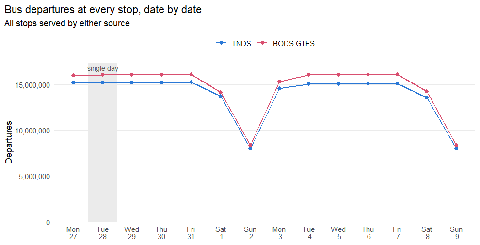

On the single day TNDS counts 0.948 times the departures BODS GTFS does; on the window's last weekday (Fri  7 Aug) the ratio is 0.937. TNDS loses ground across the window relative to BODS GTFS, which is the signature of TNDS registrations expiring inside it.

How each stop's kind of disagreement over the window compares with the kind
it shows on the single day. A stop that disagrees over the window but agrees
on the day disagrees only on other dates — an expiry, a cut-short calendar, or
a difference confined to some days of the week. A stop that disagrees the same
way on both is a different timetable.

|Window \ day | TNDS only| BODS only| TNDS higher| BODS higher|   equal| no service on the day|
|:------------|---------:|---------:|-----------:|-----------:|-------:|---------------------:|
|TNDS only    |     9,409|         0|           0|           0|       0|                 2,132|
|BODS only    |         0|     4,451|           0|           0|       0|                   441|
|TNDS higher  |       999|         5|      23,819|         470|  13,539|                   256|
|BODS higher  |        15|       554|         717|      38,988|   9,587|                   210|
|equal        |        10|        20|          64|          68| 200,055|                 4,191|

- **TNDS only**: 98.8% of the window difference is at stops showing the same kind on the day, and 0.0% at stops where the two agree exactly on the day.
- **BODS only**: 99.2% of the window difference is at stops showing the same kind on the day, and 0.0% at stops where the two agree exactly on the day.
- **TNDS higher**: 84.0% of the window difference is at stops showing the same kind on the day, and 10.6% at stops where the two agree exactly on the day.
- **BODS higher**: 93.4% of the window difference is at stops showing the same kind on the day, and 5.0% at stops where the two agree exactly on the day.

## Stop codes: missing, or filed under a neighbour?

A stop served by only one source may be a stop the other genuinely does not
serve. Or the same buses may be filed under a neighbouring stop code: another
stand at a bus station, the stop across the road, a code one source has
retired. For each one-source stop the test below looks for the nearest stop
within 100 m where the **other** source runs more departures than this one's
does, and compares that surplus with this stop's own count. A surplus within a
third of it is "similar": almost certainly the same buses under two codes.

|Period |Kind      |  Stops| Neighbour ≤ 30 m| Neighbour ≤ 100 m| … with similar departures| Departures at those stops|
|:------|:---------|------:|----------------:|-----------------:|-------------------------:|-------------------------:|
|window |TNDS only | 11,541|             2.6%|              5.7%|                      1.8%|                      4.1%|
|window |BODS only |  4,892|             4.9%|              9.6%|                      3.8%|                      3.7%|
|day    |TNDS only | 10,433|             2.7%|              5.3%|                      2.3%|                      3.9%|
|day    |BODS only |  5,030|             4.3%|              8.2%|                      3.7%|                      3.8%|

Over the window 209 TNDS-only stops pair up with a neighbour this way, carrying 41,589 TNDS departures. Each such pair inflates the one-source count at one stop and the frequency difference at the other at the same time. The pairs are not reconciled anywhere in this report: they are listed in the tables and named in the case notes, because which code is right is a question for NaPTAN, not for either timetable.

## Where the disagreement is

Every stop that differs by at least one departure a day on average, coloured
by its kind and sized by the difference. Points are drawn smallest first, so
the largest differences sit on top.

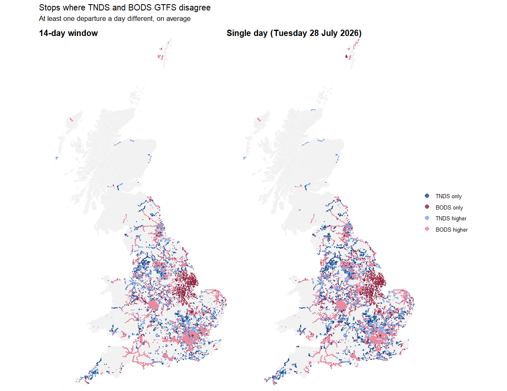

**Close-ups, 14-day window.**

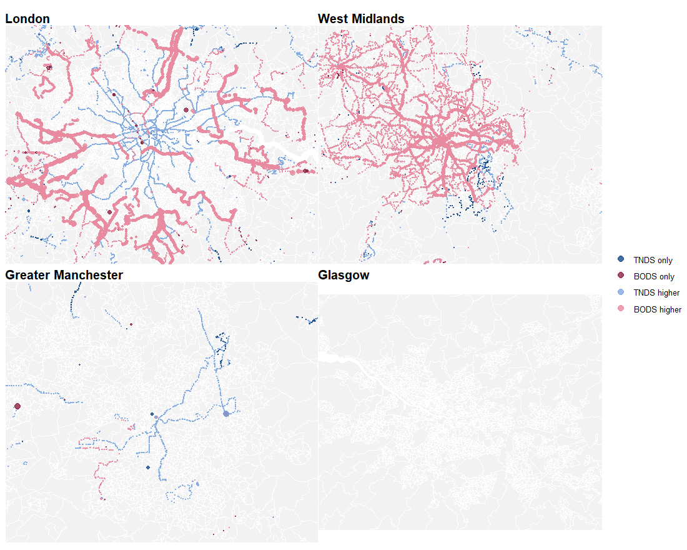

**Close-ups, single day (Tuesday 28 July 2026).**

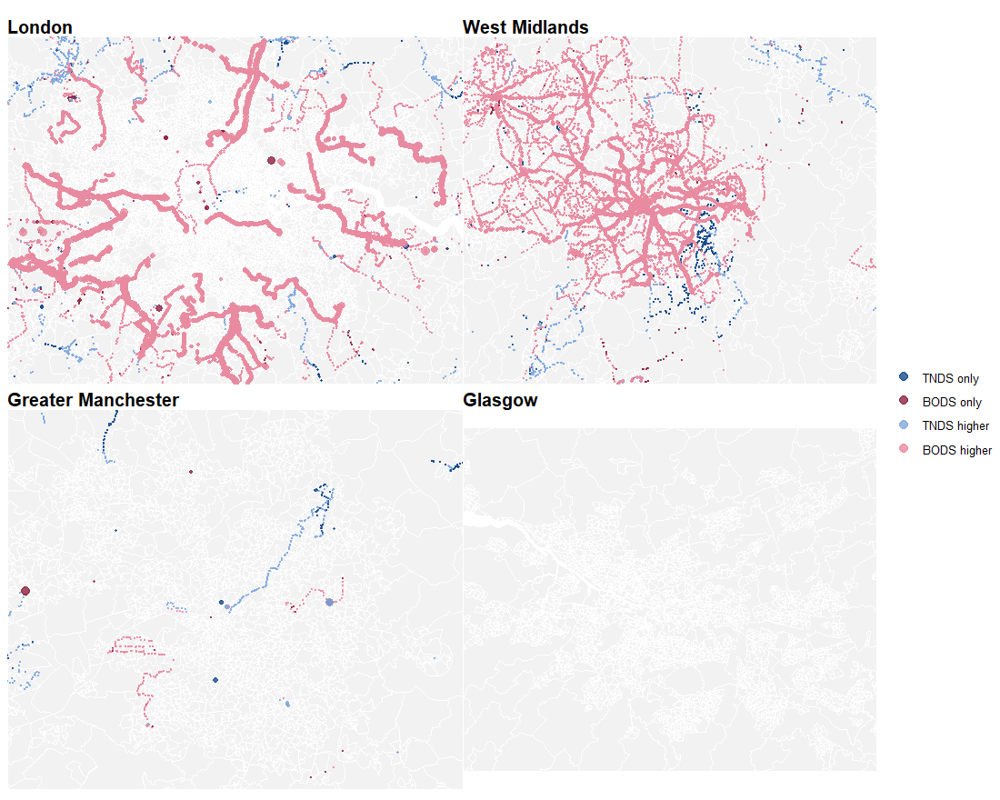

## The stops that disagree most

### 14-day window

**TNDS only.**

|  #|Stop         |Name                           |Area, zone                   |  TNDS| BODS GTFS| Difference| Other period|Nearby stop where the other source runs more (surplus) |
|--:|:------------|:------------------------------|:----------------------------|-----:|---------:|----------:|------------:|:------------------------------------------------------|
|  1|149000006983 |Hardwick Road                  |Brighton and Hove, E01016885 | 4,000|         0|      4,000|      308 / 0|149000006503 (77 m, 3,874)                             |
|  2|1500IM187U   |Coach Station                  |Essex, E01035178             | 2,590|         0|      2,590|      185 / 0|1500IM187S (10 m, 1,674)                               |
|  3|13005999D    |Millburngate Stand D           |Durham, E01020702            | 2,432|         0|      2,432|      187 / 0|13005999J (1 m, 2,448)                                 |
|  4|1500IM187R   |Coach Station                  |Essex, E01035178             | 2,412|         0|      2,412|      191 / 0|1500IM187Q (6 m, 2,412)                                |
|  5|1500STANHI   |Holiday Inn                    |Essex, E01035178             | 1,918|         0|      1,918|      137 / 0|                                                       |
|  6|1500STANPI   |Premier Inn                    |Essex, E01035178             | 1,918|         0|      1,918|      137 / 0|                                                       |
|  7|269030091    |St Margaret's Bus Station      |Leicester, E01034022         | 1,816|         0|      1,816|      138 / 0|269030089 (9 m, 314)                                   |
|  8|43000700113  |Wolverhampton Bus Station      |West Midlands, E01034313     | 1,768|         0|      1,768|      141 / 0|43000700107 (13 m, 430)                                |
|  9|2800S16053A  |Lowe Street                    |Merseyside, E01006877        | 1,602|         0|      1,602|      129 / 0|                                                       |
| 10|1180PLM001   |Mayflower Street               |Plymouth, E01015152          | 1,598|         0|      1,598|      126 / 0|                                                       |
| 11|250020345    |Bus Station                    |Lancashire, E01024877        | 1,484|         0|      1,484|      114 / 0|250020347 (9 m, 1,358)                                 |
| 12|3100Z264767  |Dudley Lane shops              |Northumberland, E01027409    | 1,482|         0|      1,482|      115 / 0|3100Z264768 (26 m, 1,192)                              |
| 13|1900HAA92176 |NHS P&R2                       |Hampshire, E01034733         | 1,480|         0|      1,480|      148 / 0|                                                       |
| 14|450030331    |Wakefield Bus Station          |West Yorkshire, E01034264    | 1,468|         0|      1,468|      126 / 0|450030183 (8 m, 10)                                    |
| 15|210021606782 |Waitrose                       |Hertfordshire, E01023918     | 1,344|         0|      1,344|      114 / 0|210021600825 (78 m, 630)                               |
| 16|1990PHA90902 |NHS Staff P&R                  |Portsmouth, E01017116        | 1,300|         0|      1,300|      130 / 0|                                                       |
| 17|370027543    |Fox Valley Way/Manchester Road |South Yorkshire, E01008144   | 1,274|         0|      1,274|      105 / 0|                                                       |
| 18|3390QM20     |Treatment Centre               |Nottingham, E01033410        | 1,270|         0|      1,270|      127 / 0|                                                       |
| 19|370010231    |Sheffield Interchange/B1       |South Yorkshire, E01033268   | 1,268|         0|      1,268|       97 / 0|370010234 (10 m, 38)                                   |
| 20|370027624    |Fitzalan Sqaure/Flat Street    |South Yorkshire, E01033264   | 1,268|         0|      1,268|       97 / 0|370023628 (94 m, 4)                                    |
| 21|370027628    |Pinfold Street/Holly Street    |South Yorkshire, E01033265   | 1,268|         0|      1,268|       97 / 0|                                                       |
| 22|370027633    |Leopold Street/Orchard Lane    |South Yorkshire, E01033265   | 1,268|         0|      1,268|       97 / 0|                                                       |
| 23|1500IM187T   |Coach Station                  |Essex, E01035178             | 1,260|         0|      1,260|       90 / 0|1500IM187S (5 m, 1,674)                                |
| 24|1500STANHH   |Novotel                        |Essex, E01022086             | 1,260|         0|      1,260|       90 / 0|                                                       |
| 25|1500STANCH2  |Drivalia Car Hire              |Essex, E01035178             | 1,246|         0|      1,246|       89 / 0|                                                       |

**BODS only.**

|  #|Stop         |Name                          |Area, zone                    | TNDS| BODS GTFS| Difference| Other period|Nearby stop where the other source runs more (surplus) |
|--:|:------------|:-----------------------------|:-----------------------------|----:|---------:|----------:|------------:|:------------------------------------------------------|
|  1|4400CY0389   |North Terminal Bus Station    |West Sussex, E01031575        |    0|     5,160|     -5,160|      0 / 383|4400CY0437 (28 m, 2,002)                               |
|  2|41000008REGE |Interchange                   |Tyne and Wear, E01008355      |    0|     4,486|     -4,486|      0 / 353|410000060407 (11 m, 5,108)                             |
|  3|2290YHA00295 |Naylors Row                   |Kingston upon Hull, E01012809 |    0|     4,378|     -4,378|      0 / 351|2290YHA01202 (54 m, 3,594)                             |
|  4|2290YHA00296 |Great Union Street            |Kingston upon Hull, E01012809 |    0|     4,378|     -4,378|      0 / 351|                                                       |
|  5|41000008REGB |Interchange                   |Tyne and Wear, E01008355      |    0|     3,706|     -3,706|      0 / 292|410000060407 (27 m, 5,108)                             |
|  6|490001338Z   |HereEast / The Yard           |Greater London, E01001849     |    0|     3,572|     -3,572|      0 / 310|                                                       |
|  7|4400CY0268   |Southgate Avenue North        |West Sussex, E01031563        |    0|     3,476|     -3,476|      0 / 262|                                                       |
|  8|4400CY0132   |Manor Royal Central           |West Sussex, E01031583        |    0|     3,236|     -3,236|      0 / 242|                                                       |
|  9|4400CY0569   |Atlantic House                |West Sussex, E01031575        |    0|     3,232|     -3,232|      0 / 242|                                                       |
| 10|1800WK15961  |St Mary's Way                 |Greater Manchester, E01006328 |    0|     2,894|     -2,894|      0 / 232|                                                       |
| 11|490000283N   |Brabham Court                 |Greater London, E01004121     |    0|     2,710|     -2,710|      0 / 202|                                                       |
| 12|4400CY0289   |London Road South             |West Sussex, E01031610        |    0|     2,628|     -2,628|      0 / 198|                                                       |
| 13|4400CY0288   |London Road South             |West Sussex, E01031583        |    0|     2,622|     -2,622|      0 / 198|                                                       |
| 14|4400CY0290   |Multiplex                     |West Sussex, E01031585        |    0|     2,622|     -2,622|      0 / 198|                                                       |
| 15|4400CY0263   |Southgate Avenue Central      |West Sussex, E01031595        |    0|     2,580|     -2,580|      0 / 192|                                                       |
| 16|4400CY0412   |Coachmans Drive North         |West Sussex, E01031552        |    0|     2,580|     -2,580|      0 / 192|                                                       |
| 17|4400CY0413   |Stadium                       |West Sussex, E01031552        |    0|     2,580|     -2,580|      0 / 192|                                                       |
| 18|4400CY0416   |Southgate Avenue South        |West Sussex, E01031595        |    0|     2,580|     -2,580|      0 / 192|                                                       |
| 19|4400CY0107   |Coachmans Drive North         |West Sussex, E01031558        |    0|     2,576|     -2,576|      0 / 192|                                                       |
| 20|4400CY0264   |Southgate Avenue Central      |West Sussex, E01031605        |    0|     2,576|     -2,576|      0 / 192|                                                       |
| 21|4400CY0411   |Broadfield Barton North       |West Sussex, E01031552        |    0|     2,576|     -2,576|      0 / 192|                                                       |
| 22|4400CY0414   |Stadium                       |West Sussex, E01031557        |    0|     2,576|     -2,576|      0 / 192|                                                       |
| 23|4400CY0415   |Southgate Avenue South        |West Sussex, E01031605        |    0|     2,576|     -2,576|      0 / 192|                                                       |
| 24|450029847    |Leeds Bus Station Entrance    |West Yorkshire, E01033011     |    0|     2,526|     -2,526|      0 / 195|450014781 (21 m, 352)                                  |
| 25|1800ANAR021  |Ashton-under-Lyne Interchange |Greater Manchester, E01005948 |    0|     2,504|     -2,504|      0 / 191|1800ANINAR1 (31 m, 2,754)                              |

**TNDS higher.**

|  #|Stop         |Name                          |Area, zone                           |  TNDS| BODS GTFS| Difference| Other period|
|--:|:------------|:-----------------------------|:------------------------------------|-----:|---------:|----------:|------------:|
|  1|3200YNA00024 |Pagnell Avenue                |North Yorkshire, E01027909           | 6,900|       300|      6,600|     552 / 24|
|  2|149000006355 |Imperial Arcade               |Brighton and Hove, E01016969         | 6,630|     1,145|      5,485|     495 / 85|
|  3|410000060407 |Regent Centre Temp Stop NB    |Tyne and Wear, E01008355             | 5,928|       820|      5,108|     482 / 65|
|  4|210021200945 |Stevenage Railway Station     |Hertfordshire, E01035570             | 7,878|     2,952|      4,926|    577 / 242|
|  5|410000060406 |Regent Centre-Temp SB         |Tyne and Wear, E01008355             | 5,132|       600|      4,532|     403 / 45|
|  6|2290YHA00446 |George Street C               |Kingston upon Hull, E01033109        | 4,866|     1,058|      3,808|     383 / 81|
|  7|2290YHA01297 |Charlotte Street              |Kingston upon Hull, E01033109        | 4,866|     1,058|      3,808|     383 / 81|
|  8|450030144    |Huddersfield Bus Station      |West Yorkshire, E01011235            | 4,516|       722|      3,794|     360 / 60|
|  9|2290YHA01200 |Malton Street                 |Kingston upon Hull, E01012809        | 4,078|       484|      3,594|     324 / 36|
| 10|2290YHA01202 |Windmill Hotel                |Kingston upon Hull, E01012809        | 4,078|       484|      3,594|     324 / 36|
| 11|370070005    |Sheffield Interchange         |South Yorkshire, E01033268           | 3,592|         2|      3,590|      283 / 0|
| 12|2290YHA00774 |St Mary's Church              |Kingston upon Hull, E01033104        | 3,930|       626|      3,304|     311 / 50|
| 13|2290YHA00797 |King William House            |Kingston upon Hull, E01033104        | 3,930|       626|      3,304|     311 / 50|
| 14|2800S16005A  |Todd Road                     |Merseyside, E01006872                | 4,150|     1,000|      3,150|     332 / 76|
| 15|040000004912 |Railway Station               |Buckinghamshire, E01032955           | 4,386|     1,552|      2,834|    361 / 130|
| 16|109000022155 |Morledge                      |Derby, E01034256                     | 8,366|     5,558|      2,808|    664 / 427|
| 17|1800ANINAR1  |Ashton-under-Lyne Interchange |Greater Manchester, E01005948        | 9,876|     7,122|      2,754|    779 / 577|
| 18|1500IM2758   |Bus Garage                    |Essex, E01021843                     | 4,369|     2,107|      2,262|    371 / 176|
| 19|040000004914 |Friarage Road                 |Buckinghamshire, E01032955           | 4,608|     2,494|      2,114|    378 / 210|
| 20|3890D000203  |Stafford Street               |Stoke-on-Trent, E01014287            | 2,706|       596|      2,110|     230 / 49|
| 21|149000006354 |Brighton University Falmer    |Brighton and Hove, E01016914         | 3,504|     1,396|      2,108|    285 / 119|
| 22|0610CH2395   |Railway Station               |Cheshire West and Chester, E01032930 | 4,730|     2,650|      2,080|    372 / 206|
| 23|040000002327 |Great Western Street          |Buckinghamshire, E01032955           | 2,758|       680|      2,078|     230 / 56|
| 24|1500IM2758B  |Fire Station                  |Essex, E01034366                     | 2,493|       485|      2,008|     198 / 39|
| 25|4400CY0437   |North Terminal Bus Station    |West Sussex, E01031575               | 2,912|       910|      2,002|     208 / 65|

**BODS higher.**

|  #|Stop         |Name                          |Area, zone                    |   TNDS| BODS GTFS| Difference| Other period|
|--:|:------------|:-----------------------------|:-----------------------------|------:|---------:|----------:|------------:|
|  1|1500AA160    |Chelmsford Railway Station    |Essex, E01034092              |  2,658|    10,606|     -7,948|    434 / 647|
|  2|1500IM2089   |Retail Market                 |Essex, E01034092              |  3,298|    10,837|     -7,539|    461 / 696|
|  3|15003411303  |Parkway                       |Essex, E01033140              |  3,518|    10,898|     -7,380|    502 / 721|
|  4|43000874601  |Castle Hill                   |West Midlands, E01009757      |  2,064|     9,250|     -7,186|    166 / 759|
|  5|450026807    |Keighley Bus Station Entrance |West Yorkshire, E01010710     |     50|     6,860|     -6,810|      4 / 550|
|  6|43000202301  |Park Street                   |West Midlands, E01033615      |  9,594|    16,224|     -6,630|  740 / 1,354|
|  7|1500CFDRSTN2 |Chelmsford Railway Station    |Essex, E01034092              |  2,129|     8,544|     -6,415|    342 / 536|
|  8|4400CY0073   |Dorsten Square                |West Sussex, E01031548        |    804|     6,888|     -6,084|     64 / 524|
|  9|4400CY0342   |Gatwick South Terminal        |West Sussex, E01031575        |    716|     6,686|     -5,970|     56 / 510|
| 10|4400CY0343   |Gatwick South Terminal        |West Sussex, E01031575        |    758|     6,686|     -5,928|     59 / 509|
| 11|43000211301  |Birmingham Coach Station      |West Midlands, E01034947      | 10,646|    16,400|     -5,754|  814 / 1,340|
| 12|40004410037A |Westway Common                |Surrey, E01030848             |  3,316|     8,868|     -5,552|    239 / 666|
| 13|43000202104  |Bus Mall                      |West Midlands, E01033561      |  9,962|    15,380|     -5,418|  762 / 1,287|
| 14|4400CY0097   |Broadfield Barton             |West Sussex, E01031552        |  1,074|     6,230|     -5,156|     82 / 466|
| 15|15003405601  |The Ship                      |Essex, E01034091              |  1,469|     6,503|     -5,034|    246 / 406|
| 16|1500IM2070   |Keene Home                    |Essex, E01021592              |  1,434|     6,328|     -4,894|    239 / 392|
| 17|15003405Y01  |The Ship                      |Essex, E01034091              |  1,409|     6,301|     -4,892|    236 / 395|
| 18|40004402125A |High Street                   |Surrey, E01034291             |  4,182|     9,008|     -4,826|    315 / 643|
| 19|1500IM2071   |King Edward VI School         |Essex, E01034091              |  1,409|     6,231|     -4,822|    236 / 388|
| 20|2290YHA00004 |Drypool Bridge                |Kingston upon Hull, E01033109 |    242|     4,982|     -4,740|     20 / 400|
| 21|2290YHA00006 |Alfred Gelder Street F        |Kingston upon Hull, E01033104 |    446|     5,176|     -4,730|     37 / 416|
| 22|40004402106A |War Memorial                  |Surrey, E01030704             |  2,592|     7,246|     -4,654|    193 / 522|
| 23|43000203501  |Smallbrook Queensway          |West Midlands, E01033615      |  7,956|    12,510|     -4,554|  614 / 1,003|
| 24|43000206202  |Colmore Row                   |West Midlands, E01033620      |  8,156|    12,684|     -4,528|  628 / 1,045|
| 25|1500AA155    |Army & Navy                   |Essex, E01033140              |  2,011|     6,512|     -4,501|    300 / 380|

### Single day (Tuesday 28 July 2026)

**TNDS only.**

|  #|Stop         |Name                           |Area, zone                   | TNDS| BODS GTFS| Difference|  Other period|Nearby stop where the other source runs more (surplus) |
|--:|:------------|:------------------------------|:----------------------------|----:|---------:|----------:|-------------:|:------------------------------------------------------|
|  1|149000006983 |Hardwick Road                  |Brighton and Hove, E01016885 |  308|         0|        308|     4,000 / 0|149000006503 (77 m, 298)                               |
|  2|370070005    |Sheffield Interchange          |South Yorkshire, E01033268   |  283|         0|        283|     3,592 / 2|370010131 (22 m, 43)                                   |
|  3|1500IM187R   |Coach Station                  |Essex, E01035178             |  191|         0|        191|     2,412 / 0|1500IM187Q (6 m, 191)                                  |
|  4|13005999D    |Millburngate Stand D           |Durham, E01020702            |  187|         0|        187|     2,432 / 0|13005999J (1 m, 188)                                   |
|  5|1500IM187U   |Coach Station                  |Essex, E01035178             |  185|         0|        185|     2,590 / 0|1500IM187S (10 m, 5)                                   |
|  6|2400109695   |Acacia Hall Fastrack Hub       |Kent, E01024137              |  160|         0|        160| 2,463 / 1,664|2400109694 (8 m, 1)                                    |
|  7|1900HAA92176 |NHS P&R2                       |Hampshire, E01034733         |  148|         0|        148|     1,480 / 0|                                                       |
|  8|43000700113  |Wolverhampton Bus Station      |West Midlands, E01034313     |  141|         0|        141|     1,768 / 0|43000700107 (13 m, 51)                                 |
|  9|269030091    |St Margaret's Bus Station      |Leicester, E01034022         |  138|         0|        138|     1,816 / 0|269030089 (9 m, 31)                                    |
| 10|1500STANHI   |Holiday Inn                    |Essex, E01035178             |  137|         0|        137|     1,918 / 0|                                                       |
| 11|1500STANPI   |Premier Inn                    |Essex, E01035178             |  137|         0|        137|     1,918 / 0|                                                       |
| 12|1990PHA90902 |NHS Staff P&R                  |Portsmouth, E01017116        |  130|         0|        130|     1,300 / 0|                                                       |
| 13|2800S16053A  |Lowe Street                    |Merseyside, E01006877        |  129|         0|        129|     1,602 / 0|                                                       |
| 14|3390QM20     |Treatment Centre               |Nottingham, E01033410        |  127|         0|        127|     1,270 / 0|                                                       |
| 15|1180PLM001   |Mayflower Street               |Plymouth, E01015152          |  126|         0|        126|     1,598 / 0|                                                       |
| 16|450030331    |Wakefield Bus Station          |West Yorkshire, E01034264    |  126|         0|        126|     1,468 / 0|450030183 (8 m, 1)                                     |
| 17|3100Z264767  |Dudley Lane shops              |Northumberland, E01027409    |  115|         0|        115|     1,482 / 0|3100Z264768 (26 m, 86)                                 |
| 18|210021606782 |Waitrose                       |Hertfordshire, E01023918     |  114|         0|        114|     1,344 / 0|210021600825 (78 m, 50)                                |
| 19|250020345    |Bus Station                    |Lancashire, E01024877        |  114|         0|        114|     1,484 / 0|250020347 (9 m, 107)                                   |
| 20|3800C329901  |The Octagon Centre             |Staffordshire, E01032898     |  112|         0|        112|    1,254 / 16|                                                       |
| 21|370027543    |Fox Valley Way/Manchester Road |South Yorkshire, E01008144   |  105|         0|        105|     1,274 / 0|                                                       |
| 22|390031081    |Co-op Education Centre         |Suffolk, E01033125           |  105|         0|        105|    1,302 / 18|                                                       |
| 23|1990PHA90900 |NHS Staff P&R                  |Portsmouth, E01017116        |  102|         0|        102|     1,020 / 0|                                                       |
| 24|1000DBTQ2424 |Colonnade                      |Derbyshire, E01019717        |   97|         0|         97|     1,114 / 0|                                                       |
| 25|370010231    |Sheffield Interchange/B1       |South Yorkshire, E01033268   |   97|         0|         97|     1,268 / 0|370010234 (10 m, 3)                                    |

**BODS only.**

|  #|Stop         |Name                       |Area, zone                    | TNDS| BODS GTFS| Difference| Other period|Nearby stop where the other source runs more (surplus) |
|--:|:------------|:--------------------------|:-----------------------------|----:|---------:|----------:|------------:|:------------------------------------------------------|
|  1|4400CY0389   |North Terminal Bus Station |West Sussex, E01031575        |    0|       383|       -383|    0 / 5,160|4400CY0437 (28 m, 143)                                 |
|  2|41000008REGE |Interchange                |Tyne and Wear, E01008355      |    0|       353|       -353|    0 / 4,486|410000060407 (11 m, 417)                               |
|  3|2290YHA00295 |Naylors Row                |Kingston upon Hull, E01012809 |    0|       351|       -351|    0 / 4,378|2290YHA01202 (54 m, 288)                               |
|  4|2290YHA00296 |Great Union Street         |Kingston upon Hull, E01012809 |    0|       351|       -351|    0 / 4,378|                                                       |
|  5|490001338Z   |HereEast / The Yard        |Greater London, E01001849     |    0|       310|       -310|    0 / 3,572|                                                       |
|  6|41000008REGB |Interchange                |Tyne and Wear, E01008355      |    0|       292|       -292|    0 / 3,706|410000060407 (27 m, 417)                               |
|  7|4400CY0268   |Southgate Avenue North     |West Sussex, E01031563        |    0|       262|       -262|    0 / 3,476|                                                       |
|  8|4400CY0132   |Manor Royal Central        |West Sussex, E01031583        |    0|       242|       -242|    0 / 3,236|                                                       |
|  9|4400CY0569   |Atlantic House             |West Sussex, E01031575        |    0|       242|       -242|    0 / 3,232|                                                       |
| 10|1800WK15961  |St Mary's Way              |Greater Manchester, E01006328 |    0|       232|       -232|    0 / 2,894|                                                       |
| 11|3500B131400  |Oxon P&R                   |Shropshire, E01028943         |    0|       204|       -204|    0 / 2,216|                                                       |
| 12|490000283N   |Brabham Court              |Greater London, E01004121     |    0|       202|       -202|    0 / 2,710|                                                       |
| 13|2000G000302  |Unicorn Hill               |Worcestershire, E01032224     |    0|       199|       -199|    0 / 2,294|                                                       |
| 14|4400CY0288   |London Road South          |West Sussex, E01031583        |    0|       198|       -198|    0 / 2,622|                                                       |
| 15|4400CY0289   |London Road South          |West Sussex, E01031610        |    0|       198|       -198|    0 / 2,628|                                                       |
| 16|4400CY0290   |Multiplex                  |West Sussex, E01031585        |    0|       198|       -198|    0 / 2,622|                                                       |
| 17|450029847    |Leeds Bus Station Entrance |West Yorkshire, E01033011     |    0|       195|       -195|    0 / 2,526|450014781 (21 m, 25)                                   |
| 18|4400CY0107   |Coachmans Drive North      |West Sussex, E01031558        |    0|       192|       -192|    0 / 2,576|                                                       |
| 19|4400CY0263   |Southgate Avenue Central   |West Sussex, E01031595        |    0|       192|       -192|    0 / 2,580|                                                       |
| 20|4400CY0264   |Southgate Avenue Central   |West Sussex, E01031605        |    0|       192|       -192|    0 / 2,576|                                                       |
| 21|4400CY0411   |Broadfield Barton North    |West Sussex, E01031552        |    0|       192|       -192|    0 / 2,576|                                                       |
| 22|4400CY0412   |Coachmans Drive North      |West Sussex, E01031552        |    0|       192|       -192|    0 / 2,580|                                                       |
| 23|4400CY0413   |Stadium                    |West Sussex, E01031552        |    0|       192|       -192|    0 / 2,580|                                                       |
| 24|4400CY0414   |Stadium                    |West Sussex, E01031557        |    0|       192|       -192|    0 / 2,576|                                                       |
| 25|4400CY0415   |Southgate Avenue South     |West Sussex, E01031605        |    0|       192|       -192|    0 / 2,576|                                                       |

**TNDS higher.**

|  #|Stop         |Name                          |Area, zone                           | TNDS| BODS GTFS| Difference|  Other period|
|--:|:------------|:-----------------------------|:------------------------------------|----:|---------:|----------:|-------------:|
|  1|3200YNA00024 |Pagnell Avenue                |North Yorkshire, E01027909           |  552|        24|        528|   6,900 / 300|
|  2|410000060407 |Regent Centre Temp Stop NB    |Tyne and Wear, E01008355             |  482|        65|        417|   5,928 / 820|
|  3|149000006355 |Imperial Arcade               |Brighton and Hove, E01016969         |  495|        85|        410| 6,630 / 1,145|
|  4|410000060406 |Regent Centre-Temp SB         |Tyne and Wear, E01008355             |  403|        45|        358|   5,132 / 600|
|  5|210021200945 |Stevenage Railway Station     |Hertfordshire, E01035570             |  577|       242|        335| 7,878 / 2,952|
|  6|2290YHA00446 |George Street C               |Kingston upon Hull, E01033109        |  383|        81|        302| 4,866 / 1,058|
|  7|2290YHA01297 |Charlotte Street              |Kingston upon Hull, E01033109        |  383|        81|        302| 4,866 / 1,058|
|  8|450030144    |Huddersfield Bus Station      |West Yorkshire, E01011235            |  360|        60|        300|   4,516 / 722|
|  9|2290YHA01200 |Malton Street                 |Kingston upon Hull, E01012809        |  324|        36|        288|   4,078 / 484|
| 10|2290YHA01202 |Windmill Hotel                |Kingston upon Hull, E01012809        |  324|        36|        288|   4,078 / 484|
| 11|2290YHA00774 |St Mary's Church              |Kingston upon Hull, E01033104        |  311|        50|        261|   3,930 / 626|
| 12|2290YHA00797 |King William House            |Kingston upon Hull, E01033104        |  311|        50|        261|   3,930 / 626|
| 13|2800S16005A  |Todd Road                     |Merseyside, E01006872                |  332|        76|        256| 4,150 / 1,000|
| 14|109000022155 |Morledge                      |Derby, E01034256                     |  664|       427|        237| 8,366 / 5,558|
| 15|040000004912 |Railway Station               |Buckinghamshire, E01032955           |  361|       130|        231| 4,386 / 1,552|
| 16|1800ANINAR1  |Ashton-under-Lyne Interchange |Greater Manchester, E01005948        |  779|       577|        202| 9,876 / 7,122|
| 17|1500IM2758   |Bus Garage                    |Essex, E01021843                     |  371|       176|        195| 4,369 / 2,107|
| 18|3890D000203  |Stafford Street               |Stoke-on-Trent, E01014287            |  230|        49|        181|   2,706 / 596|
| 19|040000002327 |Great Western Street          |Buckinghamshire, E01032955           |  230|        56|        174|   2,758 / 680|
| 20|040000004914 |Friarage Road                 |Buckinghamshire, E01032955           |  378|       210|        168| 4,608 / 2,494|
| 21|0610CH2395   |Railway Station               |Cheshire West and Chester, E01032930 |  372|       206|        166| 4,730 / 2,650|
| 22|149000006354 |Brighton University Falmer    |Brighton and Hove, E01016914         |  285|       119|        166| 3,504 / 1,396|
| 23|2400A050680A |Chequers Bus Station          |Kent, E01034992                      |  185|        21|        164|   2,204 / 234|
| 24|1500IM2758B  |Fire Station                  |Essex, E01034366                     |  198|        39|        159|   2,493 / 485|
| 25|02904131     |Lea Manor High School         |Luton, E01015771                     |  332|       177|        155| 3,914 / 2,088|

**BODS higher.**

|  #|Stop         |Name                          |Area, zone                    | TNDS| BODS GTFS| Difference|    Other period|
|--:|:------------|:-----------------------------|:-----------------------------|----:|---------:|----------:|---------------:|
|  1|43000202301  |Park Street                   |West Midlands, E01033615      |  740|     1,354|       -614|  9,594 / 16,224|
|  2|43000874601  |Castle Hill                   |West Midlands, E01009757      |  166|       759|       -593|   2,064 / 9,250|
|  3|450026807    |Keighley Bus Station Entrance |West Yorkshire, E01010710     |    4|       550|       -546|      50 / 6,860|
|  4|43000211301  |Birmingham Coach Station      |West Midlands, E01034947      |  814|     1,340|       -526| 10,646 / 16,400|
|  5|43000202104  |Bus Mall                      |West Midlands, E01033561      |  762|     1,287|       -525|  9,962 / 15,380|
|  6|4400CY0073   |Dorsten Square                |West Sussex, E01031548        |   64|       524|       -460|     804 / 6,888|
|  7|4400CY0342   |Gatwick South Terminal        |West Sussex, E01031575        |   56|       510|       -454|     716 / 6,686|
|  8|4400CY0343   |Gatwick South Terminal        |West Sussex, E01031575        |   59|       509|       -450|     758 / 6,686|
|  9|40004410037A |Westway Common                |Surrey, E01030848             |  239|       666|       -427|   3,316 / 8,868|
| 10|43000206202  |Colmore Row                   |West Midlands, E01033620      |  628|     1,045|       -417|  8,156 / 12,684|
| 11|43000205207  |Newhall Street                |West Midlands, E01033620      |  644|     1,052|       -408|  8,348 / 12,716|
| 12|43000211504  |Adderley Street               |West Midlands, E01034946      |  680|     1,079|       -399|  8,882 / 13,106|
| 13|43000203501  |Smallbrook Queensway          |West Midlands, E01033615      |  614|     1,003|       -389|  7,956 / 12,510|
| 14|43000501201  |Six Ways                      |West Midlands, E01009007      |  418|       802|       -384|   5,366 / 9,594|
| 15|4400CY0097   |Broadfield Barton             |West Sussex, E01031552        |   82|       466|       -384|   1,074 / 6,230|
| 16|2290YHA00004 |Drypool Bridge                |Kingston upon Hull, E01033109 |   20|       400|       -380|     242 / 4,982|
| 17|2290YHA00006 |Alfred Gelder Street F        |Kingston upon Hull, E01033104 |   37|       416|       -379|     446 / 5,176|
| 18|43000215301  |Five Ways Metro               |West Midlands, E01034948      |  480|       858|       -378|  6,212 / 10,270|
| 19|43000206203  |Colmore Row                   |West Midlands, E01033620      |  466|       843|       -377|  6,084 / 10,288|
| 20|43000203203  |Moor Street Station           |West Midlands, E01033620      |  466|       839|       -373|  6,048 / 10,168|
| 21|2290YHA00970 |Alfred Gelder Street G        |Kingston upon Hull, E01033104 |   37|       387|       -350|     446 / 4,812|
| 22|43000270102  |Water Street                  |West Midlands, E01034930      |  459|       807|       -348|   5,894 / 9,664|
| 23|43002104302  |Moor St Selfridges            |West Midlands, E01033561      |  468|       815|       -347|   5,972 / 9,458|
| 24|43004171001  |Druids Heath Terminus         |West Midlands, E01008979      |  338|       685|       -347|   4,344 / 7,830|
| 25|1980SN120518 |Central Station               |Southampton, E01035445        |  471|       804|       -333|   6,064 / 7,824|

"Other period" gives TNDS / BODS GTFS departures in the period not ranked on.

## The worst cases, route by route

The top 5 stops of each kind in each period. For each one:

- **Routes.** Every route calling at the stop in either source, in **both directions** — so the opposite direction is drawn even where it uses the stop across the road. Added to those, every route of the *other* source whose stop sequence shares at least half its consecutive stop pairs with one of them. Route and trip identifiers are not shared between the sources, and route numbers are not reliably shared, but the stop sequence is. Matching on ordered pairs keeps the two directions apart, and a source that files one stop under another code loses two pairs, not the whole route.
- **Groups.** Patterns linked that way form directional groups. Within each group, journeys at the stop are matched date by date on departure time, within **5 minutes** either way: UK2GTFS interpolates the times of non-timing points, and a stop that is a timing point in one source may be interpolated in the other.
- **Charts.** Departures at the stop on every date of the window, which shows a source that stops part way through. Departures by hour on the single day, which shows whether the difference is the whole day or one part of it. A close-up of the stops within 400 m, which shows a neighbouring code carrying the missing buses.

The note at the head of each case is generated from those measurements by fixed rules (`case_findings()` in this report). It says what the data show, not which source is right.

### Cases: 14-day window

#### TNDS only

**1. Hardwick Road — `149000006983`**, Brighton and Hove, E01016885. TNDS 4,000, BODS GTFS 0 (window); on the day, TNDS 308, BODS GTFS 0.

- BODS GTFS runs more at **149000006503** (Hardwick Road) 77 m away: 3,874 departures more than the other source there, against this stop's 4,000 in TNDS: very likely the same buses under two stop codes.
- BODS GTFS has a route with the same stop sequence as **5B, N5, 3X** but it does not call at this stop code (4,000 departures).

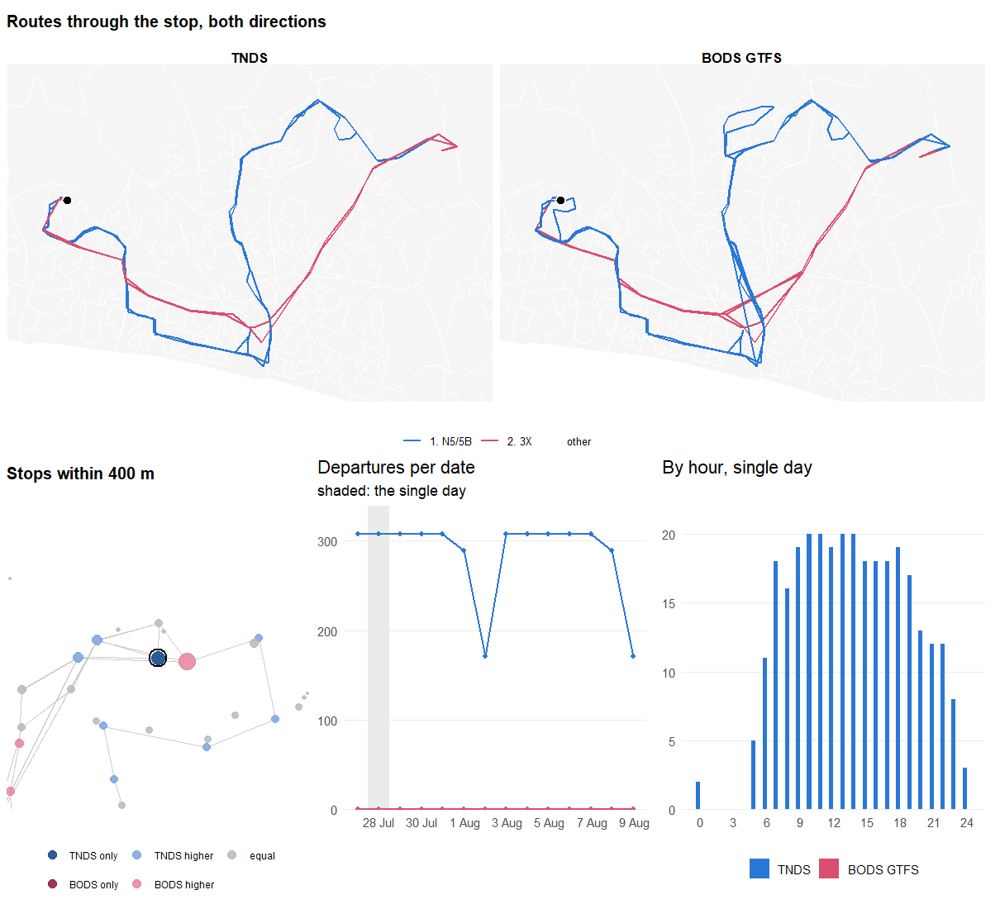

|TNDS route |BODS route |Operator        |From → to                                  | TNDS here| BODS here| Matched|Last date T / B |
|:----------|:----------|:---------------|:------------------------------------------|---------:|---------:|-------:|:---------------|
|5B         |5B, N5     |Brighton & Hove |Hardwick Road → Asda Crowhurst Road        |     1,160|         0|       0|Sun  9 Aug / —  |
|5B         |5B         |Brighton & Hove |Asda Crowhurst Road → Hardwick Road        |     1,136|         0|       0|Sun  9 Aug / —  |
|3X         |3X         |Brighton & Hove |Hardwick Road → Brighton University Falmer |       852|         0|       0|Sun  9 Aug / —  |
|3X         |3X         |Brighton & Hove |Brighton University Falmer → Hardwick Road |       852|         0|       0|Sun  9 Aug / —  |

**2. Coach Station — `1500IM187U`**, Essex, E01035178. TNDS 2,590, BODS GTFS 0 (window); on the day, TNDS 185, BODS GTFS 0.

- BODS GTFS runs more at **1500IM187S** (Coach Station) 10 m away: 1,674 departures more than the other source there, against this stop's 2,590 in TNDS.
- Only in TNDS, with no route in BODS GTFS sharing their stop sequence: **PREM** (2,590 departures).

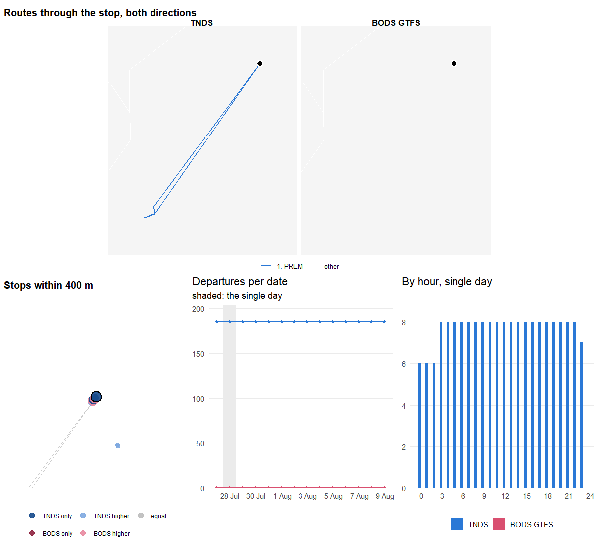

|TNDS route |BODS route |Operator |From → to                   | TNDS here| BODS here| Matched|Last date T / B |
|:----------|:----------|:--------|:---------------------------|---------:|---------:|-------:|:---------------|
|PREM       |—          |Bus4Us   |Coach Station → Premier Inn |     1,246|         0|       0|Sun  9 Aug / —  |
|PREM       |—          |Bus4Us   |Premier Inn → Coach Station |       672|         0|       0|Sun  9 Aug / —  |
|PREM       |—          |Bus4Us   |Holiday Inn → Coach Station |       672|         0|       0|Sun  9 Aug / —  |

**3. Millburngate Stand D — `13005999D`**, Durham, E01020702. TNDS 2,432, BODS GTFS 0 (window); on the day, TNDS 187, BODS GTFS 0.

- BODS GTFS runs more at **13005999J** (Millburngate Stand D) 1 m away: 2,448 departures more than the other source there, against this stop's 2,432 in TNDS: very likely the same buses under two stop codes.
- BODS GTFS has a route with the same stop sequence as **PR1, PR2, N21** but it does not call at this stop code (2,432 departures).

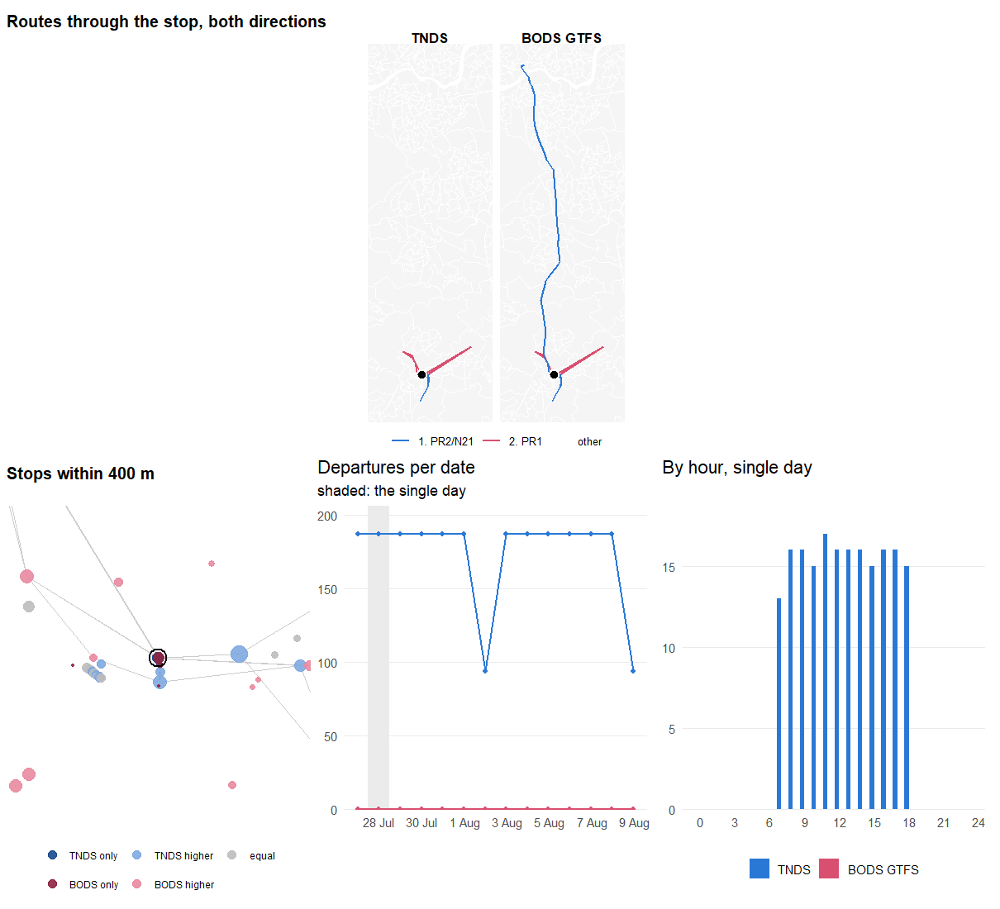

|TNDS route |BODS route |Operator                |From → to                                       | TNDS here| BODS here| Matched|Last date T / B |
|:----------|:----------|:-----------------------|:-----------------------------------------------|---------:|---------:|-------:|:---------------|
|PR1        |PR1        |Gateshead Central taxis |Sniperley Park and Ride → Belmont Park and Ride |       658|         0|       0|Sun  9 Aug / —  |
|PR1        |PR1        |Gateshead Central Buses |Belmont Park and Ride → Sniperley Park and Ride |       646|         0|       0|Sun  9 Aug / —  |
|PR2        |PR2        |Gateshead Central Buses |Howlands Park and Ride → Millburngate Stand D   |       564|         0|       0|Sat  8 Aug / —  |
|PR2        |PR2, N21   |Gateshead Central Buses |Millburngate Stand D → Howlands Park and Ride   |       564|         0|       0|Sat  8 Aug / —  |

**4. Coach Station — `1500IM187R`**, Essex, E01035178. TNDS 2,412, BODS GTFS 0 (window); on the day, TNDS 191, BODS GTFS 0.

- BODS GTFS runs more at **1500IM187Q** (Coach Station) 6 m away: 2,412 departures more than the other source there, against this stop's 2,412 in TNDS: very likely the same buses under two stop codes.
- BODS GTFS has a route with the same stop sequence as **510, 509, 723, 59, 305, 34** but it does not call at this stop code (2,412 departures).

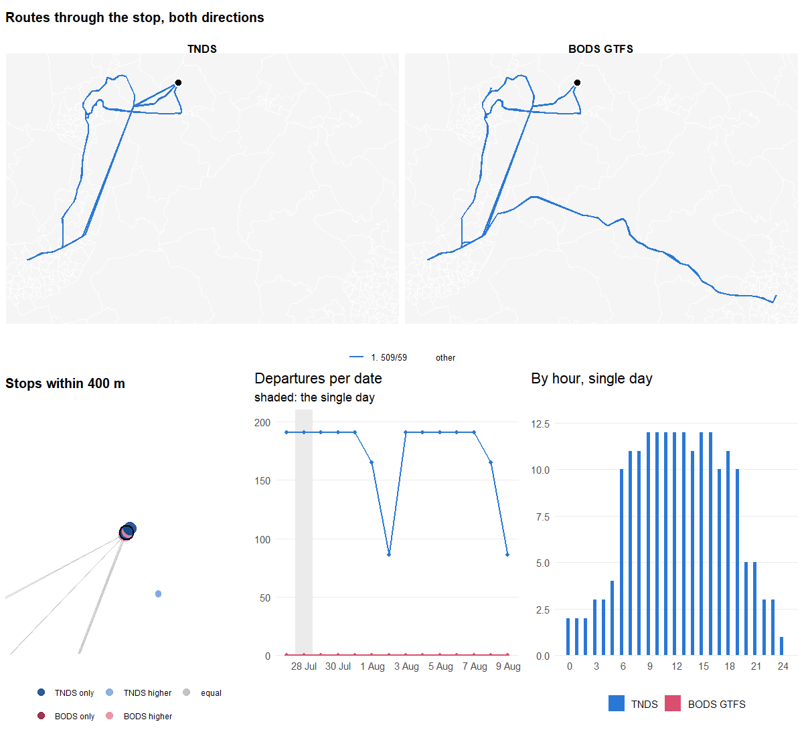

|TNDS route    |BODS route                 |Operator               |From → to                        | TNDS here| BODS here| Matched|Last date T / B |
|:-------------|:--------------------------|:----------------------|:--------------------------------|---------:|---------:|-------:|:---------------|
|510, 509, 723 |510, 509, 723, 59, 305, 34 |Arriva Herts and Essex |Temp Bus Station → Coach Station |     1,210|         0|       0|Sun  9 Aug / —  |
|510, 509, 723 |510, 509, 723, 59, 305     |Arriva Herts and Essex |Coach Station → Temp Bus Station |     1,202|         0|       0|Sun  9 Aug / —  |

**5. Holiday Inn — `1500STANHI`**, Essex, E01035178. TNDS 1,918, BODS GTFS 0 (window); on the day, TNDS 137, BODS GTFS 0.

- Only in TNDS, with no route in BODS GTFS sharing their stop sequence: **PREM** (1,918 departures).

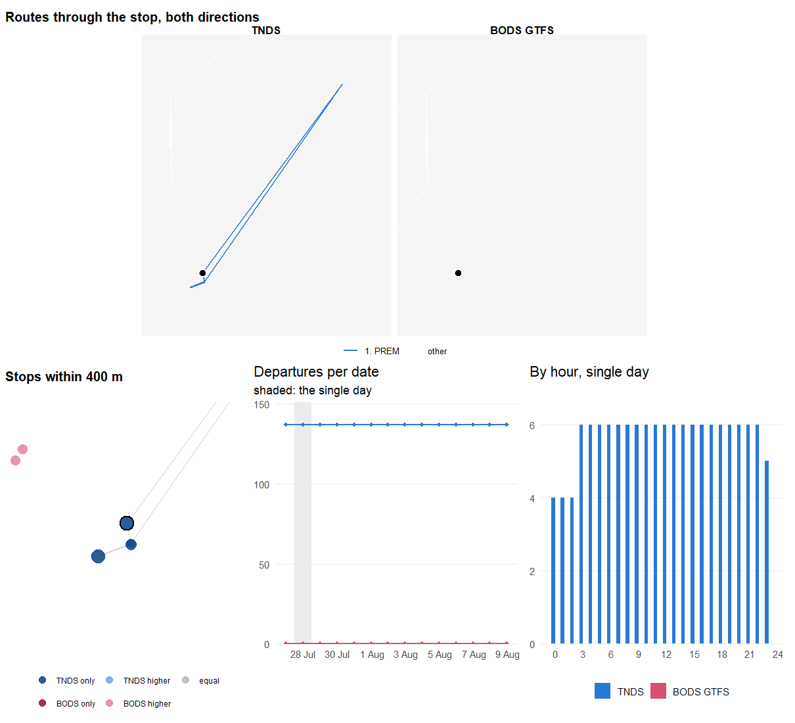

|TNDS route |BODS route |Operator |From → to                   | TNDS here| BODS here| Matched|Last date T / B |
|:----------|:----------|:--------|:---------------------------|---------:|---------:|-------:|:---------------|
|PREM       |—          |Bus4Us   |Coach Station → Premier Inn |     1,246|         0|       0|Sun  9 Aug / —  |
|PREM       |—          |Bus4Us   |Holiday Inn → Coach Station |       672|         0|       0|Sun  9 Aug / —  |
|PREM       |—          |Bus4Us   |Premier Inn → Coach Station |         0|         0|       0|— / —           |

#### BODS only

**1. North Terminal Bus Station — `4400CY0389`**, West Sussex, E01031575. TNDS 0, BODS GTFS 5,160 (window); on the day, TNDS 0, BODS GTFS 383.

- TNDS runs more at **4400CY0437** (North Terminal Bus Station) 28 m away: 2,002 departures more than the other source there, against this stop's 5,160 in BODS GTFS.
- Only in BODS GTFS, with no route in TNDS sharing their stop sequence: **10** (3,586 departures).
- TNDS has a route with the same stop sequence as **71, 65, 61, 23, 200, HB1** but it does not call at this stop code (1,574 departures).

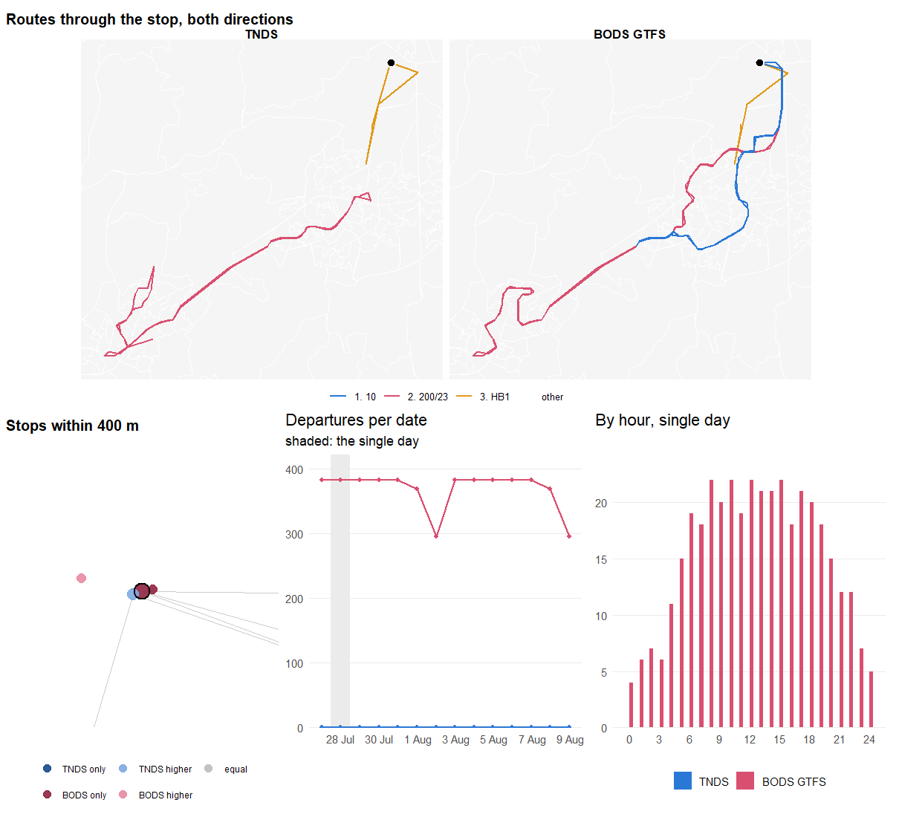

|TNDS route     |BODS route |Operator                       |From → to                                        | TNDS here| BODS here| Matched|Last date T / B |
|:--------------|:----------|:------------------------------|:------------------------------------------------|---------:|---------:|-------:|:---------------|
|—              |10         |Metrobus                       |Millpond Lane → North Terminal Bus Station       |         0|     1,796|       0|— / Sun  9 Aug  |
|—              |10         |Metrobus                       |North Terminal Bus Station → Millpond Lane       |         0|     1,790|       0|— / Sun  9 Aug  |
|71, 65, 61, 23 |200        |Metrobus                       |Bus Station → North Terminal Bus Station         |         0|       578|       0|— / Sun  9 Aug  |
|71, 23         |200        |Metrobus                       |North Terminal Bus Station → Bus Station         |         0|       548|       0|— / Sun  9 Aug  |
|HB1            |HB1        |united minibuses and coaches l |Gatwick Manor Hotel → North Terminal Bus Station |         0|       448|       0|— / Sun  9 Aug  |

**2. Interchange — `41000008REGE`**, Tyne and Wear, E01008355. TNDS 0, BODS GTFS 4,486 (window); on the day, TNDS 0, BODS GTFS 353.

- TNDS runs more at **410000060407** (Regent Centre Temp Stop NB) 11 m away: 5,108 departures more than the other source there, against this stop's 4,486 in BODS GTFS: very likely the same buses under two stop codes.
- TNDS has a route with the same stop sequence as **44, 43, 45, Q3, X46, 49 and 14 more** but it does not call at this stop code (4,486 departures).

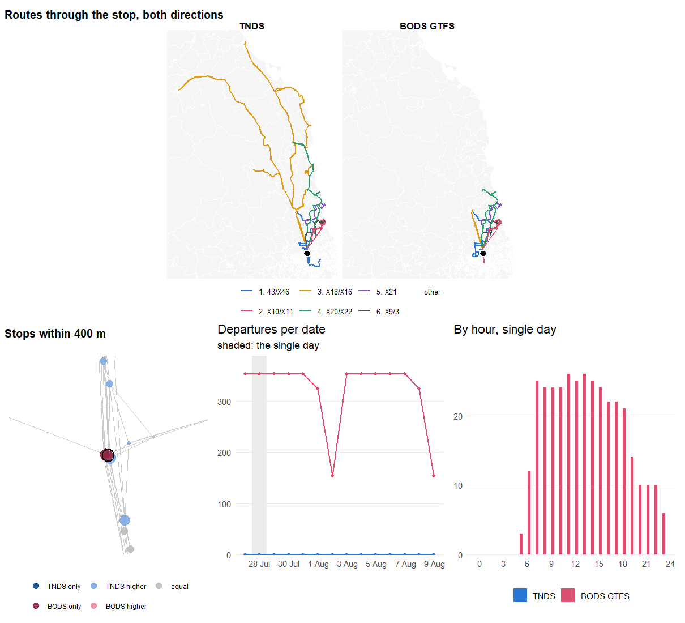

|TNDS route                   |BODS route            |Operator                |From → to                                  | TNDS here| BODS here| Matched|Last date T / B |
|:----------------------------|:---------------------|:-----------------------|:------------------------------------------|---------:|---------:|-------:|:---------------|
|44, 43, 45, Q3, X46, 49, Q3X |44, 43, 45, X46, T123 |Arriva North East       |Front Street → Haymarket Bus Station       |         0|     1,424|       0|— / Sun  9 Aug  |
|X11, X10, X30                |X11, X10, X30         |Arriva North East       |Bus station → Haymarket Bus Station        |         0|       888|       0|— / Sun  9 Aug  |
|X16, X15, X14, X18           |X18, X16              |Arriva North East       |Bus Station → Haymarket Bus Station        |         0|       714|       0|— / Sun  9 Aug  |
|X22, X20                     |X22, X20              |Arriva North East       |Turning circle → Haymarket Bus Station     |         0|       530|       0|— / Sun  9 Aug  |
|X21                          |X21                   |Arriva North East       |Sandy Bay → Haymarket Bus Station          |         0|       398|       0|— / Sun  9 Aug  |
|X9, 3                        |X9                    |Arriva North East       |Bus station → Haymarket Bus Station        |         0|       368|       0|— / Sun  9 Aug  |
|X46                          |X46                   |Gateshead Central Buses |Featherstone Grove → Haymarket Bus Station |         0|       164|       0|— / Sat  8 Aug  |
|X16, X15, X14, X18           |X18, X16              |Arriva North East       |Haymarket Bus Station → Bus Station        |         0|         0|       0|— / —           |
|X21                          |X21                   |Arriva North East       |Haymarket Bus Station → Sandy Bay          |         0|         0|       0|— / —           |
|X22, X20                     |X22, X20              |Arriva North East       |Haymarket Bus Station → Turning circle     |         0|         0|       0|— / —           |

**3. Naylors Row — `2290YHA00295`**, Kingston upon Hull, E01012809. TNDS 0, BODS GTFS 4,378 (window); on the day, TNDS 0, BODS GTFS 351.

- TNDS runs more at **2290YHA01202** (Windmill Hotel) 54 m away: 3,594 departures more than the other source there, against this stop's 4,378 in BODS GTFS: very likely the same buses under two stop codes.
- TNDS has a route with the same stop sequence as **8, 15, 111, 24, 11, 277 and 13 more** but it does not call at this stop code (4,378 departures).

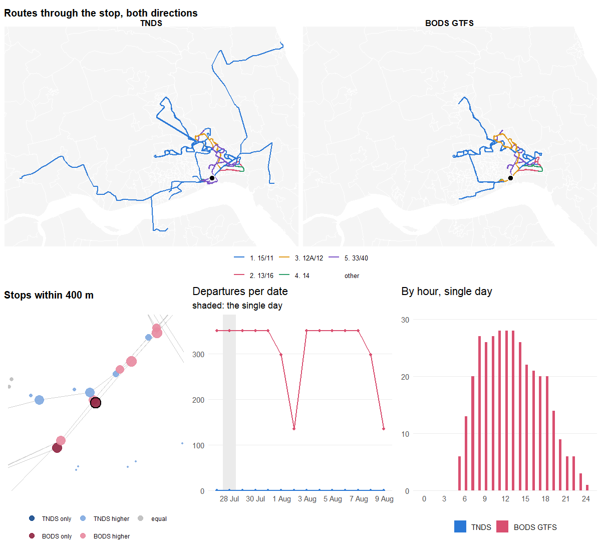

|TNDS route                                |BODS route                   |Operator                 |From → to                                  | TNDS here| BODS here| Matched|Last date T / B |
|:-----------------------------------------|:----------------------------|:------------------------|:------------------------------------------|---------:|---------:|-------:|:---------------|
|8, 15, 111, 24, 11, 277, 11A, 110         |8, 15, 57, 56, 11, 11A, 110  |Stagecoach East Midlands |Bransholme Centre A → Hull Interchange     |         0|     2,224|       0|— / Sun  9 Aug  |
|13                                        |13                           |Stagecoach East Midlands |Greenwich Avenue → Hull Interchange        |         0|       760|       0|— / Sun  9 Aug  |
|12A, 12                                   |12A, 12                      |Stagecoach East Midlands |Kingswood Health Centre → Hull Interchange |         0|       650|       0|— / Sun  9 Aug  |
|14                                        |14                           |Stagecoach East Midlands |Ecclesfield Avenue → Hull Interchange      |         0|       438|       0|— / Sun  9 Aug  |
|33C, 34, 40, 33, 33A                      |33C, 34, 40, 33              |Stagecoach East Midlands |Bransholme Centre A → Hull Interchange     |         0|       306|       0|— / Sat  8 Aug  |
|34, 33C, 40, 33, 33A                      |34, 33C, 40, 33              |Stagecoach East Midlands |Hull Interchange → Foster Street           |         0|         0|       0|— / —           |
|2, 8C, 15, 20, 111, 11, 55, 255, 11A, 110 |8C, 57, 15, 56, 11, 110, 11A |Stagecoach East Midlands |Burcott Garth → Hull Interchange           |         0|         0|       0|— / —           |
|12, 12A                                   |12, 12A                      |Stagecoach East Midlands |Hull Interchange → Kingswood Health Centre |         0|         0|       0|— / —           |
|14                                        |14                           |Stagecoach East Midlands |Hull Interchange → Aspire Academy          |         0|         0|       0|— / —           |
|13, 16                                    |13                           |Stagecoach East Midlands |Hull Interchange → Greenwich Avenue        |         0|         0|       0|— / —           |

**4. Great Union Street — `2290YHA00296`**, Kingston upon Hull, E01012809. TNDS 0, BODS GTFS 4,378 (window); on the day, TNDS 0, BODS GTFS 351.

- TNDS has a route with the same stop sequence as **8, 15, 111, 24, 11, 277 and 13 more** but it does not call at this stop code (4,378 departures).

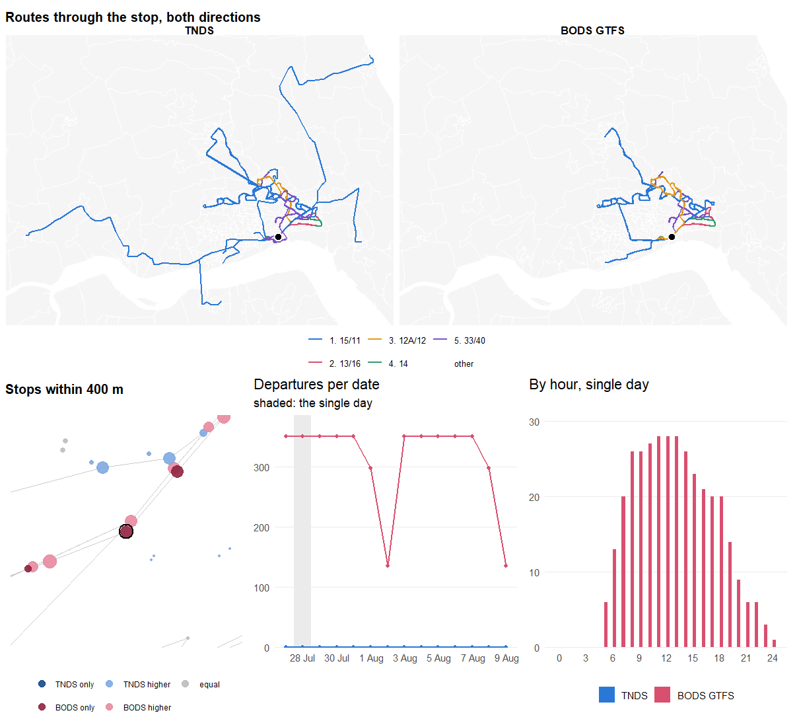

|TNDS route                                |BODS route                   |Operator                 |From → to                                  | TNDS here| BODS here| Matched|Last date T / B |
|:-----------------------------------------|:----------------------------|:------------------------|:------------------------------------------|---------:|---------:|-------:|:---------------|
|8, 15, 111, 24, 11, 277, 11A, 110         |8, 15, 57, 56, 11, 11A, 110  |Stagecoach East Midlands |Bransholme Centre A → Hull Interchange     |         0|     2,224|       0|— / Sun  9 Aug  |
|13                                        |13                           |Stagecoach East Midlands |Greenwich Avenue → Hull Interchange        |         0|       760|       0|— / Sun  9 Aug  |
|12A, 12                                   |12A, 12                      |Stagecoach East Midlands |Kingswood Health Centre → Hull Interchange |         0|       650|       0|— / Sun  9 Aug  |
|14                                        |14                           |Stagecoach East Midlands |Ecclesfield Avenue → Hull Interchange      |         0|       438|       0|— / Sun  9 Aug  |
|33C, 34, 40, 33, 33A                      |33C, 34, 40, 33              |Stagecoach East Midlands |Bransholme Centre A → Hull Interchange     |         0|       306|       0|— / Sat  8 Aug  |
|34, 33C, 40, 33, 33A                      |34, 33C, 40, 33              |Stagecoach East Midlands |Hull Interchange → Foster Street           |         0|         0|       0|— / —           |
|2, 8C, 15, 20, 111, 11, 55, 255, 11A, 110 |8C, 57, 15, 56, 11, 110, 11A |Stagecoach East Midlands |Burcott Garth → Hull Interchange           |         0|         0|       0|— / —           |
|12, 12A                                   |12, 12A                      |Stagecoach East Midlands |Hull Interchange → Kingswood Health Centre |         0|         0|       0|— / —           |
|14                                        |14                           |Stagecoach East Midlands |Hull Interchange → Aspire Academy          |         0|         0|       0|— / —           |
|13, 16                                    |13                           |Stagecoach East Midlands |Hull Interchange → Greenwich Avenue        |         0|         0|       0|— / —           |

**5. Interchange — `41000008REGB`**, Tyne and Wear, E01008355. TNDS 0, BODS GTFS 3,706 (window); on the day, TNDS 0, BODS GTFS 292.

- TNDS runs more at **410000060407** (Regent Centre Temp Stop NB) 27 m away: 5,108 departures more than the other source there, against this stop's 3,706 in BODS GTFS.
- TNDS has a route with the same stop sequence as **44, 43, 45, Q3, X46, 49 and 9 more** but it does not call at this stop code (3,706 departures).

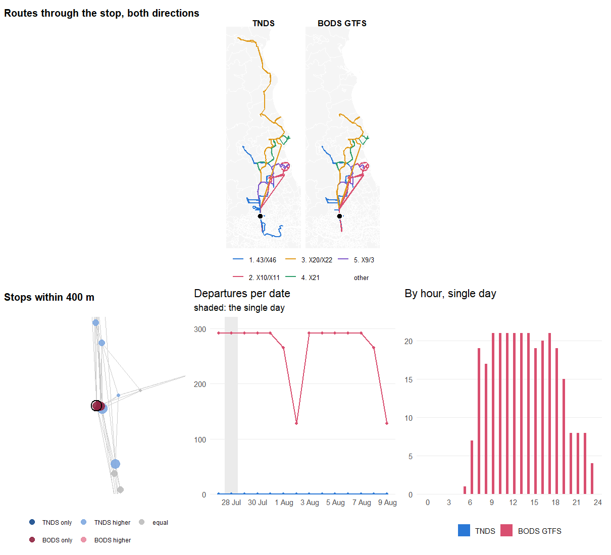

|TNDS route                   |BODS route      |Operator                |From → to                                  | TNDS here| BODS here| Matched|Last date T / B |
|:----------------------------|:---------------|:-----------------------|:------------------------------------------|---------:|---------:|-------:|:---------------|
|44, 43, 45, Q3, X46, 49, Q3X |44, 43, 45, X46 |Arriva North East       |Front Street → Haymarket Bus Station       |         0|     1,564|       0|— / Sun  9 Aug  |
|X10, X11, X30                |X10, X11, X30   |Arriva North East       |Haymarket Bus Station → Bus station        |         0|       890|       0|— / Sun  9 Aug  |
|X22, X20                     |X22, X20        |Arriva North East       |Haymarket Bus Station → Turning circle     |         0|       518|       0|— / Sun  9 Aug  |
|X21                          |X21             |Arriva North East       |Haymarket Bus Station → Sandy Bay          |         0|       386|       0|— / Sun  9 Aug  |
|X9, 3                        |X9              |Arriva North East       |Haymarket Bus Station → Bus station        |         0|       348|       0|— / Sun  9 Aug  |
|X21                          |X21             |Arriva North East       |Sandy Bay → Haymarket Bus Station          |         0|         0|       0|— / —           |
|X22, X20                     |X22, X20        |Arriva North East       |Turning circle → Haymarket Bus Station     |         0|         0|       0|— / —           |
|X9, 3                        |X9              |Arriva North East       |Bus station → Haymarket Bus Station        |         0|         0|       0|— / —           |
|X11, X10, X30                |X11, X10, X30   |Arriva North East       |Bus station → Haymarket Bus Station        |         0|         0|       0|— / —           |
|X46                          |X46             |Gateshead Central Buses |Featherstone Grove → Haymarket Bus Station |         0|         0|       0|— / —           |

#### TNDS higher

**1. Pagnell Avenue — `3200YNA00024`**, North Yorkshire, E01027909. TNDS 6,900, BODS GTFS 300 (window); on the day, TNDS 552, BODS GTFS 24.

- Routes in both (401): 300 journeys match within 5 minutes; 6,600 TNDS and 0 BODS GTFS journeys have no counterpart.

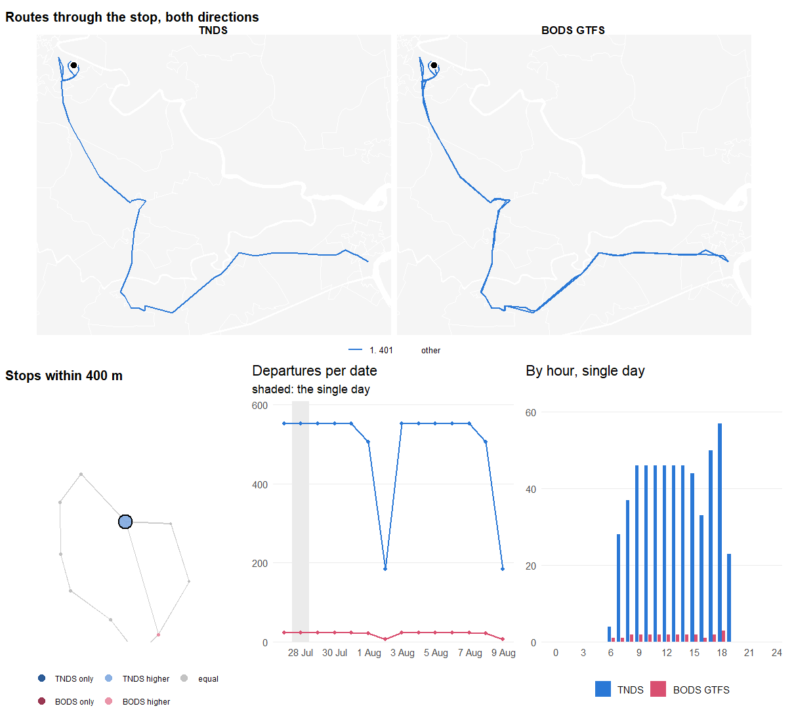

|TNDS route |BODS route |Operator         |From → to                     | TNDS here| BODS here| Matched|Last date T / B         |
|:----------|:----------|:----------------|:-----------------------------|---------:|---------:|-------:|:-----------------------|
|401        |401        |Arriva Yorkshire |Supermarket → Bus Stn Stand 2 |     6,900|       300|     300|Sun  9 Aug / Sun  9 Aug |

**2. Imperial Arcade — `149000006355`**, Brighton and Hove, E01016969. TNDS 6,630, BODS GTFS 1,145 (window); on the day, TNDS 495, BODS GTFS 85.

- TNDS has a route with the same stop sequence as **18, 50, 23, 20, 27, 12X and 9 more** but it does not call at this stop code (853 departures).
- Routes in both (37, 37B, 37C): 292 journeys match within 5 minutes; 6,338 TNDS and 0 BODS GTFS journeys have no counterpart.

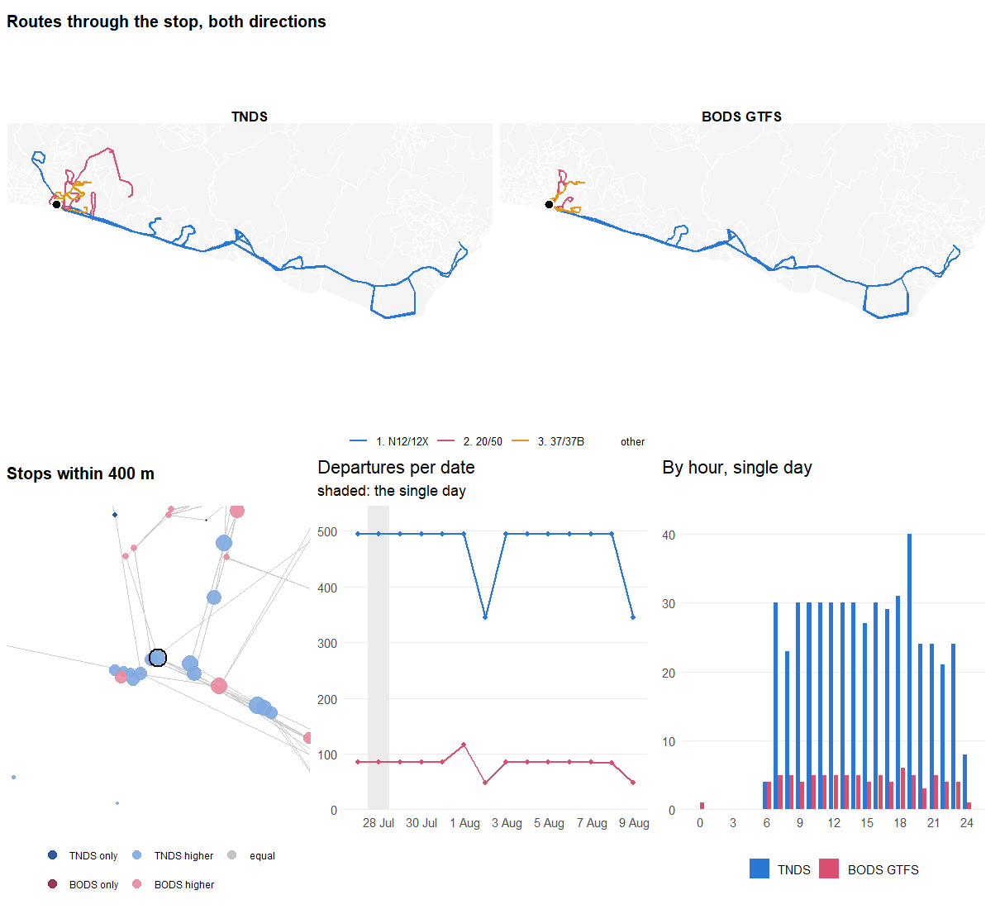

|TNDS route                                  |BODS route        |Operator        |From → to                           | TNDS here| BODS here| Matched|Last date T / B         |
|:-------------------------------------------|:-----------------|:---------------|:-----------------------------------|---------:|---------:|-------:|:-----------------------|
|37, 37B, 37C                                |37                |Compass Travel  |Meadowview → Imperial Arcade        |     6,630|       292|     292|Sun  9 Aug / Sun  9 Aug |
|18, 50, 23                                  |20                |Brighton & Hove |Stonehurst Court → Brighton Station |         0|       782|       0|— / Sun  9 Aug          |
|27, 12X, 12, 14, 12A, 13X, 14A, 1, 14C, N14 |12X, 12, 13X, N12 |Brighton & Hove |Whitethorn Drive → Coombe Vale Top  |         0|        71|       0|— / Sat  1 Aug          |
|27, 14, 12X, 12, 12A, 7, 13X, 14C           |12X, 12, 13X, N12 |Brighton & Hove |Coombe Vale Top → Whitethorn Drive  |         0|         0|       0|— / —                   |
|37, 37B                                     |37                |Compass Travel  |Beresford Road → Meadowview         |         0|         0|       0|— / —                   |

**3. Regent Centre Temp Stop NB — `410000060407`**, Tyne and Wear, E01008355. TNDS 5,928, BODS GTFS 820 (window); on the day, TNDS 482, BODS GTFS 65.

- BODS GTFS has a route with the same stop sequence as **X22, X16, X20, X15, X14, X18 and 15 more** but it does not call at this stop code (3,434 departures).
- Routes in both (44, 43, 45, Q3, X46, 49 and 2 more): 820 journeys match within 5 minutes; 1,674 TNDS and 0 BODS GTFS journeys have no counterpart.

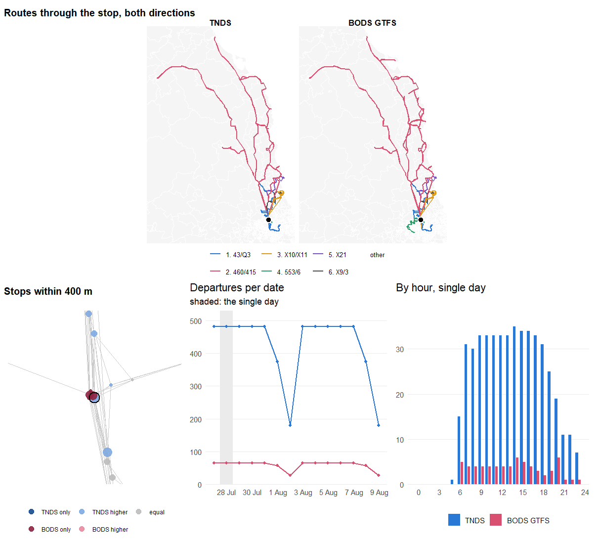

|TNDS route                   |BODS route                                            |Operator                |From → to                                  | TNDS here| BODS here| Matched|Last date T / B         |
|:----------------------------|:-----------------------------------------------------|:-----------------------|:------------------------------------------|---------:|---------:|-------:|:-----------------------|
|44, 43, 45, Q3, X46, 49, Q3X |44, 43, 45, Q3, X46, 49, Q3X, T123                    |Arriva North East       |Front Street → Haymarket Bus Station       |     2,494|       820|     820|Sun  9 Aug / Sun  9 Aug |
|X22, X16, X20, X15, X14, X18 |X18, X22, X20, X16, X15, X14, 918, 477, 418, 415, 460 |Arriva North East       |Haymarket Bus Station → Bus Station        |     1,230|         0|       0|Sun  9 Aug / —          |
|X10, X11, X30                |X10, X11, X30                                         |Arriva North East       |Haymarket Bus Station → Bus station        |       890|         0|       0|Sun  9 Aug / —          |
|X21                          |X21                                                   |Arriva North East       |Haymarket Bus Station → Sandy Bay          |       386|         0|       0|Sun  9 Aug / —          |
|X9                           |X9, 3                                                 |Arriva North East       |Haymarket Bus Station → Bus station        |       348|         0|       0|Sun  9 Aug / —          |
|553                          |553, 7, 6                                             |Arriva North East       |Freeman Hospital Grounds → Interchange     |       280|         0|       0|Fri  7 Aug / —          |
|553                          |553, 7, 6                                             |Arriva North East       |Interchange → Freeman Hospital Grounds     |       280|         0|       0|Fri  7 Aug / —          |
|X46                          |X46                                                   |Gateshead Central Buses |Featherstone Grove → Haymarket Bus Station |        20|         0|       0|Fri  7 Aug / —          |
|X22, X20, X16, X15, X14, X18 |X18, X15, X22, X20, X16, X14, 918, 418, 477, 415, 460 |Arriva North East       |Bus Station → Haymarket Bus Station        |         0|         0|       0|— / —                   |
|X21                          |X21                                                   |Arriva North East       |Sandy Bay → Haymarket Bus Station          |         0|         0|       0|— / —                   |

**4. Stevenage Railway Station — `210021200945`**, Hertfordshire, E01035570. TNDS 7,878, BODS GTFS 2,952 (window); on the day, TNDS 577, BODS GTFS 242.

- BODS GTFS has a route with the same stop sequence as **SB5, SB50, SB3, SB2, SB4, SB40 and 6 more** but it does not call at this stop code (3,786 departures).
- Routes in both (101, 100, 9D, 9B, 9A, 9 and 42 more): 2,894 journeys match within 5 minutes; 1,198 TNDS and 58 BODS GTFS journeys have no counterpart.

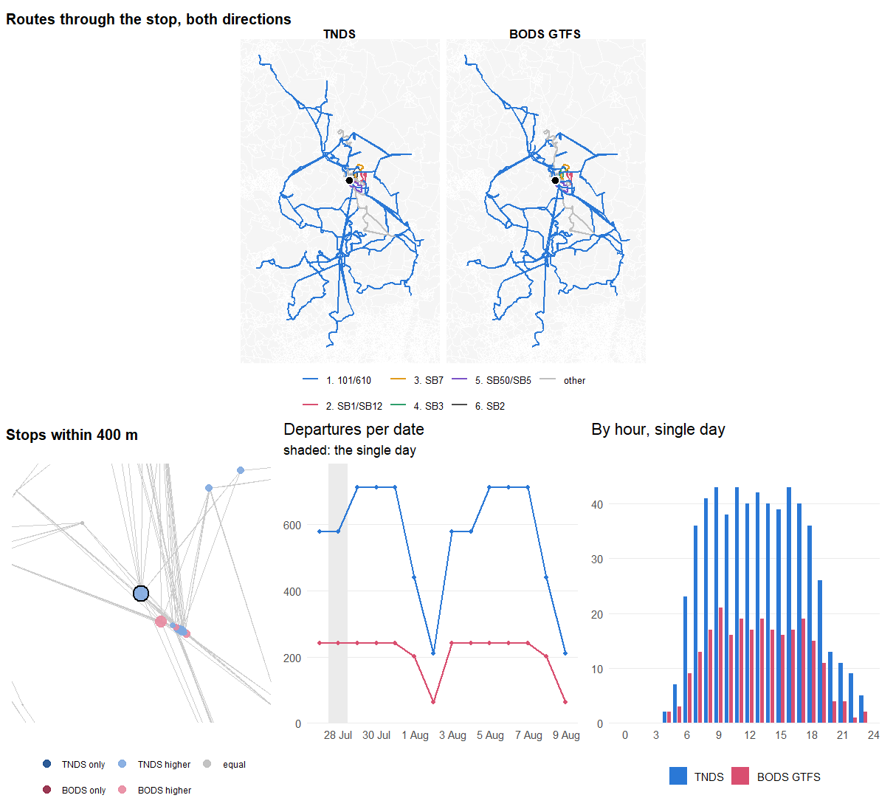

|TNDS route                                                                                                  |BODS route                                                                                                  |Operator               |From → to                           | TNDS here| BODS here| Matched|Last date T / B         |
|:-----------------------------------------------------------------------------------------------------------|:-----------------------------------------------------------------------------------------------------------|:----------------------|:-----------------------------------|---------:|---------:|-------:|:-----------------------|
|SB1, SB12                                                                                                   |SB1, SB12                                                                                                   |Arriva                 |Woodcock Road → Bus Station         |     1,192|       216|     216|Sun  9 Aug / Sat  8 Aug |
|SB5, SB50                                                                                                   |SB5, SB50                                                                                                   |Arriva                 |Bus Station → Bus Station           |       840|         0|       0|Sun  9 Aug / —          |
|SB3                                                                                                         |SB3                                                                                                         |Arriva                 |Bus Station → Bus Station           |       764|         0|       0|Sun  9 Aug / —          |
|SB2                                                                                                         |SB2                                                                                                         |Arriva                 |Bus Station → Bus Station           |       732|         0|       0|Sun  9 Aug / —          |
|SB4                                                                                                         |SB4, SB40                                                                                                   |Arriva                 |Bus Station → Bus Station           |       440|         0|       0|Sun  9 Aug / —          |
|SB7                                                                                                         |SB7                                                                                                         |Arriva Herts and Essex |Manchester Close → Bus Station      |       378|         0|       0|Sun  9 Aug / —          |
|SB8, SB9                                                                                                    |SB8, SB9                                                                                                    |Arriva Herts and Essex |Bus Station → Bus Station           |       356|         0|       0|Sun  9 Aug / —          |
|55                                                                                                          |55                                                                                                          |Arriva Herts and Essex |Bus Station → Southfields           |       252|         0|       0|Sun  9 Aug / —          |
|301, 653, 602, 302, 400, 625, 80, 44, 366, 314, 45, 324                                                     |653, 301, 602, 302, 401, 400, 625, 80, 44, 314, 45                                                          |Arriva                 |Lister Hospital → St Peter's Street |       142|        58|       0|Sat  8 Aug / Sat  8 Aug |
|301, 653, 602, 610, 302, 614, 907, 635, 242, 625, 907A, 390, 644, 38, 341, 641, 305, 35, 38A, 314, 37X, 310 |653, 301, 602, 610, 302, 907, 635, 242, 625, 907A, 38, 390, 644, 341, 641, 305, 35, 38A, 37X, 314, HL1, 612 |Arriva                 |St Peter's Street → Lister Hospital |       880|       814|     814|Sun  9 Aug / Sun  9 Aug |

**5. Regent Centre-Temp SB — `410000060406`**, Tyne and Wear, E01008355. TNDS 5,132, BODS GTFS 600 (window); on the day, TNDS 403, BODS GTFS 45.

- BODS GTFS has a route with the same stop sequence as **X22, X20, X16, X15, X14, X18 and 12 more** but it does not call at this stop code (3,042 departures).
- Routes in both (44, 43, 45, Q3, X46, 49 and 2 more): 600 journeys match within 5 minutes; 1,490 TNDS and 0 BODS GTFS journeys have no counterpart.

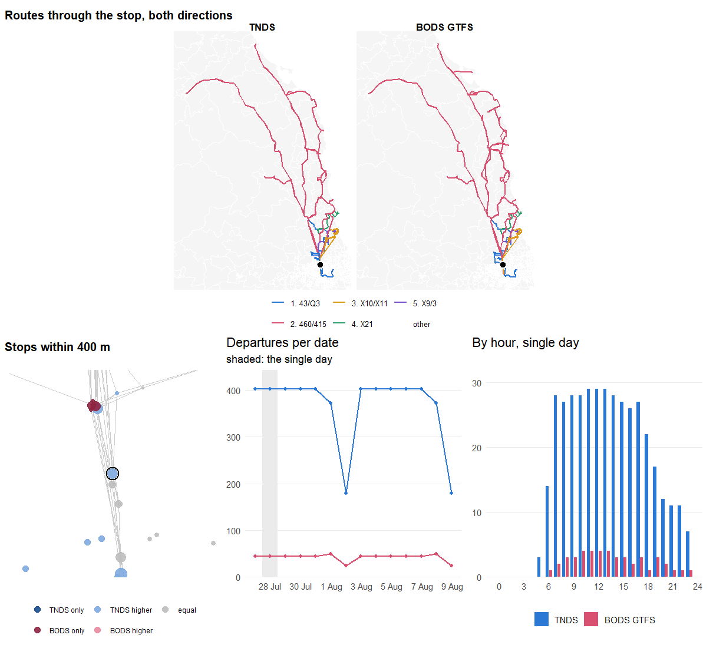

|TNDS route                   |BODS route                                            |Operator                |From → to                                  | TNDS here| BODS here| Matched|Last date T / B         |
|:----------------------------|:-----------------------------------------------------|:-----------------------|:------------------------------------------|---------:|---------:|-------:|:-----------------------|
|44, 43, 45, Q3, X46, 49, Q3X |44, 43, 45, Q3, X46, 49, Q3X, T123                    |Arriva North East       |Front Street → Haymarket Bus Station       |     1,522|       112|     112|Sun  9 Aug / Sat  8 Aug |
|X22, X20, X16, X15, X14, X18 |X18, X15, X22, X20, X16, X14, 918, 418, 477, 415, 460 |Arriva North East       |Bus Station → Haymarket Bus Station        |     1,244|         0|       0|Sun  9 Aug / —          |
|X11, X10, X30                |X11, X10, X30                                         |Arriva North East       |Bus station → Haymarket Bus Station        |       888|         0|       0|Sun  9 Aug / —          |
|X21                          |X21                                                   |Arriva North East       |Sandy Bay → Haymarket Bus Station          |       398|         0|       0|Sun  9 Aug / —          |
|X9                           |X9, 3                                                 |Arriva North East       |Bus station → Haymarket Bus Station        |       368|         0|       0|Sun  9 Aug / —          |
|X46                          |X46                                                   |Gateshead Central Buses |Featherstone Grove → Haymarket Bus Station |       144|         0|       0|Sat  8 Aug / —          |
|Q3, Q3X                      |Q3, Q3X                                               |Go North East           |Brunton Lane-Farm Cottages → Interchange   |       568|       488|     488|Sun  9 Aug / Sun  9 Aug |
|X22, X16, X20, X15, X14, X18 |X18, X22, X20, X16, X15, X14, 918, 477, 418, 415, 460 |Arriva North East       |Haymarket Bus Station → Bus Station        |         0|         0|       0|— / —                   |
|X21                          |X21                                                   |Arriva North East       |Haymarket Bus Station → Sandy Bay          |         0|         0|       0|— / —                   |
|X9                           |X9, 3                                                 |Arriva North East       |Haymarket Bus Station → Bus station        |         0|         0|       0|— / —                   |

#### BODS higher

**1. Chelmsford Railway Station — `1500AA160`**, Essex, E01034092. TNDS 2,658, BODS GTFS 10,606 (window); on the day, TNDS 434, BODS GTFS 647.

- The two part company between the window's weeks: from **Mon  3 Aug**, TNDS 434 to 27 a weekday, while BODS GTFS 647 to 1,054 a weekday.
- Only in TNDS, with no route in BODS GTFS sharing their stop sequence: **32** (72 departures).
- Routes in both (300, C1, 371, C5, C3, C2 and 36 more): 2,514 journeys match within 5 minutes; 72 TNDS and 8,092 BODS GTFS journeys have no counterpart.

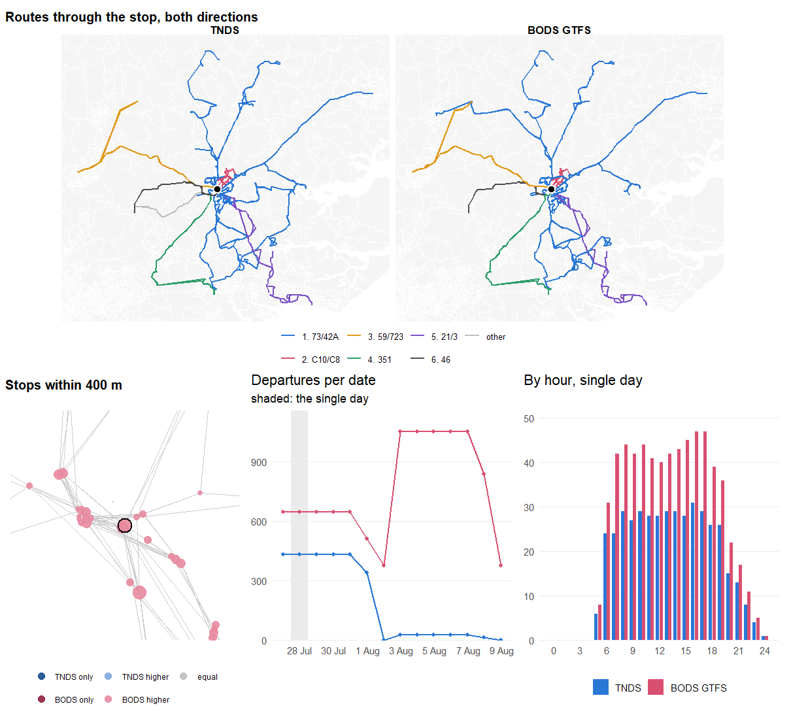

|TNDS route                                                                                                                     |BODS route                                                                                                                |Operator               |From → to                                            | TNDS here| BODS here| Matched|Last date T / B         |
|:------------------------------------------------------------------------------------------------------------------------------|:-------------------------------------------------------------------------------------------------------------------------|:----------------------|:----------------------------------------------------|---------:|---------:|-------:|:-----------------------|
|300, C1, 371, C5, C3, C2, 14, 170, C7, 94, 38, 13B, 48, 49, 13, 47, C6, 99, 94A, 73B, 71, C7E, 13A, 370, 73, 70, 94B, C12, 73A |C1, C5, 300, C3, C2, 170, C7, 371, 14WI, 13B, 94, C6, 13, 47, 73B, 370, 13A, 73, 49, 70, C12, 73A, C2e, 71, 94A, 42A, 94B |First Essex            |Hospital → West Lawn                                 |     1,780|     7,852|   1,779|Sat  8 Aug / Sun  9 Aug |
|C9, C10                                                                                                                        |C9, C10, C8                                                                                                               |First Essex            |Beaulieu Park Railway Station → Beaulieu Park Railwa |       534|     2,148|     524|Sat  1 Aug / Sun  9 Aug |
|351                                                                                                                            |351                                                                                                                       |First Essex            |Bus Station → Eagle Way                              |        66|       218|      66|Sat  1 Aug / Sun  9 Aug |
|73B, 73                                                                                                                        |73B, 73                                                                                                                   |First Essex            |Bus Station → Cherry Garden                          |        36|       130|      31|Sat  1 Aug / Sat  8 Aug |
|32                                                                                                                             |—                                                                                                                         |Stephensons of Essex   |Bus Station → Two Brewers                            |        72|         0|       0|Sat  8 Aug / —          |
|46                                                                                                                             |46                                                                                                                        |First Essex            |Bus Station → Two Brewers                            |        56|       108|      36|Fri  7 Aug / Sat  8 Aug |
|3, 21                                                                                                                          |3, 21, 8A                                                                                                                 |First Essex            |Bus Station → Travel Centre                          |        54|        90|      18|Sat  8 Aug / Sat  8 Aug |
|723, 59                                                                                                                        |723, 59                                                                                                                   |Arriva Herts and Essex |Temp Bus Station → Coach Station                     |        60|        60|      60|Fri  7 Aug / Fri  7 Aug |
|C1, C5, C2, 170, C7, 49, C6, 47, 38, 99, 48, 370, C7E, 38A, 70, 31                                                             |C1, C5, C2, C7, 170, 370, C6, 47, 70, 49, 31, 42A, C2e                                                                    |First Essex            |West Lawn → Hospital                                 |         0|         0|       0|— / —                   |
|3, 26, 27, 8A                                                                                                                  |3, 26, 27, 8A                                                                                                             |First Essex            |Travel Centre → Bus Station                          |         0|         0|       0|— / —                   |

**2. Retail Market — `1500IM2089`**, Essex, E01034092. TNDS 3,298, BODS GTFS 10,837 (window); on the day, TNDS 461, BODS GTFS 696.

- The two part company between the window's weeks: from **Mon  3 Aug**, TNDS 461 to 96 a weekday, while BODS GTFS 695 to 1,057 a weekday.
- Only in BODS GTFS, with no route in TNDS sharing their stop sequence: **49** (14 departures).
- BODS GTFS has a route with the same stop sequence as **19, 20, 21, 22, 339, 22B and 5 more** but it does not call at this stop code (9 departures).
- TNDS has a route with the same stop sequence as **C9, C10, C8** but it does not call at this stop code (680 departures).
- Routes in both (300, C1, 371, C5, X20, C2 and 56 more): 3,235 journeys match within 5 minutes; 54 TNDS and 6,908 BODS GTFS journeys have no counterpart.

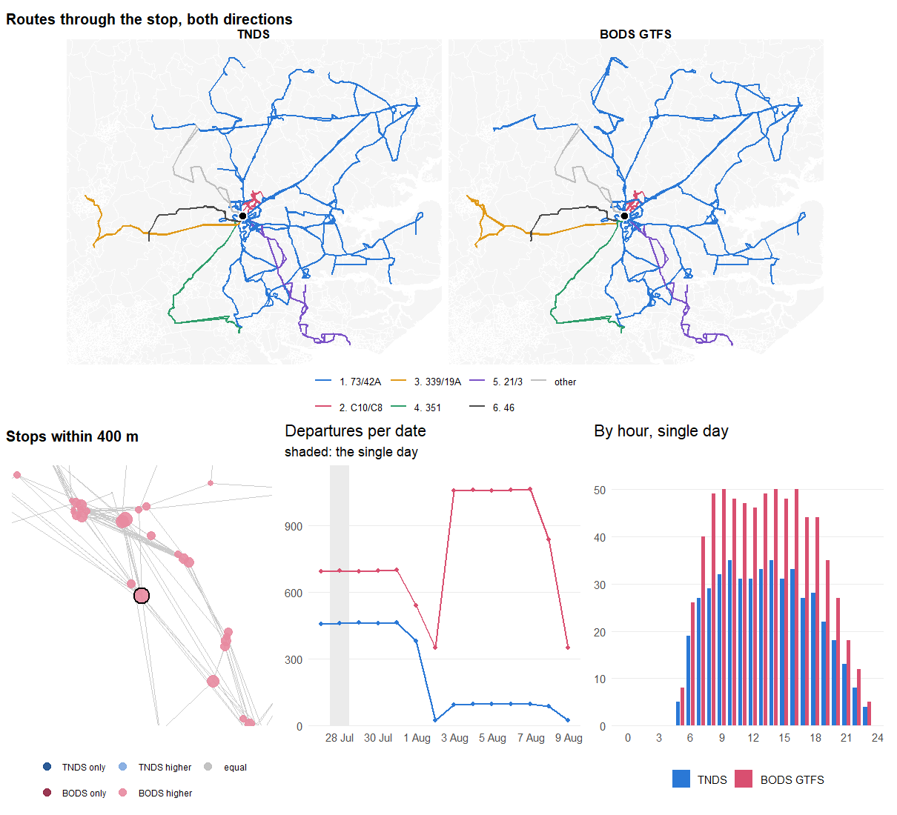

|TNDS route                                                                                                                                                                                                          |BODS route                                                                                                                                                                                                    |Operator             |From → to                                            | TNDS here| BODS here| Matched|Last date T / B         |
|:-------------------------------------------------------------------------------------------------------------------------------------------------------------------------------------------------------------------|:-------------------------------------------------------------------------------------------------------------------------------------------------------------------------------------------------------------|:--------------------|:----------------------------------------------------|---------:|---------:|-------:|:-----------------------|
|300, C1, 371, C5, X20, C2, C3, 375, 14, 170, C7, 94, 331, 333, 336, 38, 13B, 48, 49, z75, 13, 47, C6, 82, 1A, 31, 75, 71, 332, 99, 94A, 370, 73B, 52, C7E, 13A, 73, X71, 38A, 70, 94B, 82A, 320, C12, 73A, 85, 3, 6 |C1, C5, C2, 300, C3, C7, 170, 371, X20, 331, 333, 336, 375, 14WI, 13B, 370, 94, C6, 31, 13, 47, 332, 73B, 13A, 70, 73, 49, 75, C12, z75, 73A, 71, 42A, C2e, 1A, 82, 94A, 320, 52, X71, 83, 82A, 94B, 85, 6, 3 |First Essex          |West Lawn → Hospital                                 |     2,276|     7,720|   2,247|Sat  8 Aug / Sun  9 Aug |
|C8, C10                                                                                                                                                                                                             |C8, C10, C9                                                                                                                                                                                                   |First Essex          |Beaulieu Park Railway Station → Beaulieu Park Railwa |       248|     1,094|     247|Sat  1 Aug / Sun  9 Aug |
|C9, C10                                                                                                                                                                                                             |C9, C10, C8                                                                                                                                                                                                   |First Essex          |Beaulieu Park Railway Station → Beaulieu Park Railwa |         0|       680|       0|— / Sun  9 Aug          |
|351                                                                                                                                                                                                                 |351                                                                                                                                                                                                           |First Essex          |Hospital (Northbound) → Bus Station                  |       103|       555|      83|Sat  1 Aug / Sun  9 Aug |
|46                                                                                                                                                                                                                  |46                                                                                                                                                                                                            |First Essex          |Two Brewers → Bus Station                            |        36|       108|      36|Sat  1 Aug / Sat  8 Aug |
|3, 26, 27, 8A                                                                                                                                                                                                       |3, 26, 27, 8A                                                                                                                                                                                                 |First Essex          |Travel Centre → Bus Station                          |        58|        90|      54|Sat  8 Aug / Sat  8 Aug |
|—                                                                                                                                                                                                                   |49                                                                                                                                                                                                            |Hedingham & Chambers |The Green → Retail Market                            |         0|        14|       0|— / Sat  8 Aug          |
|17, 18                                                                                                                                                                                                              |18, 17                                                                                                                                                                                                        |JW Lodge & Sons      |High Street → Railway Street Car Park                |         8|        16|       8|Sat  8 Aug / Sat  8 Aug |
|19                                                                                                                                                                                                                  |20, 21, 22, 339, 22B, 19A, 13B, 18C                                                                                                                                                                           |Central Connect      |Temp Bus Station → Two Brewers                       |         5|         0|       0|Fri 31 Jul / —          |
|3, 21, 8A                                                                                                                                                                                                           |3, 21, 8A                                                                                                                                                                                                     |First Essex          |Bus Station → Travel Centre                          |         4|         0|       0|Wed  5 Aug / —          |

**3. Parkway — `15003411303`**, Essex, E01033140. TNDS 3,518, BODS GTFS 10,898 (window); on the day, TNDS 502, BODS GTFS 721.

- The two part company between the window's weeks: from **Mon  3 Aug**, TNDS 503 to 115 a weekday, while BODS GTFS 722 to 1,108 a weekday.
- TNDS has a route with the same stop sequence as **C9, C10, C8** but it does not call at this stop code (680 departures).
- Routes in both (C5, C2, 375, 170, C7, C1 and 44 more): 3,431 journeys match within 5 minutes; 87 TNDS and 6,787 BODS GTFS journeys have no counterpart.

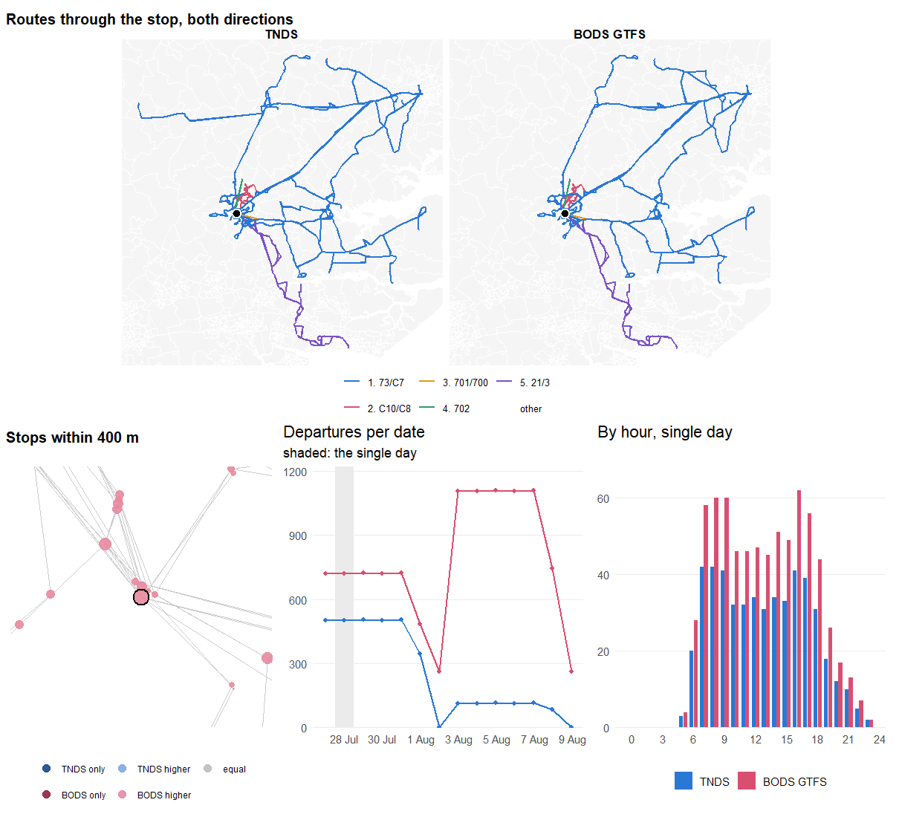

|TNDS route                                                                                                             |BODS route                                                                                                     |Operator    |From → to                                            | TNDS here| BODS here| Matched|Last date T / B         |
|:----------------------------------------------------------------------------------------------------------------------|:--------------------------------------------------------------------------------------------------------------|:-----------|:----------------------------------------------------|---------:|---------:|-------:|:-----------------------|
|C5, C2, 375, 170, C7, C1, 331, 333, 336, C6, 47, 1A, 31, 38, 75, 332, 99, 370, C7E, 38A, 70, 94A, 3, 6                 |C5, C2, C7, C1, 331, 333, 336, 375, 370, 31, C6, 47, 332, 75, 1A, C2e, 94A, 170, 6, 3                          |First Essex |Heath Drive → Lodge Road                             |     1,197|     4,497|   1,136|Sat  8 Aug / Sun  9 Aug |
|702                                                                                                                    |702                                                                                                            |First Essex |Chelmer Valley Park-and-Ride → Chelmer Valley Park-a |       265|     1,315|     265|Fri 31 Jul / Fri  7 Aug |
|701, 700                                                                                                               |700, 701                                                                                                       |First Essex |Sandon Park-and-Ride Car Park → Sandon Park-and-Ride |     1,209|     2,085|   1,184|Sat  8 Aug / Sat  8 Aug |
|C8, C10                                                                                                                |C8, C10, C9                                                                                                    |First Essex |Beaulieu Park Railway Station → Beaulieu Park Railwa |       248|     1,094|     247|Sat  1 Aug / Sun  9 Aug |
|C9, C10                                                                                                                |C9, C10, C8                                                                                                    |First Essex |Beaulieu Park Railway Station → Beaulieu Park Railwa |         0|       680|       0|— / Sun  9 Aug          |
|371, C5, X20, C3, C2, 170, C7, C1, 38, z75, 47, C6, 82, 71, 99, 73B, 52, C7E, 370, 73, X71, 70, 82A, 320, C12, 73A, 85 |C5, C3, C2, C7, 371, X20, C1, C6, 47, 73B, 370, 73, C12, z75, 73A, 71, C2e, 82, 320, 52, X71, 83, 82A, 170, 85 |First Essex |Lodge Road → Heath Drive                             |       541|     1,133|     541|Sat  8 Aug / Sun  9 Aug |
|3, 26, 27, 8A                                                                                                          |3, 26, 27, 8A                                                                                                  |First Essex |Travel Centre → Bus Station                          |        58|        94|      58|Sat  8 Aug / Sat  8 Aug |
|3, 21, 8A                                                                                                              |3, 21, 8A                                                                                                      |First Essex |Bus Station → Travel Centre                          |         0|         0|       0|— / —                   |
|375, 333, 336, 331, 31, 332, 75, 3, 6                                                                                  |333, 336, 375, 331, 332, 31, 75, 6, 3                                                                          |First Essex |Bus Station → Lilac Grove                            |         0|         0|       0|— / —                   |
|73B, 73                                                                                                                |73B, 73                                                                                                        |First Essex |Bus Station → Cherry Garden                          |         0|         0|       0|— / —                   |

**4. Castle Hill — `43000874601`**, West Midlands, E01009757. TNDS 2,064, BODS GTFS 9,250 (window); on the day, TNDS 166, BODS GTFS 759.

- TNDS has a route with the same stop sequence as **87, 82, 74, 7, 19** but it does not call at this stop code (4,242 departures).
- Routes in both (126, 12, 12A, 11A, 11, X8 and 5 more): 2,050 journeys match within 5 minutes; 14 TNDS and 2,958 BODS GTFS journeys have no counterpart.

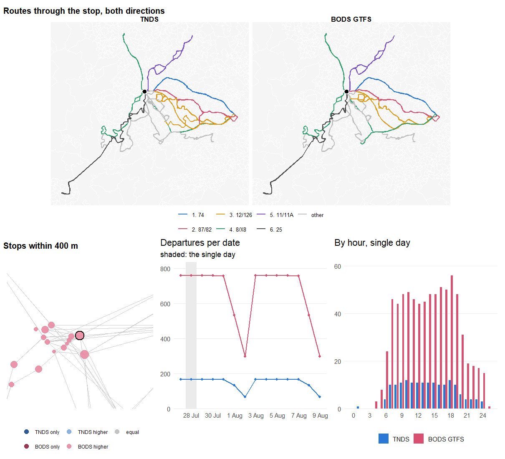

|TNDS route   |BODS route   |Operator                       |From → to                                  | TNDS here| BODS here| Matched|Last date T / B         |
|:------------|:------------|:------------------------------|:------------------------------------------|---------:|---------:|-------:|:-----------------------|
|87, 82       |87           |National Express West Midlands |Colmore Row → Coronation Gardens           |         0|     1,882|       0|— / Sun  9 Aug          |
|126, 12, 12A |126, 12, 12A |National Express West Midlands |Colmore Row → Coronation Gardens           |       244|     1,894|     244|Sun  9 Aug / Sun  9 Aug |
|74           |74           |National Express West Midlands |Colmore Circus → West Bromwich Bus Station |         0|     1,584|       0|— / Sun  9 Aug          |
|11A, 11      |11, 11A      |National Express West Midlands |Newport Street → Ednam Road                |       554|     1,408|     540|Sun  9 Aug / Sun  9 Aug |
|X8, 8        |X8, 8        |National Express West Midlands |Colmore Row → Wolverhampton Bus Station    |       590|     1,020|     590|Sun  9 Aug / Sun  9 Aug |
|7            |7            |National Express West Midlands |Wollaston Junction → Evolve Campus         |         0|       390|       0|— / Sun  9 Aug          |
|19           |19           |Diamond Bus                    |Queen Elizabeth Hospital → Evolve Campus   |         0|       386|       0|— / Sun  9 Aug          |
|216, 215     |215, 216     |Diamond Bus                    |Bus Interchange → Ednam Road               |       142|       152|     142|Sat  8 Aug / Sat  8 Aug |
|25           |25           |National Express West Midlands |Stourbridge Interchange → Priory Street    |       380|       380|     380|Sun  9 Aug / Sun  9 Aug |
|14           |14           |Diamond Bus                    |Bus Interchange → Priory Street            |       154|       154|     154|Sat  8 Aug / Sat  8 Aug |

**5. Keighley Bus Station Entrance — `450026807`**, West Yorkshire, E01010710. TNDS 50, BODS GTFS 6,860 (window); on the day, TNDS 4, BODS GTFS 550.

- TNDS has a route with the same stop sequence as **66, 62, M5, M4, M3, M6 and 32 more** but it does not call at this stop code (6,810 departures).
- Routes in both (K15): 50 journeys match within 5 minutes; 0 TNDS and 0 BODS GTFS journeys have no counterpart.

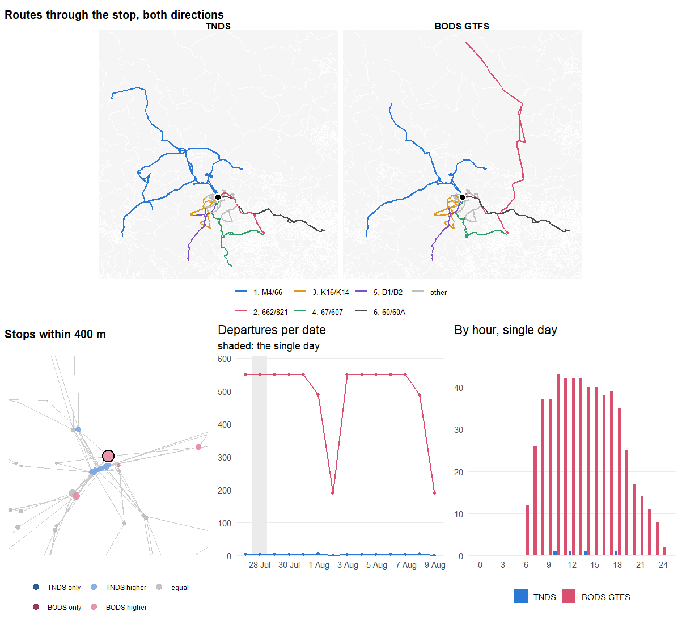

|TNDS route                                                       |BODS route           |Operator                 |From → to                                            | TNDS here| BODS here| Matched|Last date T / B |
|:----------------------------------------------------------------|:--------------------|:------------------------|:----------------------------------------------------|---------:|---------:|-------:|:---------------|
|66, 62, M5, M4, M3, M6, 64, 71, 903, 78A, 210, 864, 75, 866, 862 |66, 62, M4, 862, 866 |The Keighley Bus Company |Bus Station Stand 5 → Keighley Bus Station Entrance  |         0|     1,108|       0|— / Sun  9 Aug  |
|K3, K2                                                           |K3, K2               |The Keighley Bus Company |Keighley Bus Station → Keighley Bus Station Entrance |         0|       846|       0|— / Sun  9 Aug  |
|K7, K14, K16                                                     |K7, K14, K16         |The Keighley Bus Company |Windsor Grove → Keighley Bus Station                 |         0|       838|       0|— / Sun  9 Aug  |
|662, 622                                                         |662, 821             |The Keighley Bus Company |Bradford Interchange Bus Station → Keighley Bus Stat |         0|       804|       0|— / Sun  9 Aug  |
|K9                                                               |K9                   |The Keighley Bus Company |Keighley Bus Station → Keighley Bus Station Entrance |         0|       614|       0|— / Sun  9 Aug  |
|B2, B3, B1                                                       |B2, B3, B1           |The Keighley Bus Company |Windsor Grove → Keighley Bus Station Entrance        |         0|       548|       0|— / Sun  9 Aug  |
|60, 60A                                                          |60, 60A              |The Keighley Bus Company |Leeds City Bus Station → Keighley Bus Station Entran |         0|       520|       0|— / Sun  9 Aug  |
|K5                                                               |K5                   |The Keighley Bus Company |Thwaites Brow Rd Bank Top Way → Keighley Bus Station |         0|       364|       0|— / Sun  9 Aug  |
|K6                                                               |K6                   |The Keighley Bus Company |Keighley Bus Station → Keighley Bus Station Entrance |         0|       330|       0|— / Sun  9 Aug  |
|K1                                                               |K1                   |The Keighley Bus Company |Laycock Lane Chapel Ln → Keighley Bus Station Entran |         0|       290|       0|— / Sun  9 Aug  |

### Cases: single day (Tuesday 28 July 2026)

15 of these 20 stops are also among the window's cases, and are not drawn again. For most of the worst stops, then, what makes them disagree over a fortnight is already there on a single ordinary weekday: a different timetable, not one cut short.

#### TNDS only

**1. Hardwick Road — `149000006983`**, Brighton and Hove, E01016885. TNDS 308, BODS GTFS 0 (day); over the window, TNDS 4,000, BODS GTFS 0.

Shown in full above.

**2. Sheffield Interchange — `370070005`**, South Yorkshire, E01033268. TNDS 283, BODS GTFS 0 (day); over the window, TNDS 3,592, BODS GTFS 2.

- BODS GTFS runs more at **370010131** (Sheffield Interchange/D3) 22 m away: 43 departures more than the other source there, against this stop's 283 in TNDS.
- Only in TNDS, with no route in BODS GTFS sharing their stop sequence: **SC1, SC2** (134 departures).
- BODS GTFS has a route with the same stop sequence as **218, 32, 31, M35, 9, 9A and 27 more** but it does not call at this stop code (149 departures).

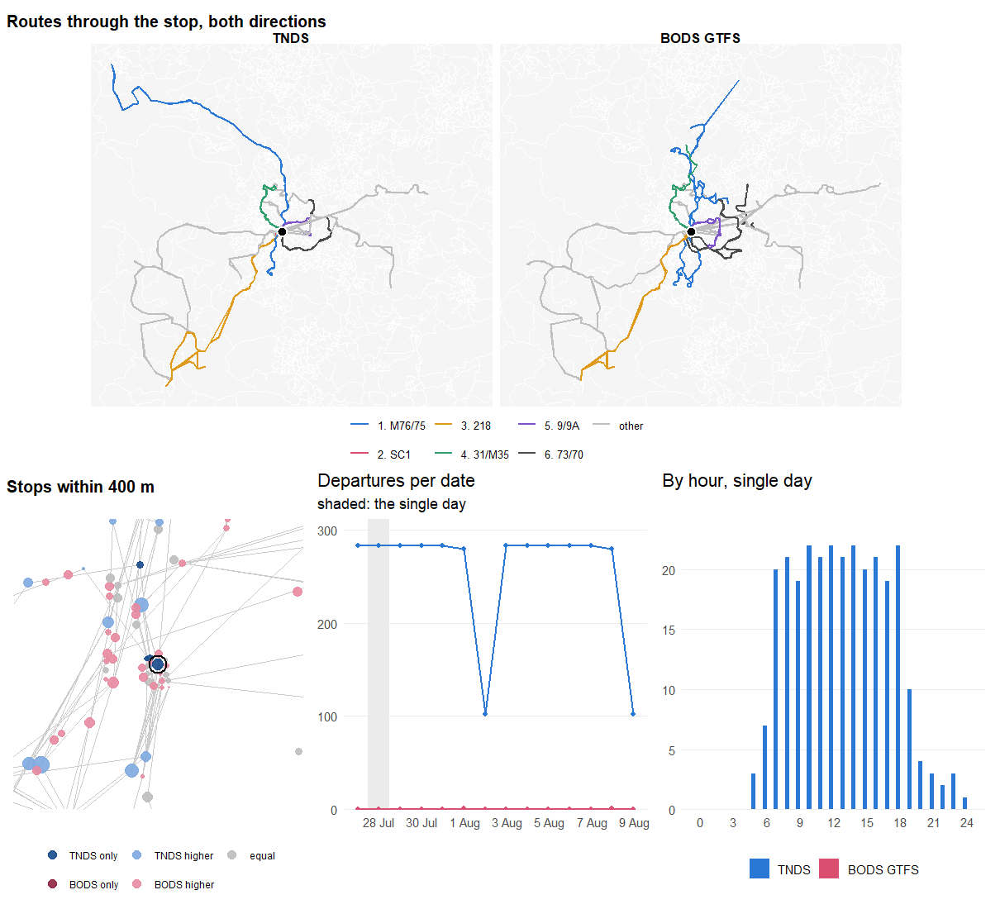

|TNDS route      |BODS route           |Operator             |From → to                                            | TNDS here| BODS here| Matched|Last date T / B         |
|:---------------|:--------------------|:--------------------|:----------------------------------------------------|---------:|---------:|-------:|:-----------------------|
|SC1             |—                    |South Pennine        |Sheffield Interchange/B1 → Sheffield Interchange     |        97|         0|       0|Sun  9 Aug / —          |
|SC2             |—                    |South Pennine        |Sheffield Interchange/A1 → Sheffield Interchange     |        37|         0|       0|Sun  9 Aug / —          |
|218             |218                  |TM Travel            |Square → Sheffield Interchange/D3                    |        23|         0|       0|Sun  9 Aug / —          |
|32              |32                   |TM Travel            |Meadowhall Interchange/D4 → Sheffield Interchange/B6 |        20|         0|       0|Sat  8 Aug / —          |
|31              |31, M35              |TM Travel            |Margetson Crescent/Knutton Road → Sheffield Intercha |        19|         0|       0|Sat  8 Aug / —          |
|9               |9, 9A                |TM Travel            |Mather Road/Mather Avenue → Sheffield Interchange/B6 |        18|         0|       0|Sat  8 Aug / —          |
|71, 71a, 71s    |71, 71A              |TM Travel            |Firvale/Winney Hill → Sheffield Interchange/C5       |        16|         0|       0|Sun  9 Aug / —          |
|70              |70, 73, 70A          |TM Travel            |Meadowhall Interchange/B2 → Sheffield Interchange/C5 |        15|         0|       0|Sat  8 Aug / —          |
|257, 257b, 257a |257, 257B, 257A      |Andrews of Tideswell |Square → Sheffield Interchange/D3                    |        13|         0|       0|Sat  8 Aug / Sat  8 Aug |
|257, 257b, 257a |257, 257B, 772, 257A |Andrews of Tideswell |Sheffield Interchange/D3 → Square                    |        12|         0|       0|Sat  8 Aug / —          |

**3. Coach Station — `1500IM187R`**, Essex, E01035178. TNDS 191, BODS GTFS 0 (day); over the window, TNDS 2,412, BODS GTFS 0.

Shown in full above.

**4. Millburngate Stand D — `13005999D`**, Durham, E01020702. TNDS 187, BODS GTFS 0 (day); over the window, TNDS 2,432, BODS GTFS 0.

Shown in full above.

**5. Coach Station — `1500IM187U`**, Essex, E01035178. TNDS 185, BODS GTFS 0 (day); over the window, TNDS 2,590, BODS GTFS 0.

Shown in full above.

#### BODS only

**1. North Terminal Bus Station — `4400CY0389`**, West Sussex, E01031575. TNDS 0, BODS GTFS 383 (day); over the window, TNDS 0, BODS GTFS 5,160.

Shown in full above.

**2. Interchange — `41000008REGE`**, Tyne and Wear, E01008355. TNDS 0, BODS GTFS 353 (day); over the window, TNDS 0, BODS GTFS 4,486.

Shown in full above.

**3. Naylors Row — `2290YHA00295`**, Kingston upon Hull, E01012809. TNDS 0, BODS GTFS 351 (day); over the window, TNDS 0, BODS GTFS 4,378.

Shown in full above.

**4. Great Union Street — `2290YHA00296`**, Kingston upon Hull, E01012809. TNDS 0, BODS GTFS 351 (day); over the window, TNDS 0, BODS GTFS 4,378.

Shown in full above.

**5. HereEast / The Yard — `490001338Z`**, Greater London, E01001849. TNDS 0, BODS GTFS 310 (day); over the window, TNDS 0, BODS GTFS 3,572.

- TNDS has a route with the same stop sequence as **108, 339, HE** but it does not call at this stop code (310 departures).

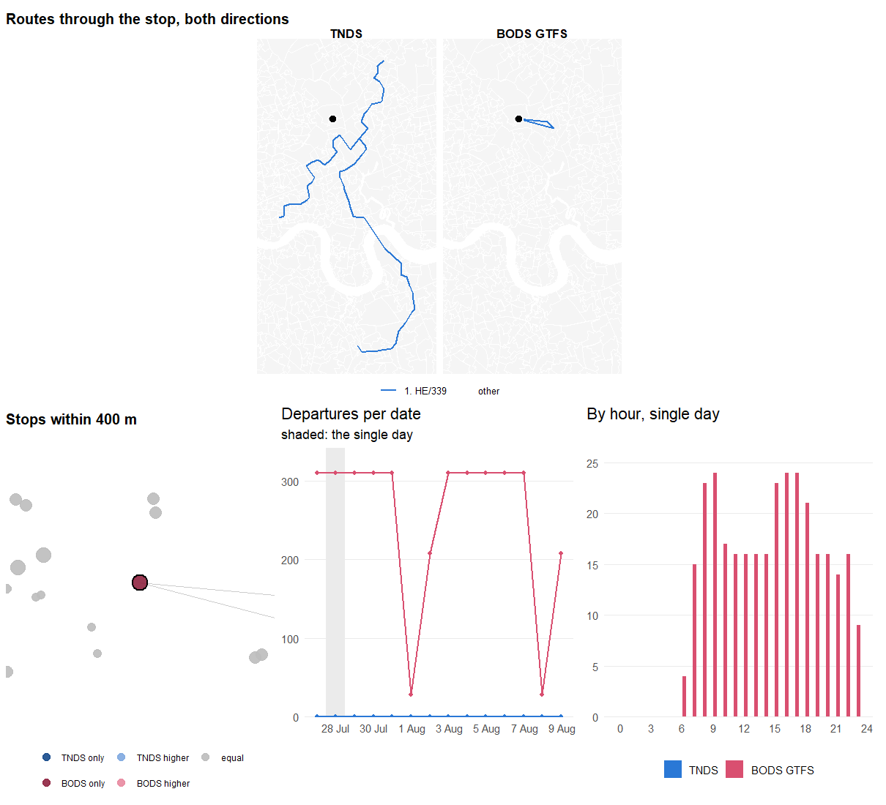

|TNDS route |BODS route |Operator               |From → to                                 | TNDS here| BODS here| Matched|Last date T / B |
|:----------|:----------|:----------------------|:-----------------------------------------|---------:|---------:|-------:|:---------------|
|108, 339   |HE         |Go Ahead Luton Parkway |HereEast / The Yard → HereEast / The Yard |         0|       310|       0|— / Sun  9 Aug  |

#### TNDS higher

**1. Pagnell Avenue — `3200YNA00024`**, North Yorkshire, E01027909. TNDS 552, BODS GTFS 24 (day); over the window, TNDS 6,900, BODS GTFS 300.

Shown in full above.

**2. Regent Centre Temp Stop NB — `410000060407`**, Tyne and Wear, E01008355. TNDS 482, BODS GTFS 65 (day); over the window, TNDS 5,928, BODS GTFS 820.

Shown in full above.

**3. Imperial Arcade — `149000006355`**, Brighton and Hove, E01016969. TNDS 495, BODS GTFS 85 (day); over the window, TNDS 6,630, BODS GTFS 1,145.

Shown in full above.

**4. Regent Centre-Temp SB — `410000060406`**, Tyne and Wear, E01008355. TNDS 403, BODS GTFS 45 (day); over the window, TNDS 5,132, BODS GTFS 600.

Shown in full above.

**5. Stevenage Railway Station — `210021200945`**, Hertfordshire, E01035570. TNDS 577, BODS GTFS 242 (day); over the window, TNDS 7,878, BODS GTFS 2,952.

Shown in full above.

#### BODS higher

**1. Park Street — `43000202301`**, West Midlands, E01033615. TNDS 740, BODS GTFS 1,354 (day); over the window, TNDS 9,594, BODS GTFS 16,224.

- Routes in both (50, 50A, 65, 97, 97A, 4 and 7 more): 735 journeys match within 5 minutes; 5 TNDS and 619 BODS GTFS journeys have no counterpart.

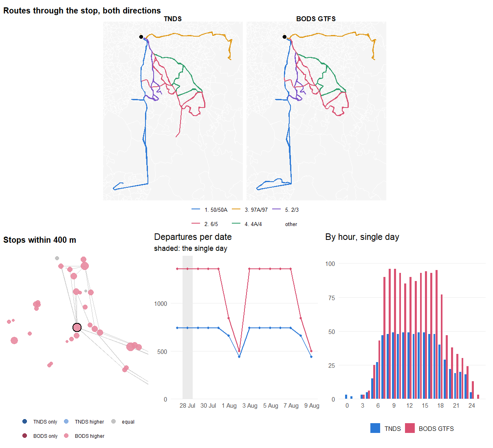

|TNDS route  |BODS route |Operator                       |From → to                                  | TNDS here| BODS here| Matched|Last date T / B         |
|:-----------|:----------|:------------------------------|:------------------------------------------|---------:|---------:|-------:|:-----------------------|
|50, 50A, 65 |50, 50A    |National Express West Midlands |Druids Heath Terminus → Moor St Selfridges |       234|       406|     233|Sun  9 Aug / Sun  9 Aug |
|97, 97A     |97, 97A    |National Express West Midlands |Chester Road → Church Centre               |       134|       261|     132|Sun  9 Aug / Sun  9 Aug |
|6, 76, 519  |6, 76      |National Express West Midlands |Solihull Town Centre → Moor Street Station |       103|       228|     102|Sun  9 Aug / Sun  9 Aug |
|4, 4A       |4, 4A      |National Express West Midlands |Solihull Station → Church Centre           |       139|       240|     138|Sun  9 Aug / Sun  9 Aug |
|3, 2        |2, 3       |National Express West Midlands |Maypole Shops → Moor Street Station        |        98|       164|      98|Sun  9 Aug / Sun  9 Aug |
|5           |5          |National Express West Midlands |Solihull Town Centre → Moor Street Station |        32|        55|      32|Sun  9 Aug / Sun  9 Aug |
|6, 5        |6, 5       |National Express West Midlands |Moor Street Station → Solihull Town Centre |         0|         0|       0|— / —                   |
|4, 4A       |4, 4A      |National Express West Midlands |Church Centre → Solihull Station           |         0|         0|       0|— / —                   |
|97, 97A     |97, 97A    |National Express West Midlands |Church Centre → Chester Road               |         0|         0|       0|— / —                   |
|50, 50A     |50, 50A    |National Express West Midlands |Moor St Selfridges → Druids Heath Terminus |         0|         0|       0|— / —                   |

**2. Castle Hill — `43000874601`**, West Midlands, E01009757. TNDS 166, BODS GTFS 759 (day); over the window, TNDS 2,064, BODS GTFS 9,250.

Shown in full above.

**3. Keighley Bus Station Entrance — `450026807`**, West Yorkshire, E01010710. TNDS 4, BODS GTFS 550 (day); over the window, TNDS 50, BODS GTFS 6,860.

Shown in full above.

**4. Birmingham Coach Station — `43000211301`**, West Midlands, E01034947. TNDS 814, BODS GTFS 1,340 (day); over the window, TNDS 10,646, BODS GTFS 16,400.

- Routes in both (97, 97A, 4, 4A, 6, 76 and 10 more): 809 journeys match within 5 minutes; 5 TNDS and 531 BODS GTFS journeys have no counterpart.

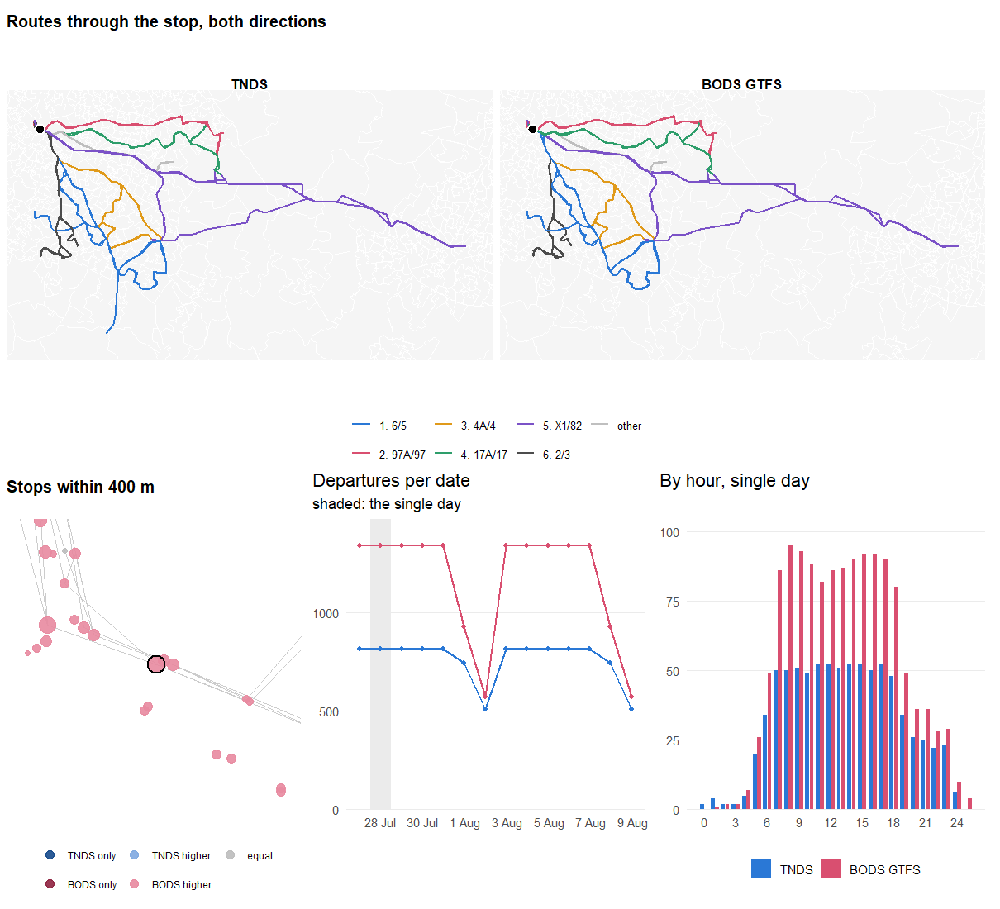

|TNDS route |BODS route |Operator                       |From → to                                            | TNDS here| BODS here| Matched|Last date T / B         |
|:----------|:----------|:------------------------------|:----------------------------------------------------|---------:|---------:|-------:|:-----------------------|
|97, 97A    |97, 97A    |National Express West Midlands |Chester Road → Church Centre                         |       134|       261|     132|Sun  9 Aug / Sun  9 Aug |
|6, 76, 519 |6, 76      |National Express West Midlands |Solihull Town Centre → Moor Street Station           |       103|       228|     102|Sun  9 Aug / Sun  9 Aug |
|4, 4A      |4, 4A      |National Express West Midlands |Solihull Station → Church Centre                     |       139|       240|     138|Sun  9 Aug / Sun  9 Aug |
|17A, 17    |17A, 17    |National Express West Midlands |Birmingham International Station → Moor St Selfridge |        90|       174|      90|Sun  9 Aug / Sun  9 Aug |
|3, 2       |2, 3       |National Express West Midlands |Maypole Shops → Moor Street Station                  |        98|       164|      98|Sun  9 Aug / Sun  9 Aug |
|5          |5          |National Express West Midlands |Solihull Town Centre → Moor Street Station           |        32|        55|      32|Sun  9 Aug / Sun  9 Aug |
|X1, X2, 82 |X1, X2, 82 |National Express Coventry      |Pool Meadow Bus Station → Dale House                 |       110|       110|     109|Sun  9 Aug / Sun  9 Aug |
|60         |60         |National Express West Midlands |Mapledene Road → Moor St Selfridges                  |       108|       108|     108|Sun  9 Aug / Sun  9 Aug |
|6, 5       |6, 5       |National Express West Midlands |Moor Street Station → Solihull Town Centre           |         0|         0|       0|— / —                   |
|4, 4A      |4, 4A      |National Express West Midlands |Church Centre → Solihull Station                     |         0|         0|       0|— / —                   |

**5. Bus Mall — `43000202104`**, West Midlands, E01033561. TNDS 762, BODS GTFS 1,287 (day); over the window, TNDS 9,962, BODS GTFS 15,380.

- Routes in both (6, 5, 97, 97A, 4, 4A and 9 more): 754 journeys match within 5 minutes; 8 TNDS and 533 BODS GTFS journeys have no counterpart.

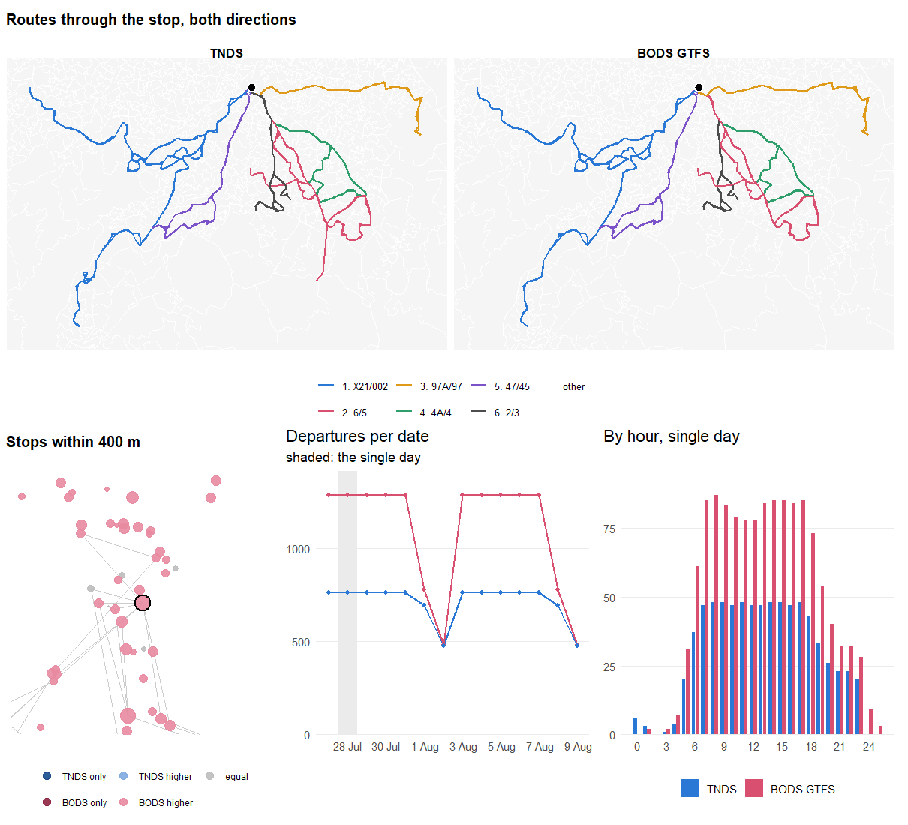

|TNDS route             |BODS route         |Operator                       |From → to                                   | TNDS here| BODS here| Matched|Last date T / B         |
|:----------------------|:------------------|:------------------------------|:-------------------------------------------|---------:|---------:|-------:|:-----------------------|
|6, 5                   |6, 5               |National Express West Midlands |Moor Street Station → Solihull Town Centre  |       135|       294|     133|Sun  9 Aug / Sun  9 Aug |
|97, 97A                |97, 97A            |National Express West Midlands |Church Centre → Chester Road                |       132|       273|     131|Sun  9 Aug / Sun  9 Aug |
|4, 4A                  |4, 4A              |National Express West Midlands |Church Centre → Solihull Station            |       140|       260|     138|Sun  9 Aug / Sun  9 Aug |
|X22, X21, 002, X20, 90 |X22, X21, 002, X20 |National Express West Midlands |The Square Peg → Bartley Green War Memorial |       131|       236|     130|Sun  9 Aug / Sun  9 Aug |
|47, 45                 |47, 45             |National Express West Midlands |Carrs Lane → Longbridge Island              |       126|       126|     125|Sun  9 Aug / Sun  9 Aug |
|3, 2                   |3, 2               |National Express West Midlands |Moor Street Station → Slade Lane            |        98|        98|      97|Sun  9 Aug / Sun  9 Aug |
|6, 76, 519             |6, 76              |National Express West Midlands |Solihull Town Centre → Moor Street Station  |         0|         0|       0|— / —                   |
|4, 4A                  |4, 4A              |National Express West Midlands |Solihull Station → Church Centre            |         0|         0|       0|— / —                   |
|47, 45                 |47, 45             |National Express West Midlands |Longbridge Island → Carrs Lane              |         0|         0|       0|— / —                   |
|5                      |5                  |National Express West Midlands |Solihull Town Centre → Moor Street Station  |         0|         0|       0|— / —                   |

"TNDS here" and "BODS here" are departures at the stop itself in the period. A
route can show zero there and still be drawn: it is the opposite direction, or
the other source's matching route, which calls at a neighbouring stop code
instead. "Matched" counts journeys found in both within the tolerance; "Last
date" is the last date in the window on which the group calls at the stop.
