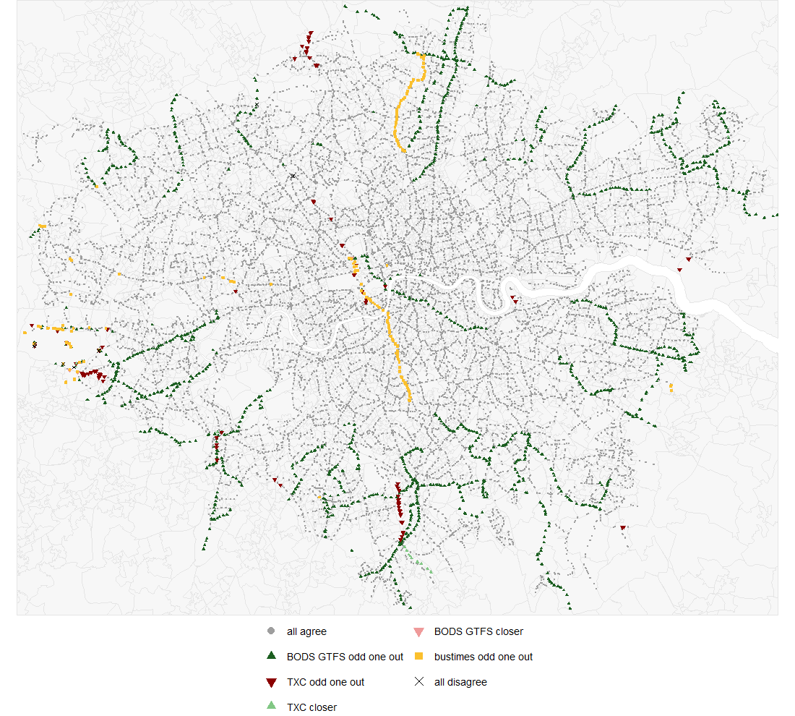
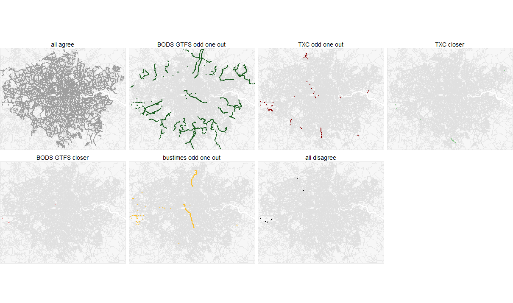
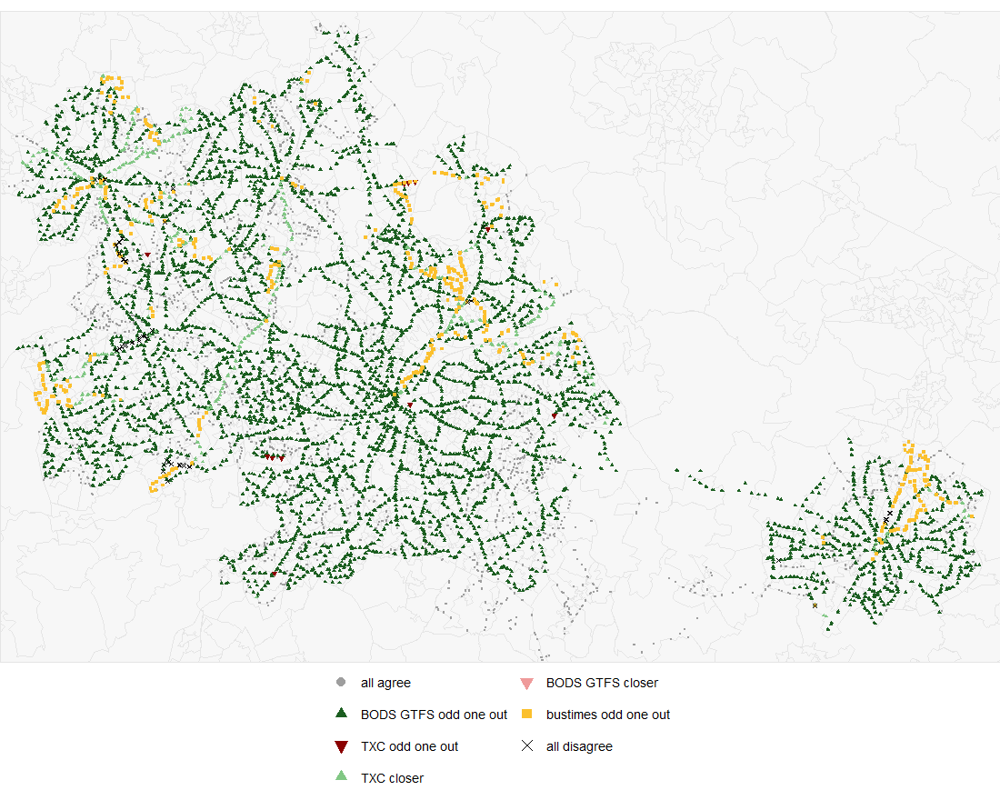
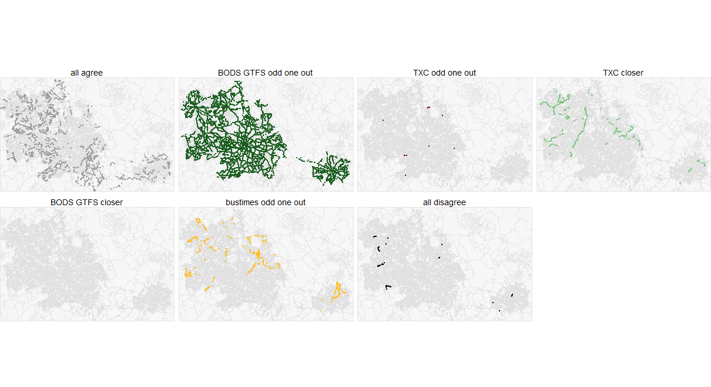
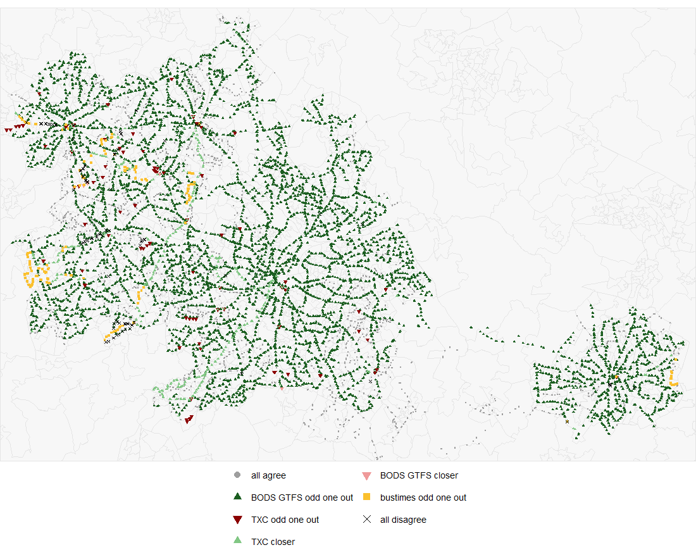
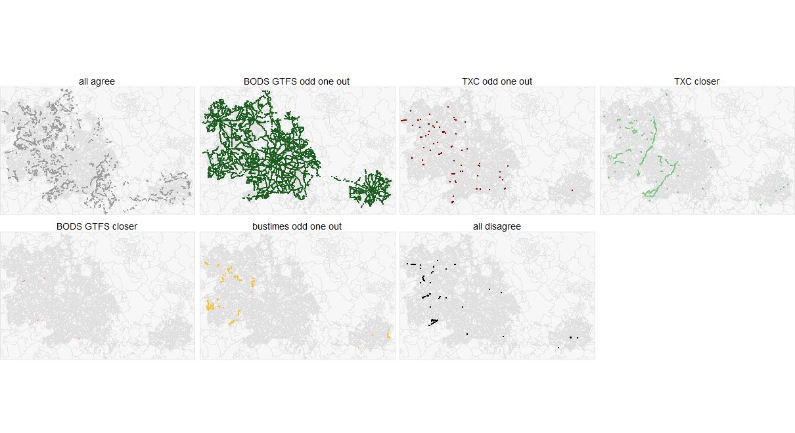

# Who is right? London and the West Midlands, stop by stop, on Thursday 19 November 2026

The [stop report](stop_disagreement.md) shows where TNDS and the DfT's BODS
GTFS disagree. It cannot say which one is right. The UK2GTFS filter work of
November closed many route-level gaps, yet the overall amount of disagreement
hardly moved. This report adds a referee to settle which side is wrong:
[bustimes.org](https://bustimes.org), a third, independent rendering of the
same timetables.

The comparison is on one day and in two cities:

- **London.** The DfT builds BODS GTFS from TNDS here, so BODS GTFS and the
  TNDS feed UK2GTFS converts start from the same TransXChange.
- **The West Midlands county.** BODS GTFS is built from the operators' own
  BODS TransXChange. This is compared twice:
  - with the same BODS TransXChange converted by UK2GTFS, which is the same
    data through a different converter;
  - with TNDS, which is different data through the same converter.

## Summary

Table: Bus departures on Thursday 19 November 2026 summed over every stop in each city

|City          |  Stops| bustimes.org|      TNDS| BODS TransXChange| BODS GTFS|
|:-------------|------:|------------:|---------:|-----------------:|---------:|
|West Midlands | 11,345|      854,385|   877,253|           885,737| 1,668,693|
|London        | 19,056|    4,016,406| 4,048,232|           186,271| 4,261,665|

Table: Share of each city's served stops in each category

|Category              | London: TNDS| West Midlands: BODS TransXChange| West Midlands: TNDS|
|:---------------------|------------:|--------------------------------:|-------------------:|
|all agree             |          88%|                              21%|                 21%|
|BODS GTFS odd one out |          10%|                              68%|                 72%|
|TXC odd one out       |           0%|                               0%|                  1%|
|TXC closer            |           0%|                               4%|                  4%|
|BODS GTFS closer      |           0%|                               0%|                  0%|
|bustimes odd one out  |           1%|                               5%|                  2%|
|all disagree          |           0%|                               0%|                  1%|

**When the two GTFS disagree, it is BODS GTFS that is usually wrong, in both
cities.**

- **The TransXChange conversions match bustimes.org.**
  - TNDS is within 0.8% of bustimes.org's
    total in London and 2.7% in the West
    Midlands.
  - BODS TransXChange is within 3.7% in
    the West Midlands.
- **BODS GTFS is 6% over in London and
  95% over in the West Midlands.**
- **Dark green is by far the largest disagreement category everywhere.** These
  are stops where bustimes.org and the TransXChange conversion agree and BODS
  GTFS does not:
  - 10% of London's stops;
  - 68% and 72% of
    the West Midlands' stops on the two maps.
- **Red, where BODS GTFS is right and the conversion is wrong, is rare.** It is
  1% of stops or less on every map.

So the filter work did its job. What it cannot remove is the disagreement
that comes from BODS GTFS itself.

**BODS GTFS is wrong in a different way in each city:**

- **London: duplicated versions of individual routes.** BODS GTFS carries
  two or three copies of individual routes, such as the 358, 466, 370 and 279.
  These are the version duplicates the DfT pipeline keeps. Its excess is
  209,000 departures at dark green stops, nearly all of its 245,000 surplus
  over bustimes.org.
- **West Midlands: the operator handover.** National Express West Midlands
  and National Express Coventry handed their networks to West Midlands Bus on
  1 November. On 19 November BODS GTFS still runs every National Express
  journey (726,000 departures) alongside the West Midlands Bus timetable that
  replaced it. That doubles almost every stop in the county.

**Yellow (both feeds agree, bustimes.org differs) is small, and splits two
ways:**

- **Both feeds wrong in the same way.** Routes run twice in TNDS, and so in
  BODS GTFS too, which in London is built from it. Late-published National
  Express timetables also appear in both of the 18 November BODS feeds.
- **bustimes.org lacks a service** at a handful of West Midlands stops.

The detail is in each city's section below.

## How the comparison was made

### The day and the snapshots

All three feeds were downloaded on the morning of Wednesday 18 November 2026:

- the TNDS regional archives;
- the BODS TransXChange bulk archive;
- the DfT's BODS GTFS.

TNDS and BODS TransXChange were converted with the current UK2GTFS (filter
round 8o), in the same way as the 11 November feeds in the
[GTFS iteration report](gtfs_iteration_nov2026.md). Each feed's departures on
Thursday 19 November 2026 were counted per NaPTAN stop. The rules are those of
`gtfs_stop_frequency()`:

- every stop-time counts, including the interpolated times at non-timing
  points;
- a trip that calls twice at a stop counts twice;
- frequency-based trips count once per implied departure;
- bus only (route type 3).

The day had to be one bustimes.org could still show, because it offers only
dates from today onwards. The start of November was therefore out of reach,
and 19 November is the first day after the snapshot. Starting so close to the
download matters because TNDS has no forward horizon (see the
[investigation](tnds_conversion_investigation.md)). Its registrations start
running out within a week of an extract, and a later day would have counted
that run-out as a TNDS shortfall.

### bustimes.org

bustimes.org reads BODS and TNDS itself and draws a dated timetable for every
service. Each grid has one row per stop, every stop including the ones hidden
behind its "All stops" switch, linked to the stop's ATCO code.

`scripts/bustimes/` fetched the 19 November page of every bus service
bustimes.org lists for its London and West Midlands regions. It then fetched
the services it found on the stop pages of every stop where a feed runs buses
but those pages had none, which covers services registered in a neighbouring
region. It counts the time cells in each stop's row:

- A time marked "set down only" counts, because it is still a stop-time in
  GTFS.
- A call after midnight (`00:15⁺¹`) by a journey that started before midnight
  counts. GTFS writes it as 24:15 on the same service day.
- A journey that runs wholly after midnight does not count. That is a night
  bus whose first call is already marked ⁺¹.

bustimes.org's page for a date shows two sets of night journeys. The previous
night's (00:23, unmarked) start on that calendar date. That night's (00:23⁺¹,
TransXChange `DepartureDayShift`) belong to that day's service. A GTFS service
day holds only one set, so counting both would double every night route.
Leaving them out removed 3,621 journeys, about 182,000 calls.

bustimes.org is not ground truth. It applies its own rules to the same
TransXChange: which version is current, bank holidays, and duplicates
between BODS and TNDS. It is a third reading by a mature, widely used
converter that shares no code with either of the others. Where it agrees
with one feed against the other, that feed is very probably right.

The scrape covered 1,562 services. 1,562 pages were fetched;
1,431 had a timetable on the day and 131 had no journeys
that day. Some stops have feed departures but no bustimes.org departures:
25 in London and 138 in the West Midlands.
They are included and are classified like any other stop. A stop where
bustimes.org has nothing but both feeds have buses is yellow, which is where
the scrape's gaps show.

### The seven categories

Two counts **agree** when they are within 2 departures or
10% of the larger, whichever is more generous. Each stop
is then placed in one of seven categories, using bustimes.org (B), BODS GTFS
(G) and the TransXChange-converted feed (T):

| | Colour | Rule |
|---|---|---|
| 1 | grey | B, G and T all agree |
| 2 | dark green | B and T agree, G does not |
| 3 | dark red | B and G agree, T does not |
| 4 | light green | no pair agrees; T is closer to B, at most half G's distance |
| 5 | light red | no pair agrees; G is closer to B, at most half T's distance |
| 6 | yellow | G and T agree, B does not |
| 7 | black | no pair agrees and neither feed is clearly closer |

Green means the TransXChange conversion is right and BODS GTFS is wrong. Red
means the reverse. On the maps, green stops are triangles pointing up, red
stops are triangles pointing down, yellow stops are squares and black stops
are crosses, so the categories can be told apart without colour. Stops no
source serves on the day are left out.

## London: BODS GTFS against TNDS

In London the DfT builds BODS GTFS from TNDS, so the two feeds should be the
same timetable. Any difference between them comes from the converters or from
the date each was taken, not from the data.

Table: London, TXC feed = TNDS: stops per category, and departures summed over those stops

|Category                                    |  Stops| Share| bustimes.org| BODS GTFS|  TXC feed|
|:-------------------------------------------|------:|-----:|------------:|---------:|---------:|
|1. All agree                                | 16,791| 88.1%|    3,415,571| 3,426,342| 3,422,622|
|2. bustimes + TXC agree, BODS GTFS differs  |  1,935| 10.2%|      517,620|   726,415|   518,594|
|3. bustimes + BODS GTFS agree, TXC differs  |     93|  0.5%|        8,970|     8,941|     9,395|
|4. None agree, TXC closer to bustimes       |     21|  0.1%|        2,909|     4,814|     3,371|
|5. None agree, BODS GTFS closer to bustimes |      4|  0.0%|          303|       515|       655|
|6. TXC + BODS GTFS agree, bustimes differs  |    203|  1.1%|       69,239|    91,990|    91,880|
|7. All significantly disagree               |      9|  0.0%|        1,794|     2,648|     1,715|

London is mostly grey: 88% of stops agree in
all three sources. The rest is concentrated, not scattered.

- **Dark green (10%).** These stops run along
  whole routes, mostly in outer London: the 358 from Crystal Palace to Orpington,
  the 466, the 370, the 279. Along each one, BODS GTFS has two or three times
  the departures that TNDS and bustimes.org agree on. In London, BODS GTFS is
  built from TNDS, so the difference is the DfT's processing. Its pipeline
  has no file versioning, so when TfL publishes a new version of a route
  under a new service code, both versions run. UK2GTFS's filter removes the
  superseded one.
- **Yellow (1%).** This is mostly two routes
  that TNDS itself runs twice on 19 November:
  - the 2 is registered by both Arriva London North and Arriva London South;
  - the 329 has two versions, one to Turnpike Lane and one to Wood Green.

  Both are overlapping registrations from an operator transfer and a route
  change. bustimes.org shows one, and the two GTFS, which share the TNDS
  source, both show two. Here the TransXChange is the problem, not either
  converter. The rest of the yellow is short sections of busy routes where
  bustimes.org has slightly more departures. These are mostly short workings
  and stand changes, and they are within a few percent on the route as a whole.
- **Dark red (0.5%).** These are routes
  present in the UK2GTFS TNDS conversion and absent from both other sources,
  such as H21 and 243, or the reverse, such as 757. A route that both bustimes.org
  and BODS GTFS lack may be a registration that has ended but that UK2GTFS
  still treats as current. These were not traced further.

The two night-bus rules matter most in London. Before journeys run wholly
after midnight were left out of the bustimes.org count, every N route was
yellow at exactly twice the feeds' count.

**2. bustimes + TXC agree, BODS GTFS differs** - the lines that differ most at these stops, with their departures summed over those stops:

|Line |Operator            | Stops| bustimes.org| BODS GTFS| TXC feed|
|:----|:-------------------|-----:|------------:|---------:|--------:|
|358  |Metrobus            |   152|       13,524|    41,414|   13,524|
|466  |Arriva London South |    90|        8,548|    31,450|    8,548|
|279  |Arriva London North |    92|       11,583|    26,203|   11,583|
|370  |Arriva London North |    71|        6,623|    18,130|    6,623|
|453  |Go Ahead London     |    75|       11,324|    22,648|   11,324|
|96   |Arriva London North |    77|       10,189|    20,353|   10,189|
|235  |London United       |    79|       10,120|    20,240|   10,120|
|K3   |London United       |    56|        3,870|    11,808|    3,870|

The stops with the largest differences:

|Stop                        |ATCO code    | bustimes.org| BODS GTFS| TXC feed|
|:---------------------------|:------------|------------:|---------:|--------:|
|Coombe Road                 |490005574V   |          792|     1,179|      792|
|Coombe Road                 |490005574S   |          784|     1,165|      784|
|Croydon Flyover             |490005855C15 |          518|       899|      518|
|Park Street                 |490010839C3  |          665|     1,046|      665|
|Aberdeen Road South Croydon |490013269S   |          784|     1,165|      784|
|Lebanon Road Tram Stop      |490002052E   |          367|       711|      367|
|Sandilands Tram Stop        |490002072B   |          367|       711|      367|
|Valley Walk                 |490002279ZZ  |          458|       802|      458|

**3. bustimes + BODS GTFS agree, TXC differs** - the lines that differ most at these stops, with their departures summed over those stops:

|Line |Operator               | Stops| bustimes.org| BODS GTFS| TXC feed|
|:----|:----------------------|-----:|------------:|---------:|--------:|
|H21  |Diamond Bus South East |    21|            0|         0|      883|
|439  |Metrobus               |    21|          524|       524|    1,084|
|757  |Arriva Beds and Bucks  |    11|          480|       480|        0|
|SL12 |Stagecoach London      |     3|          372|       372|        0|
|243  |Arriva London North    |    15|            0|         0|      224|
|H30  |Diamond Bus South East |     2|          134|       134|        0|
|213  |Go Ahead London        |     1|          108|       105|        0|
|151  |Go Ahead London        |     2|          283|       283|      189|

The stops with the largest differences:

|Stop                                    |ATCO code   | bustimes.org| BODS GTFS| TXC feed|
|:---------------------------------------|:-----------|------------:|---------:|--------:|
|Brabham Court                           |490000283N  |          206|       203|        0|
|Ferry Lane / Coldharbour Lane           |490002508LF |          186|       186|        0|
|Heathrow Terminal 5                     |49001643020 |          135|       138|        9|
|Lamson Road / Rainham Station Southside |490002507LR |           93|        93|        0|
|Lamson Road / Rainham Station Southside |490002507RL |           93|        93|        0|
|Heathrow Terminal 4                     |4900001049  |            0|         0|       80|
|Green Line Coach Station                |4900074806  |           80|        80|        0|
|Waye Avenue                             |490005704W  |          621|       621|      551|

**4. None agree, TXC closer to bustimes** - the lines that differ most at these stops, with their departures summed over those stops:

|Line |Operator               | Stops| bustimes.org| BODS GTFS| TXC feed|
|:----|:----------------------|-----:|------------:|---------:|--------:|
|407  |Transport UK           |    16|        1,496|     2,712|    1,496|
|490  |Transport UK           |     2|          195|       355|      195|
|446  |White Bus Services     |     2|            0|       108|       69|
|216  |London United          |     1|            0|        98|        0|
|294  |Stagecoach London      |     1|           85|       158|       85|
|411  |London United          |     1|            0|        53|        0|
|B1   |First Essex            |     1|            0|        40|       40|
|H2X  |Diamond Bus South East |     1|           76|       114|       38|

The stops with the largest differences:

|Stop                |ATCO code   | bustimes.org| BODS GTFS| TXC feed|
|:-------------------|:-----------|------------:|---------:|--------:|
|Kingston Station    |490001173Q  |          293|       441|      250|
|Heathrow Terminal 3 |490008026WH |          206|       366|      185|
|Heathrow Terminal 4 |490000104E  |          194|       342|      239|
|Scylla Road         |490011963W  |          202|       322|      235|
|Harold Wood Station |490001137A  |          190|       303|      230|
|Devon Close         |490006064N  |          119|       197|      144|
|Foxley Hill Road    |490006975NB |          148|       226|      173|
|Garston Lane        |490007129N  |          119|       197|      144|

**5. None agree, BODS GTFS closer to bustimes** - the lines that differ most at these stops, with their departures summed over those stops:

|Line |Operator                            | Stops| bustimes.org| BODS GTFS| TXC feed|
|:----|:-----------------------------------|-----:|------------:|---------:|--------:|
|RA2  |First Berkshire & The Thames Valley |     1|            0|       118|      118|
|H30  |Diamond Bus South East              |     1|            0|         0|      114|
|H21  |Diamond Bus South East              |     2|            0|         0|       80|
|446  |White Bus Services                  |     2|            0|        72|       70|
|757  |Arriva Beds and Bucks               |     1|           40|        40|        0|
|N40  |NATIONAL EXPRESS OPERATIONS LIMITED |     1|            0|         0|        6|
|N30  |Diamond Bus South East              |     1|            0|         0|        4|
|203  |London United                       |     2|          110|       112|      110|

The stops with the largest differences:

|Stop                               |ATCO code   | bustimes.org| BODS GTFS| TXC feed|
|:----------------------------------|:-----------|------------:|---------:|--------:|
|Heathrow Terminal 5                |49001643012 |          153|       271|      395|
|Animal Reception Centre            |490003332W  |           55|        92|      130|
|Great South West Road East Bedfont |490007415W  |           55|        92|      130|
|Baker Street Station               |490006135S  |           40|        60|        0|

**6. TXC + BODS GTFS agree, bustimes differs** - the lines that differ most at these stops, with their departures summed over those stops:

|Line |Operator                            | Stops| bustimes.org| BODS GTFS| TXC feed|
|:----|:-----------------------------------|-----:|------------:|---------:|--------:|
|2    |Arriva London South                 |    78|        9,833|    19,982|   19,982|
|329  |Arriva London                       |    65|        7,980|    17,080|   17,080|
|A4   |First Berkshire & The Thames Valley |    11|            0|       816|      816|
|102  |Arriva London North                 |     9|            0|       306|      306|
|446  |White Bus Services                  |     7|            0|       252|      241|
|7X   |First Berkshire & The Thames Valley |    10|            0|       247|      247|
|N207 |Transport UK                        |    12|            0|       237|      237|
|RA2  |First Berkshire & The Thames Valley |     5|            0|       234|      234|

The stops with the largest differences:

|Stop                         |ATCO code   | bustimes.org| BODS GTFS| TXC feed|
|:----------------------------|:-----------|------------:|---------:|--------:|
|Norwood Bus Garage           |490010444W  |          638|       895|      895|
|Heathrow Central Bus Station |4900801620  |           58|       286|      291|
|Heathrow Terminal 5          |49001643023 |            0|       181|      181|
|Orchard Street / Selfridges  |490010622L  |          964|     1,112|    1,112|
|Hyde Park Corner             |490000119K  |        1,061|     1,208|    1,208|
|Wilton Street                |490005138N  |        1,061|     1,208|    1,208|
|Grosvenor Gardens (SW1)      |490007544Q  |        1,061|     1,208|    1,208|
|Heathrow Terminal 3          |490008026SS |            0|       145|      145|

**7. All significantly disagree** - the lines that differ most at these stops, with their departures summed over those stops:

|Line |Operator               | Stops| bustimes.org| BODS GTFS| TXC feed|
|:----|:----------------------|-----:|------------:|---------:|--------:|
|490  |Transport UK           |     5|          485|       881|      485|
|703  |Thames Valley Buses    |     1|            0|        86|       86|
|757  |Arriva Beds and Bucks  |     2|           80|       160|        0|
|446  |White Bus Services     |     2|            0|        72|       69|
|H30  |Diamond Bus South East |     2|          130|       130|       58|
|292  |Uno                    |     1|           54|       108|       54|
|H21  |Diamond Bus South East |     1|            0|         0|       40|
|H5H  |Hotel Hoppa            |     1|           71|       110|       39|

The stops with the largest differences:

|Stop                                     |ATCO code   | bustimes.org| BODS GTFS| TXC feed|
|:----------------------------------------|:-----------|------------:|---------:|--------:|
|Heathrow Terminal 5                      |49001643017 |          346|       474|      180|
|Heathrow Terminal 5                      |4900164307  |          153|       345|      269|
|Cargo Centre                             |490004355N  |          294|       378|      223|
|Hatton Cross Station                     |490000103C  |          450|       534|      381|
|Hatton Cross Station                     |490000103E  |          169|       289|      258|
|Scylla Road                              |490011963E  |          194|       306|      267|
|Brent Cross Centre / North Circular Road |490016416J  |           40|        80|        0|
|Brent Cross Centre / North Circular Road |490016416K  |           40|        80|        0|

## West Midlands: BODS GTFS against BODS TransXChange

This is the same operator data through two converters: the DfT's, and
UK2GTFS's with its filtering of superseded and overlapping files.

Table: West Midlands, TXC feed = BODS TransXChange (UK2GTFS)

|Category                                   | Stops| Share| bustimes.org| BODS GTFS| TXC feed|
|:------------------------------------------|-----:|-----:|------------:|---------:|--------:|
|1. All agree                               | 2,406| 21.3%|       48,495|    48,828|   48,541|
|2. bustimes + TXC agree, BODS GTFS differs | 7,724| 68.3%|      714,323| 1,443,566|  715,366|
|3. bustimes + BODS GTFS agree, TXC differs |    11|  0.1%|          326|       319|       21|
|4. None agree, TXC closer to bustimes      |   496|  4.4%|       65,857|   127,694|   75,094|
|6. TXC + BODS GTFS agree, bustimes differs |   611|  5.4%|       21,843|    41,439|   41,190|
|7. All significantly disagree              |    55|  0.5%|        3,541|     6,847|    5,525|

Only 21% of West Midlands stops agree in all
three sources. Dark green covers 68%, which is
nearly every stop West Midlands Bus serves. The grey that remains is mostly
stops served only by smaller operators.

- **Dark green.** BODS GTFS counts each West Midlands Bus stop about twice:
  - once for West Midlands Bus (797,000 departures on the day, already about
    10% more than the 722,000 in the BODS TransXChange conversion);
  - once again for the National Express West Midlands and National Express
    Coventry timetables it replaced (644,000 and 82,000).

  bustimes.org and the UK2GTFS conversion of the same BODS TransXChange have
  only the West Midlands Bus timetable.
- **Light green (4%).** Routes such as the 4,
  4M and 9, where BODS GTFS doubles and the conversion is near but not within
  10% of bustimes.org. The 4H is the exception, and it is unresolved. Both
  TransXChange conversions have about 46 journeys at each stop, while
  bustimes.org shows four journeys each way on 19 November.
- **Yellow (5%).** Mostly a defect in the
  18 November BODS TransXChange archive. It contains National Express West
  Midlands timetables for the 66 and 96 and National Express Coventry ones for
  the 20, 20A and 22. These are valid on 19 November, and both BODS feeds run
  them alongside West Midlands Bus. The 11 November archive did not have them.
  They add 21,000 departures, 2.4% of the county, to the conversion. The rest
  of the yellow is Diamond Bus's 226 and a few Walsall routes (23, 41, 224),
  which both feeds run and bustimes.org does not show on the day.

**2. bustimes + TXC agree, BODS GTFS differs** - the lines that differ most at these stops, with their departures summed over those stops:

|Line |Operator                       | Stops| bustimes.org| BODS GTFS| TXC feed|
|:----|:------------------------------|-----:|------------:|---------:|--------:|
|50   |West Midlands Bus              |    74|       13,406|    43,135|   16,337|
|6    |West Midlands Bus              |   339|       20,375|    48,076|   24,038|
|97   |West Midlands Bus              |    98|            0|    20,070|   10,035|
|11A  |National Express West Midlands |   212|       19,905|    39,830|   19,915|
|63   |West Midlands Bus              |   111|        9,251|    27,774|    9,336|
|9    |West Midlands Bus              |   321|       18,478|    36,819|   18,486|
|14   |West Midlands Bus              |   224|       10,864|    28,478|   14,421|
|11C  |West Midlands Bus              |   136|       16,856|    33,722|   16,861|

The stops with the largest differences:

|Stop                     |ATCO code   | bustimes.org| BODS GTFS| TXC feed|
|:------------------------|:-----------|------------:|---------:|--------:|
|Bus Mall                 |43000202104 |          805|     1,842|      805|
|Smallbrook Queensway     |43000203501 |          677|     1,639|      677|
|Birmingham Coach Station |43000211301 |          863|     1,816|      863|
|Park Street              |43000202301 |          782|     1,679|      782|
|Adderley Street          |43000211504 |          722|     1,534|      722|
|Moor Street Queensway    |43000210101 |          367|     1,101|      367|
|Moor St Selfridges       |43002104302 |          488|     1,204|      488|
|Druids Heath Terminus    |43004171001 |          353|     1,056|      353|

**3. bustimes + BODS GTFS agree, TXC differs** - the lines that differ most at these stops, with their departures summed over those stops:

|Line |Operator              | Stops| bustimes.org| BODS GTFS| TXC feed|
|:----|:---------------------|-----:|------------:|---------:|--------:|
|97A  |West Midlands Bus     |     1|          141|        41|        0|
|17   |West Midlands Bus     |     1|           59|        59|        0|
|17A  |West Midlands Bus     |     1|           34|        34|        0|
|229  |Diamond Bus           |     1|           29|        29|        0|
|55   |Kevs Cars and Coaches |     3|           21|        21|        0|
|78A  |Stagecoach Midlands   |     4|           17|         0|        0|
|182  |Diamond Bus           |     1|            4|         4|        0|
|97   |West Midlands Bus     |     1|            0|       100|        0|

The stops with the largest differences:

|Stop             |ATCO code   | bustimes.org| BODS GTFS| TXC feed|
|:----------------|:-----------|------------:|---------:|--------:|
|Fazeley Street   |43000212602 |          141|       141|        0|
|Railway Bridge   |43000465402 |           93|        93|        0|
|Anchor Rd        |43007280002 |           29|        29|        0|
|Highfield Lane   |43003102502 |            7|         7|        0|
|no. 252          |43003103002 |            7|         7|        0|
|Rickyard Piece   |43003104002 |            7|         7|        0|
|Coleshill Street |43000571501 |           11|        10|        6|
|Longbridge Lane  |43000364301 |            4|         4|        0|

**4. None agree, TXC closer to bustimes** - the lines that differ most at these stops, with their departures summed over those stops:

|Line |Operator                       | Stops| bustimes.org| BODS GTFS| TXC feed|
|:----|:------------------------------|-----:|------------:|---------:|--------:|
|4    |National Express West Midlands |    88|        5,612|    11,646|    6,011|
|59   |West Midlands Bus              |    48|        8,827|    13,814|    6,907|
|4H   |Diamond Bus                    |    97|          350|     4,847|    4,497|
|1    |National Express West Midlands |    51|        6,811|    10,994|    6,448|
|4M   |West Midlands Bus              |    88|        3,780|     7,560|    3,780|
|9    |West Midlands Bus              |    51|        1,902|     3,796|    1,902|
|X4   |West Midlands Bus              |    14|          910|     2,751|      917|
|96   |National Express West Midlands |    56|        1,704|     3,457|    3,457|

The stops with the largest differences:

|Stop                    |ATCO code   | bustimes.org| BODS GTFS| TXC feed|
|:-----------------------|:-----------|------------:|---------:|--------:|
|Barnabas Road           |43000501301 |          325|       735|      397|
|Wilton Road             |43000501503 |          325|       735|      397|
|Barnabas Road           |43000501302 |          325|       730|      391|
|Millennium Point        |43000209402 |          354|       718|      409|
|Matthew Boulton College |43002104402 |          354|       718|      409|
|Millennium Point        |43000209401 |          355|       716|      411|
|Matthew Boulton College |43002104401 |          355|       716|      411|
|The Mount               |43000503804 |          261|       612|      305|

**6. TXC + BODS GTFS agree, bustimes differs** - the lines that differ most at these stops, with their departures summed over those stops:

|Line |Operator                       | Stops| bustimes.org| BODS GTFS| TXC feed|
|:----|:------------------------------|-----:|------------:|---------:|--------:|
|20   |National Express Coventry      |    37|        3,228|     6,879|    6,879|
|66   |National Express West Midlands |    82|        2,294|     5,354|    5,354|
|96   |National Express West Midlands |    87|        2,847|     5,720|    5,720|
|22   |National Express Coventry      |    51|        1,745|     4,243|    4,243|
|20A  |West Midlands Bus              |    49|        2,320|     4,050|    4,050|
|226  |Diamond Bus                    |    60|            0|     1,344|    1,344|
|4H   |Diamond Bus                    |    27|          112|     1,428|    1,316|
|20B  |National Express Coventry      |    38|            0|       943|      943|

The stops with the largest differences:

|Stop               |ATCO code   | bustimes.org| BODS GTFS| TXC feed|
|:------------------|:-----------|------------:|---------:|--------:|
|Sainsbury's        |43000001004 |          211|       488|      488|
|St Lawrence's Road |43000024002 |          233|       401|      399|
|Corporation Street |43000004203 |          256|       422|      422|
|Leicester Row      |43000020101 |          256|       422|      422|
|City Wharf         |43000020202 |          256|       422|      422|
|Broad Street       |43000022401 |          215|       381|      381|
|Station Street     |43000022502 |          215|       381|      381|
|Churchill Avenue   |43000022601 |          215|       381|      381|

**7. All significantly disagree** - the lines that differ most at these stops, with their departures summed over those stops:

|Line |Operator                  | Stops| bustimes.org| BODS GTFS| TXC feed|
|:----|:-------------------------|-----:|------------:|---------:|--------:|
|4H   |Diamond Bus               |    12|           48|       612|      564|
|20   |National Express Coventry |     5|          435|       971|      971|
|3    |West Midlands Bus         |     5|          299|       601|      299|
|226  |Diamond Bus               |    13|            0|       289|      289|
|20A  |West Midlands Bus         |     5|          234|       409|      409|
|12X  |West Midlands Bus         |     1|           34|       202|      104|
|5    |West Midlands Bus         |    13|          130|       260|      130|
|20B  |National Express Coventry |     5|            0|       115|      115|

The stops with the largest differences:

|Stop                      |ATCO code   | bustimes.org| BODS GTFS| TXC feed|
|:-------------------------|:-----------|------------:|---------:|--------:|
|Eagle Street              |43000020301 |          315|       541|      481|
|Honeyfield Road           |43000020501 |          318|       544|      483|
|Honeyfield Road           |43000020502 |          315|       541|      481|
|Tower Court               |43000020601 |          315|       541|      481|
|Tower Court               |43000020603 |          318|       544|      483|
|University Interchange    |43000065302 |           60|       272|      174|
|Wolverhampton Bus Station |43000700114 |           52|       216|      164|
|Red Lion Street           |43000702301 |          210|       274|      144|

## West Midlands: BODS GTFS against TNDS

Table: West Midlands, TXC feed = TNDS (UK2GTFS)

|Category                                    | Stops| Share| bustimes.org| BODS GTFS| TXC feed|
|:-------------------------------------------|-----:|-----:|------------:|---------:|--------:|
|1. All agree                                | 2,357| 20.8%|       47,164|    47,482|   47,187|
|2. bustimes + TXC agree, BODS GTFS differs  | 8,166| 72.0%|      743,066| 1,472,042|  744,080|
|3. bustimes + BODS GTFS agree, TXC differs  |   104|  0.9%|        1,750|     1,768|    1,985|
|4. None agree, TXC closer to bustimes       |   431|  3.8%|       54,205|   129,045|   70,440|
|5. None agree, BODS GTFS closer to bustimes |     6|  0.1%|          183|       255|      333|
|6. TXC + BODS GTFS agree, bustimes differs  |   186|  1.6%|        2,995|     7,950|    7,769|
|7. All significantly disagree               |    95|  0.8%|        5,022|    10,151|    5,459|

With TNDS in place of BODS TransXChange the picture is almost the same.
Dark green covers 72% of stops: BODS GTFS's
double count does not depend on which TransXChange it is compared with.

TNDS does not carry the late National Express timetables, so its yellow is
smaller (2%). Its dark red is a little larger
(0.9%). These are stops where bustimes.org
agrees with the DfT's BODS-based count and not with TNDS, which suggests that
the TNDS registration differs from the BODS one. They were not traced
further.

**2. bustimes + TXC agree, BODS GTFS differs** - the lines that differ most at these stops, with their departures summed over those stops:

|Line |Operator                       | Stops| bustimes.org| BODS GTFS| TXC feed|
|:----|:------------------------------|-----:|------------:|---------:|--------:|
|50   |West Midlands Bus              |    70|       12,863|    41,458|   15,732|
|6    |West Midlands Bus              |   341|       20,543|    48,412|   24,206|
|11A  |National Express West Midlands |   213|       20,076|    40,172|   20,086|
|97   |West Midlands Bus              |    98|            0|    20,070|   10,035|
|9    |West Midlands Bus              |   340|       19,352|    38,672|   19,312|
|14   |West Midlands Bus              |   226|       11,309|    29,395|   14,866|
|11C  |West Midlands Bus              |   139|       17,177|    34,364|   17,182|
|3    |West Midlands Bus              |   365|       16,008|    31,709|   15,999|

The stops with the largest differences:

|Stop                     |ATCO code   | bustimes.org| BODS GTFS| TXC feed|
|:------------------------|:-----------|------------:|---------:|--------:|
|Bus Mall                 |43000202104 |          805|     1,842|      805|
|Birmingham Coach Station |43000211301 |          863|     1,816|      869|
|Park Street              |43000202301 |          782|     1,679|      799|
|Adderley Street          |43000211504 |          722|     1,534|      728|
|Moor St Selfridges       |43002104302 |          488|     1,204|      522|
|Druids Heath Terminus    |43004171001 |          353|     1,056|      350|
|Newhall Street           |43000205207 |          694|     1,382|      694|
|Colmore Row              |43000206202 |          652|     1,304|      652|

**3. bustimes + BODS GTFS agree, TXC differs** - the lines that differ most at these stops, with their departures summed over those stops:

|Line |Operator          | Stops| bustimes.org| BODS GTFS| TXC feed|
|:----|:-----------------|-----:|------------:|---------:|--------:|
|12   |West Midlands Bus |     7|            0|         0|      337|
|50A  |Diamond Bus       |     3|          195|        56|        0|
|27   |Diamond Bus       |     9|           20|        20|      206|
|97A  |West Midlands Bus |     1|          141|        41|        0|
|229  |Diamond Bus       |     6|           29|        29|      142|
|19   |Diamond Bus       |     4|          110|       110|        0|
|45   |West Midlands Bus |     3|           98|        98|        0|
|9    |West Midlands Bus |    11|           96|        96|        0|

The stops with the largest differences:

|Stop                      |ATCO code   | bustimes.org| BODS GTFS| TXC feed|
|:-------------------------|:-----------|------------:|---------:|--------:|
|Fazeley Street            |43000212602 |          141|       141|        0|
|Railway Bridge            |43000465402 |           93|        93|        0|
|West Bromwich Bus Station |43000955901 |            0|         0|       73|
|Birchall Street           |43000211803 |           65|        65|        0|
|Moseley Road              |43000217102 |           65|        65|        0|
|Farquhar Road             |43000219503 |           65|        65|        0|
|Flood Street              |43000875203 |           61|        61|        0|
|Fountain Road             |43000304103 |           51|        51|        0|

**4. None agree, TXC closer to bustimes** - the lines that differ most at these stops, with their departures summed over those stops:

|Line |Operator                       | Stops| bustimes.org| BODS GTFS| TXC feed|
|:----|:------------------------------|-----:|------------:|---------:|--------:|
|63   |West Midlands Bus              |   101|        9,230|    27,678|   13,790|
|61   |West Midlands Bus              |    91|        7,959|    23,795|   12,290|
|4    |National Express West Midlands |    88|        5,656|    11,734|    6,055|
|4H   |Diamond Bus                    |    98|          354|     4,898|    4,544|
|4M   |West Midlands Bus              |    88|        3,780|     7,560|    3,780|
|80   |National Express West Midlands |    40|        3,634|     7,268|    3,142|
|226  |Diamond Bus                    |    54|            0|     1,186|    1,186|
|50   |West Midlands Bus              |     3|          540|     1,667|      679|

The stops with the largest differences:

|Stop                   |ATCO code   | bustimes.org| BODS GTFS| TXC feed|
|:----------------------|:-----------|------------:|---------:|--------:|
|Smallbrook Queensway   |43000203501 |          677|     1,639|      771|
|Moor Street Queensway  |43000210101 |          367|     1,101|      558|
|New Street Station     |43000201703 |          321|       932|      418|
|New Street Station     |43000201702 |          316|       917|      410|
|Albert Street          |43000206801 |          316|       917|      410|
|South and City College |43001341701 |          321|       839|      382|
|College Walk           |43000352101 |          235|       705|      329|
|Farquhar Road          |43000219502 |          253|       685|      335|

**5. None agree, BODS GTFS closer to bustimes** - the lines that differ most at these stops, with their departures summed over those stops:

|Line |Operator              | Stops| bustimes.org| BODS GTFS| TXC feed|
|:----|:---------------------|-----:|------------:|---------:|--------:|
|229  |Diamond Bus           |     2|            0|         0|       56|
|23   |West Midlands Bus     |     1|            0|        20|       20|
|23A  |Carolean Coaches      |     1|            0|        18|       18|
|50A  |Diamond Bus           |     1|           20|        20|       37|
|224  |Carolean Coaches      |     2|            0|        16|       16|
|147  |Kevs Cars and Coaches |     1|            0|        11|       11|
|192  |Diamond Bus           |     1|           11|        11|       22|
|50   |West Midlands Bus     |     1|            3|        10|        4|

The stops with the largest differences:

|Stop                   |ATCO code   | bustimes.org| BODS GTFS| TXC feed|
|:----------------------|:-----------|------------:|---------:|--------:|
|Wednesbury Bus Station |43000974412 |            0|        48|      101|
|Wednesbury Bus Station |43000974405 |           73|        63|       10|
|Hall Lane              |43000728201 |            8|        16|       44|
|Rowan Road             |43000852102 |            8|        16|       44|
|Halesowen Bus Station  |43000804705 |           58|        69|       80|
|Maypole Island         |43000418601 |           36|        43|       54|

**6. TXC + BODS GTFS agree, bustimes differs** - the lines that differ most at these stops, with their departures summed over those stops:

|Line |Operator                       | Stops| bustimes.org| BODS GTFS| TXC feed|
|:----|:------------------------------|-----:|------------:|---------:|--------:|
|226  |Diamond Bus                    |    60|            0|     1,344|    1,344|
|4H   |Diamond Bus                    |    23|           96|     1,224|    1,128|
|41   |National Express West Midlands |    24|            0|       587|      587|
|10   |National Express West Midlands |    15|          373|       746|      671|
|23   |West Midlands Bus              |    24|            0|       274|      274|
|23A  |Carolean Coaches               |    24|            0|       273|      273|
|10A  |West Midlands Bus              |    14|          266|       532|      532|
|85   |Stagecoach Midlands            |    15|          176|       336|      336|

The stops with the largest differences:

|Stop                      |ATCO code   | bustimes.org| BODS GTFS| TXC feed|
|:-------------------------|:-----------|------------:|---------:|--------:|
|Walsall Town Hall         |43000602101 |          260|       484|      489|
|Mendip Road               |43000809502 |            8|       102|       94|
|West Bromwich Bus Station |43000955905 |           87|       174|      173|
|Wulfrun Centre            |43000701103 |          213|       280|      278|
|Red Lion Street           |43000702301 |          210|       274|      248|
|Bilston Bus Station       |43000717907 |           52|       106|      109|
|Halesowen Bus Station     |43000804707 |           60|       110|      106|
|Bramstead Avenue          |43000743301 |           48|        96|       90|

**7. All significantly disagree** - the lines that differ most at these stops, with their departures summed over those stops:

|Line |Operator                       | Stops| bustimes.org| BODS GTFS| TXC feed|
|:----|:------------------------------|-----:|------------:|---------:|--------:|
|4H   |Diamond Bus                    |    16|           64|       816|      752|
|12   |West Midlands Bus              |     7|          337|       625|        0|
|226  |Diamond Bus                    |    13|            0|       289|      289|
|10   |National Express West Midlands |    12|          281|       562|      562|
|10A  |West Midlands Bus              |    12|          247|       494|      494|
|12X  |West Midlands Bus              |     1|           34|       202|       98|
|34   |West Midlands Bus              |     2|          155|       310|       51|
|11A  |National Express West Midlands |     2|          150|       300|        0|

The stops with the largest differences:

|Stop                   |ATCO code   | bustimes.org| BODS GTFS| TXC feed|
|:----------------------|:-----------|------------:|---------:|--------:|
|Castle Hill            |43000874601 |          486|       863|       59|
|Walsall Town Hall      |43000602102 |          235|       425|        0|
|Shenstone Road         |43000289701 |          104|       307|        0|
|Walsall Bus Station    |43000601110 |          198|       352|      105|
|Camp Lane              |43000400101 |           21|       152|      248|
|Railway Bridge         |43000680201 |          108|       216|        0|
|University Interchange |43000065302 |           60|       272|      168|
|Bilston Bus Station    |43000717906 |          151|       280|       78|

### TNDS or BODS TransXChange: what the choice of source costs

Both West Midlands maps share bustimes.org and BODS GTFS. The only change
between them is the TransXChange UK2GTFS converted. A stop that changes
colour between the two maps is a stop where the choice of source, rather
than the converter, decides the answer.

Table: West Midlands stops: category on the BODS TransXChange map (rows) against the TNDS map (columns)

|BODS TransXChange map | BODS GTFS closer| BODS GTFS odd one out| TXC closer| TXC odd one out| all agree| all disagree| bustimes odd one out|
|:---------------------|----------------:|---------------------:|----------:|---------------:|---------:|------------:|--------------------:|
|NA                    |                0|                     0|          0|              36|         6|            0|                    0|
|BODS GTFS odd one out |                2|                  7429|        219|               1|         1|           42|                   30|
|TXC closer            |                0|                   284|        210|               0|         0|            1|                    1|
|TXC odd one out       |                0|                     0|          0|               7|         4|            0|                    0|
|all agree             |                0|                     0|          0|              60|      2346|            0|                    0|
|all disagree          |                0|                    11|          1|               0|         0|           42|                    1|
|bustimes odd one out  |                4|                   442|          1|               0|         0|           10|                  154|

90% of West Midlands stops have the same colour on both maps.

The largest moves are between yellow and dark green, and between light and
dark green:

- **Yellow on the BODS TransXChange map, dark green on the TNDS map.** These
  are the National Express timetables that are in the 18 November BODS archive
  and not in TNDS.
- **Light green ↔ dark green.** These are routes where one TransXChange source
  is just inside the 10% rule and the other just outside it.

Neither move changes the answer to "which GTFS is wrong". For the West
Midlands, the two TransXChange sources are interchangeable as a check on BODS
GTFS.

## How much the snapshot date matters

Table: Share of stops per category with the 11 November feeds and with the 18 November feeds, both counted on 19 November against the same bustimes.org scrape

|Category                                    |London: TNDS 11 Nov |London: TNDS 18 Nov |West Midlands: BODS TransXChange 11 Nov |West Midlands: BODS TransXChange 18 Nov |West Midlands: TNDS 11 Nov |West Midlands: TNDS 18 Nov |
|:-------------------------------------------|:-------------------|:-------------------|:---------------------------------------|:---------------------------------------|:--------------------------|:--------------------------|
|1. All agree                                |88%                 |88%                 |21%                                     |21%                                     |21%                        |21%                        |
|2. bustimes + TXC agree, BODS GTFS differs  |10%                 |10%                 |72%                                     |68%                                     |72%                        |72%                        |
|3. bustimes + BODS GTFS agree, TXC differs  |0%                  |0%                  |0%                                      |0%                                      |1%                         |1%                         |
|4. None agree, TXC closer to bustimes       |0%                  |0%                  |4%                                      |4%                                      |4%                         |4%                         |
|5. None agree, BODS GTFS closer to bustimes |0%                  |0%                  |NA%                                     |NA%                                     |0%                         |0%                         |
|6. TXC + BODS GTFS agree, bustimes differs  |1%                  |1%                  |3%                                      |5%                                      |1%                         |2%                         |
|7. All significantly disagree               |0%                  |0%                  |0%                                      |0%                                      |1%                         |1%                         |

Table: Departures on 19 November from each snapshot

|City          |TNDS 11 Nov |TNDS 18 Nov |BODS TXC 11 Nov |BODS TXC 18 Nov |BODS GTFS 11 Nov |BODS GTFS 18 Nov |
|:-------------|:-----------|:-----------|:---------------|:---------------|:----------------|:----------------|
|London        |4,047,846   |4,048,232   |186,271         |186,271         |4,261,728        |4,261,665        |
|West Midlands |876,655     |877,253     |866,084         |885,737         |2,135,665        |1,668,693        |

The week between snapshots changed little:

- **London.** It is essentially unchanged: all three feeds are within 0.01%
  of their 11 November totals.
- **West Midlands, TNDS.** Also unchanged. This fits TNDS losing
  registrations only from about a week after an extract, not within the first
  week.
- **West Midlands, BODS TransXChange.** It gained the 21,000 National Express
  departures described above, which doubled its yellow.
- **West Midlands, BODS GTFS.** It is the one feed that moved a lot, from
  2.14 to 1.67 million departures. In the 11 November GTFS, West Midlands Bus
  alone had 1.26 million, 1.75 times the BODS TransXChange conversion. By
  18 November that was down to 1.1 times, but the National Express copy was
  still there.

So the BODS GTFS double count in the West Midlands is not a one-off: it has
persisted for at least two weekly snapshots after the handover.

## How much the agreement rule matters

Table: Share of stops per category under a stricter and a looser agreement rule

|Map                              |Rule                |all agree |BODS GTFS odd one out |TXC odd one out |TXC closer |BODS GTFS closer |bustimes odd one out |all disagree |
|:--------------------------------|:-------------------|:---------|:---------------------|:---------------|:----------|:----------------|:--------------------|:------------|
|London: TNDS                     |1 departures or 5%  |87%       |11%                   |1%              |0%         |0%               |2%                   |0%           |
|London: TNDS                     |2 departures or 10% |88%       |10%                   |0%              |0%         |0%               |1%                   |0%           |
|London: TNDS                     |3 departures or 20% |91%       |8%                    |0%              |0%         |0%               |1%                   |0%           |
|West Midlands: BODS TransXChange |1 departures or 5%  |20%       |68%                   |0%              |6%         |0%               |5%                   |1%           |
|West Midlands: BODS TransXChange |2 departures or 10% |21%       |68%                   |0%              |4%         |0%               |5%                   |0%           |
|West Midlands: BODS TransXChange |3 departures or 20% |22%       |70%                   |0%              |2%         |0%               |6%                   |0%           |
|West Midlands: TNDS              |1 departures or 5%  |20%       |71%                   |1%              |6%         |0%               |1%                   |1%           |
|West Midlands: TNDS              |2 departures or 10% |21%       |72%                   |1%              |4%         |0%               |2%                   |1%           |
|West Midlands: TNDS              |3 departures or 20% |21%       |72%                   |1%              |3%         |0%               |2%                   |0%           |

## Caveats

- **One weekday.** The comparison says nothing about Saturdays, Sundays or
  school holidays. A source that gets its weekday calendars right and its
  weekend ones wrong looks good here.
- **Counts, not journeys.** Two sources can agree on the number of
  departures at a stop and still disagree on the times. A route present in
  one source and absent in another can also be offset by a duplicate
  elsewhere. A grey stop shows that the counts agree; it does not prove the
  timetables are identical.
- **Stop codes.** A source that files a route under a neighbouring stop code,
  such as the other stand of a bus station, makes two stops disagree, one
  each way. The [stop report](stop_disagreement.md) measures how common that
  is.
- **bustimes.org's own processing.** It merges BODS and TNDS, picks versions
  and handles bank holidays its own way, and it is updated continuously. Its
  page for 19 November reflects data newer than the 18 November snapshots by
  however long it took to fetch.
- **Line names.** The route tables match lines by their name, upper-cased with
  punctuation removed, within one stop. A line that two sources name
  differently appears twice, once with zeros (see
  [route matching](bus_source_comparison.md)).
