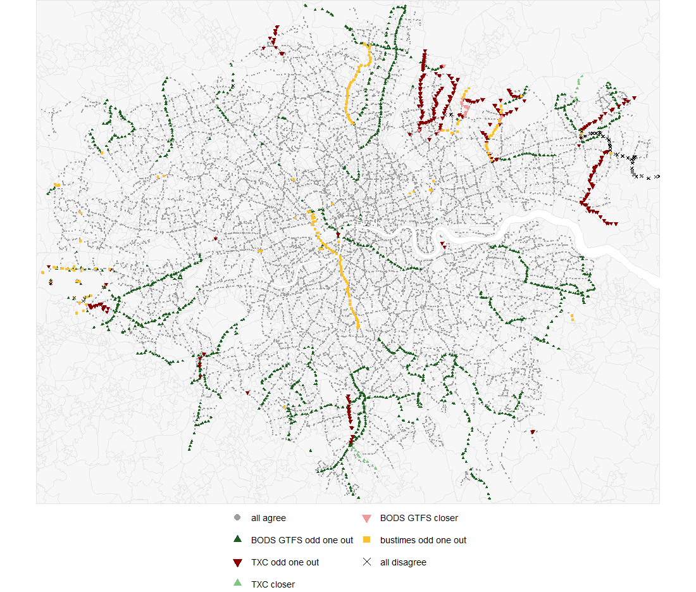
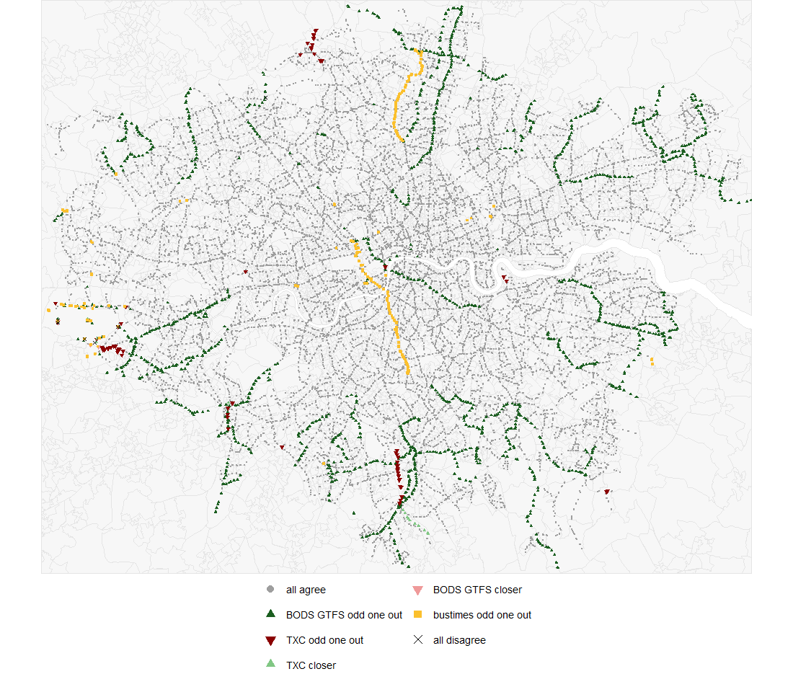
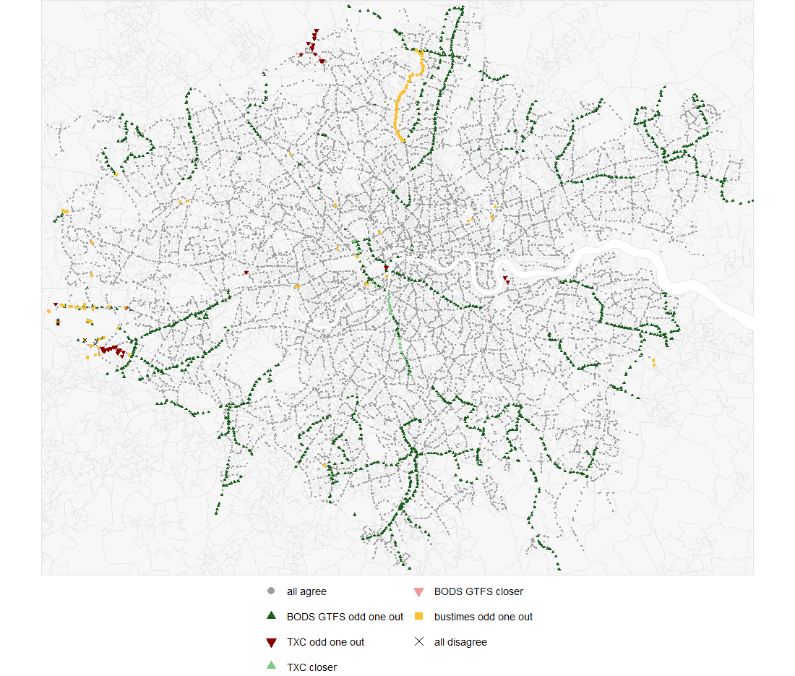
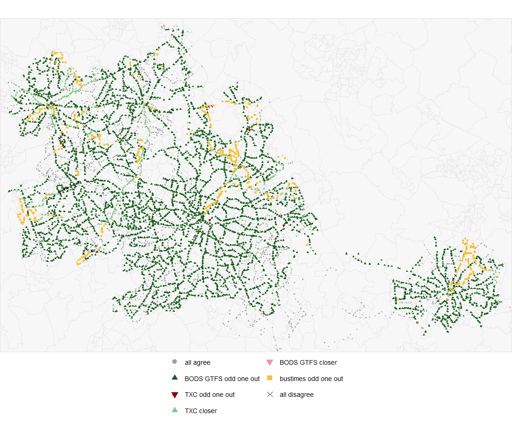
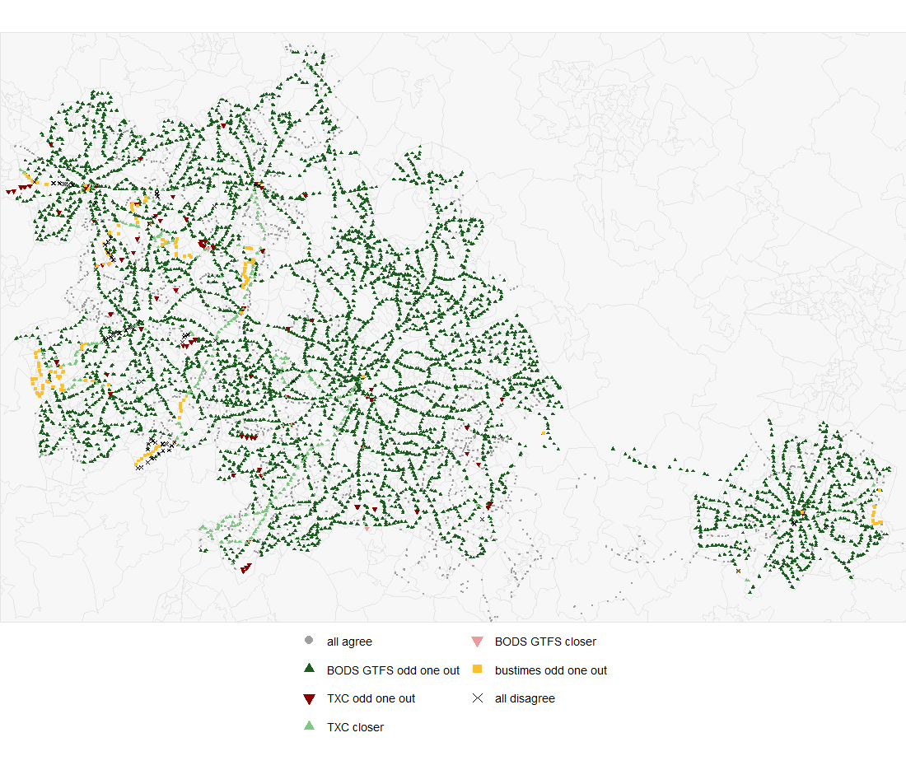
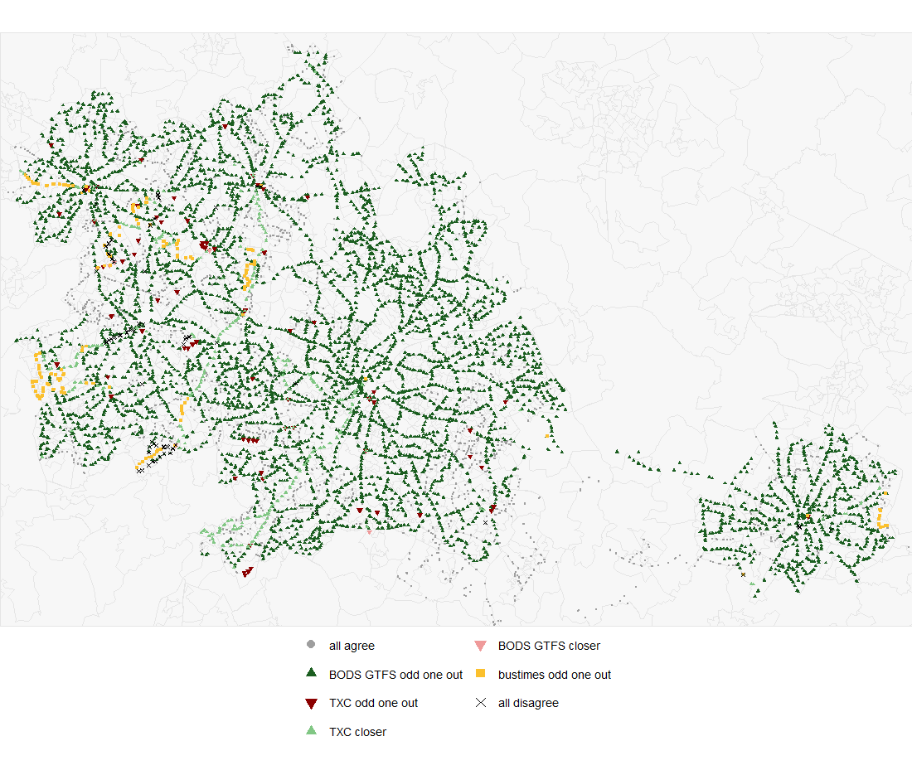
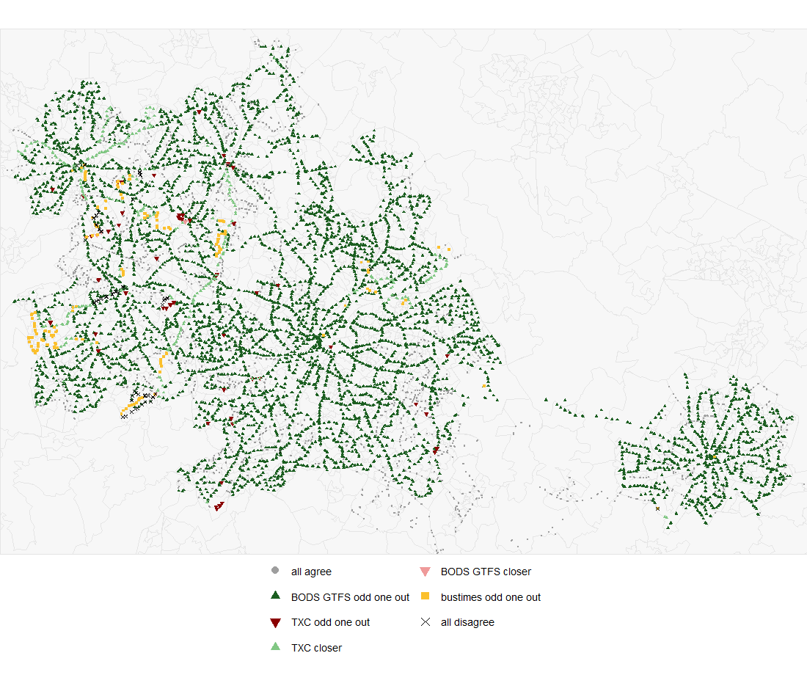

# Who is right? Bus and coach, three TNDS editions, Friday 20 November 2026

This is the second run of the [19 November comparison](stop_disagreement_cities.md).
It uses the same two cities, the same seven categories and bustimes.org again
as referee, with four changes:

1. **Coach is counted as well as bus.**
   - bustimes.org was scraped for bus and coach services.
   - Each feed keeps route types 3 (bus) and 200 (coach).
   - The BODS Coach feed supplies coach to every TransXChange-built feed, at
     the stops and lines that feed lacks, as the yearly series does from 2024.
   - A route-level **mode check** counts each line's departures as bus and as
     coach in every source. It flags lines whose departures change mode
     between two sources: a soft pass if the line's total still agrees, a
     fail if it does not.
2. **TNDS is converted three ways:**
   - the 2.5 edition the pipeline uses;
   - the 2.1 edition published beside it;
   - a **blend**: 2.5 plus the 2.1-only files whose service 2.5 does not
     carry.
3. **Stop locations.** TNDS and BODS TransXChange were converted with
   UK2GTFS 0.4.1, `stop_locations = "naptan_fill"`. A stop missing from the
   pipeline's NaPTAN copy keeps its calls when the TransXChange file says
   where it is. See the [stop location report](stop_location_quality.md).
4. **The day is Friday 20 November.** The feeds are the same 18 November
   downloads.
5. **A combined feed** (added 27 November): TNDS and UK2GTFS's conversion
   of the BODS TransXChange archive, with one source chosen for each
   service, as proposed in
   [gtfs_iteration_nov2026.md §5](gtfs_iteration_nov2026.md#5-a-combined-source).
   It is shown with and without the cross-file copy rule. See
   [A combined feed](#a-combined-feed-tnds-and-bods-chosen-service-by-service).

Table: Bus and coach departures on Friday 20 November 2026 summed over every stop in each city

|City          |  Stops| bustimes.org|  TNDS 2.5|  TNDS 2.1| TNDS blend|  Combined| Combined + copy rule| BODS TransXChange| BODS GTFS|
|:-------------|------:|------------:|---------:|---------:|----------:|---------:|--------------------:|-----------------:|---------:|
|London        | 19,092|    4,026,934| 4,069,161| 4,101,937|  4,069,161| 4,069,715|            4,061,224|           192,949| 4,282,619|
|West Midlands | 11,352|      853,852|   878,520|   878,808|    878,808|   864,832|              864,832|           885,290| 1,654,336|

Table: Each feed's total against bustimes.org

|City          |TNDS 2.5 |TNDS 2.1 |TNDS blend |Combined |Combined + copy rule |BODS TransXChange |BODS GTFS |
|:-------------|:--------|:--------|:----------|:--------|:--------------------|:-----------------|:---------|
|London        |+1.0%    |+1.9%    |+1.0%      |+1.1%    |+0.9%                |-95.2%            |+6.3%     |
|West Midlands |+2.9%    |+2.9%    |+2.9%      |+1.3%    |+1.3%                |+3.7%             |+93.7%    |

Table: Share of each city's served stops in each category, every map

|Category              |London: TNDS 2.5 |London: TNDS 2.1 |London: TNDS blend |London: Combined |London: Combined + copy rule |West Midlands: BODS TransXChange |West Midlands: TNDS 2.5 |West Midlands: TNDS 2.1 |West Midlands: TNDS blend |West Midlands: Combined |West Midlands: Combined + copy rule |
|:---------------------|:----------------|:----------------|:------------------|:----------------|:----------------------------|:--------------------------------|:-----------------------|:-----------------------|:-------------------------|:-----------------------|:-----------------------------------|
|all agree             |87.9%            |86.5%            |87.9%              |88.0%            |88.1%                        |21.4%                            |20.8%                   |20.9%                   |20.9%                     |21.1%                   |21.1%                               |
|BODS GTFS odd one out |10.4%            |9.6%             |10.4%              |10.4%            |10.7%                        |68.3%                            |71.9%                   |71.9%                   |71.9%                     |72.4%                   |72.4%                               |
|TXC odd one out       |0.4%             |1.9%             |0.4%               |0.4%             |0.3%                         |0.1%                             |0.9%                    |0.8%                    |0.8%                      |0.6%                    |0.6%                                |
|TXC closer            |0.1%             |0.2%             |0.1%               |0.1%             |0.2%                         |4.4%                             |3.8%                    |3.8%                    |3.8%                      |3.6%                    |3.6%                                |
|BODS GTFS closer      |0.0%             |0.1%             |0.0%               |0.0%             |0.0%                         |0.0%                             |0.1%                    |0.1%                    |0.1%                      |0.1%                    |0.1%                                |
|bustimes odd one out  |1.1%             |1.4%             |1.1%               |1.1%             |0.7%                         |5.4%                             |1.7%                    |1.8%                    |1.8%                      |1.6%                    |1.6%                                |
|all disagree          |0.0%             |0.4%             |0.0%               |0.0%             |0.0%                         |0.5%                             |0.8%                    |0.7%                    |0.7%                      |0.6%                    |0.6%                                |

**What changed since 19 November**

- **TNDS 2.5 remains the better of the two published editions.**
  - In London, 2.1 makes 279
    more stops red (TransXChange the odd one out), and its total is
    +1.9% against bustimes.org, compared
    with +1.0% for 2.5.
  - The cause is cross-boundary copies. 2.1's South East zip carries Essex
    County Council's copies of seven Stagecoach London routes, and those
    routes count twice. 2.5 removes the copies.
- **The blend is 2.5 with nothing lost.**
  - It adds the 8 services 2.5 dropped that no 2.5 file carries.
  - In London it is identical to 2.5.
  - In the West Midlands it adds Arriva's 9 to Bridgnorth, and 11 red stops
    in Wolverhampton turn grey.
- **The two red stops traced to the frozen NaPTAN are fixed.**
  - Brabham Court and SL12's Ferry Lane / Coldharbour Lane are now grey (all
    agree), because their TfL files say where they are (`naptan_fill`).
  - Red stops in London fell from 93 to
    77. The rest are TNDS input, as found on 19
    November.
- **Adding coach changes little, and bus/coach labelling conflicts are rare.**
  - Of about 1,100 lines matched in each pair of sources, three move between
    bus and coach.
  - Green Line 757 is a soft pass: the same 800 departures, a coach in TNDS
    and a bus on bustimes.org.
  - N40 and RA2 fail and are explained below.
- **Two cross-region duplicates still count twice in TNDS.** The 439 in London
  (TfL's file plus a superseded 2024 Go-Ahead version) and the X6 in the West Midlands
  survive every filter. The scan finds 34 such pairs nationally.
- **Unchanged from 19 November:**
  - BODS GTFS still counts West Midlands Bus about twice
    (+93.7%), which makes most West Midlands
    stops dark green.
  - BODS TransXChange does not carry TfL's own routes, so it has no London
    map.

## A combined feed: TNDS and BODS chosen service by service

The [November audit](gtfs_iteration_nov2026.md) found that TNDS and
UK2GTFS's conversion of the BODS TransXChange archive fail in different
places. TNDS lags BODS and runs out early. BODS lacks London, Scotland, Wales
and some English services. A wholesale merge was tested and rejected
([source_triangulation.md](source_triangulation.md)): it counted every
service both carry twice. The combined feed instead takes each service from
one source only.

**How it is built** (`R/convert_combined.R`):

1. **The inputs.** These are the two feeds already on the maps above: the
   TNDS blend edition and the BODS TransXChange conversion. Each was filtered
   and converted on its own. The choice is made on the converted feeds, not
   on the raw files: each source's file filter still sees every file of its
   own when it picks between versions, and the untrimmed caches keep each
   timetable's real operating period.
2. **Matching.** A service is an operator plus its TransXChange
   `ServiceCode`. TNDS and BODS services are matched when they share a line
   name and at least half the smaller one's stops. A second pass, which
   ignores line names, matches services with the same first-stop departures
   over at least half their stops. Matched services are grouped, because one
   BODS registration can match two TNDS files and the reverse.
3. **Choice, per group:**
   - **A doubling first.** The smaller source is taken when one source runs
     1.7 to 2.3 times the other's journeys in the window. It is also taken
     from 1.7 times up when the larger source runs the group under more
     operators.
   - **Otherwise the newer timetable**, provided it runs to the window's end.
   - **Otherwise TNDS.**

   A service in one source only is taken from that source.
4. **Output.** The kept services are merged, trimmed to the snapshot ±45
   days and cleaned. The copy rule (`gtfs_deduplicate_copies()`) is applied
   to the second version before trimming, as it must be.

The doubling rule is not in the §5 design. It was added after a dry run on
these feeds:

- 184 groups had one source at about twice the other, split evenly between
  the two sources.
- Every case read was a bus counted twice:
  - in BODS, versions left open (National Express West Midlands republished
    beside West Midlands Bus, Green Line 757, London 372 and 465);
  - in TNDS, copies (Arriva Cymru's North West and Wales files, Arriva SB1,
    Bee Network 612).
- The fresher source was often the doubled one.
- One exception was found: Preston 35, where the operator's timetable sides
  with BODS's larger count.

Table: Matched groups by the source taken and why; journeys are trip-days in the window (16-29 November), all of Great Britain

|Source taken      |Reason                                   | Groups| TNDS journeys| BODS journeys|
|:-----------------|:----------------------------------------|------:|-------------:|-------------:|
|BODS TransXChange |newer, and runs to the window's end      |   1852|       815,104|       815,045|
|BODS TransXChange |the other source runs it about twice     |    108|        66,906|        33,217|
|BODS TransXChange |newer; neither runs to the window's end  |      2|             4|             4|
|BODS TransXChange |the only one running to the window's end |      1|            17|            51|
|TNDS              |same start: TNDS by default              |   3043|     1,384,307|     1,386,345|
|TNDS              |newer, and runs to the window's end      |   2055|       730,299|       726,807|
|TNDS              |the other source runs it about twice     |    105|        28,260|        60,632|
|TNDS              |newer; neither runs to the window's end  |      4|            90|             8|
|TNDS              |the only one running to the window's end |      1|           300|            45|

Table: Services in one source only, taken from it

|Source            | Services|  Journeys|
|:-----------------|--------:|---------:|
|BODS TransXChange |      542|    34,605|
|TNDS              |    3,810| 2,182,436|

**Nationally the choice moves about a quarter of the services, and
the total hardly at all.**

- Of 7,171 matched groups, 1,963 are taken from BODS.
- 213 are decided by the doubling rule. In 120 of
  those it takes the other source from the one the newer-timetable rule
  alone would have chosen.
- Over the fortnight the combined feed has 5,208,614 journeys,
  against 5,207,723 in TNDS and 3,056,759 in BODS
  TransXChange (+0.02% on TNDS). The
  doubles it removes and the services it adds from BODS roughly cancel.

Table: Departures on Friday 20 November 2026 summed over each city's stops, and against bustimes.org

|City          | bustimes.org|        TNDS blend|          Combined| Combined + copy rule| BODS TransXChange|          BODS GTFS|
|:-------------|------------:|-----------------:|-----------------:|--------------------:|-----------------:|------------------:|
|London        |    4,026,934| 4,069,161 (+1.0%)| 4,069,715 (+1.1%)|    4,061,224 (+0.9%)|  192,949 (-95.2%)|  4,282,619 (+6.3%)|
|West Midlands |      853,852|   878,808 (+2.9%)|   864,832 (+1.3%)|      864,832 (+1.3%)|   885,290 (+3.7%)| 1,654,336 (+93.7%)|

Table: Share of lines whose departures over the city's stops agree with bustimes.org (within 2 departures or 10%)

|City          |TNDS blend |Combined |Combined + copy rule |BODS TransXChange |BODS GTFS |
|:-------------|:----------|:--------|:--------------------|:-----------------|:---------|
|London        |89.9%      |90.0%    |90.1%                |17.5%             |84.4%     |
|West Midlands |80.1%      |81.8%    |81.8%                |80.7%             |38.4%     |

Table: Sum over lines of the absolute difference from bustimes.org, departures

|City          |TNDS blend |Combined |Combined + copy rule |BODS TransXChange |BODS GTFS |
|:-------------|:----------|:--------|:--------------------|:-----------------|:---------|
|London        |48,267     |48,329   |39,838               |3,854,925         |276,527   |
|West Midlands |84,988     |74,846   |74,846               |94,656            |830,052   |

Table: London - stops per category: the TNDS blend and the combined feed

|Category                 | London: TNDS blend| London: Combined| London: Combined + copy rule|
|:------------------------|------------------:|----------------:|----------------------------:|
|1. all agree             |              16789|            16790|                        16811|
|2. BODS GTFS odd one out |               1983|             1978|                         2040|
|3. TXC odd one out       |                 77|               71|                           50|
|4. TXC closer            |                 21|               23|                           43|
|5. BODS GTFS closer      |                  3|                3|                            3|
|6. bustimes odd one out  |                210|              215|                          133|
|7. all disagree          |                  7|                5|                            5|

Table: West Midlands - stops per category: the TNDS blend and the combined feed

|Category                 | West Midlands: BODS TransXChange| West Midlands: TNDS blend| West Midlands: Combined| West Midlands: Combined + copy rule|
|:------------------------|--------------------------------:|-------------------------:|-----------------------:|-----------------------------------:|
|1. all agree             |                             2417|                      2374|                    2389|                                2389|
|2. BODS GTFS odd one out |                             7723|                      8165|                    8213|                                8213|
|3. TXC odd one out       |                                6|                        93|                      65|                                  65|
|4. TXC closer            |                              495|                       430|                     411|                                 411|
|5. BODS GTFS closer      |                                0|                         6|                       6|                                   6|
|6. bustimes odd one out  |                              613|                       200|                     185|                                 185|
|7. all disagree          |                               56|                        84|                      70|                                  70|

Table: The lines whose departures most change between the TNDS blend and the combined feed with the copy rule, summed over the city's stops on Friday 20 November 2026

|City          |Line                                    | bustimes.org| BODS GTFS| TNDS blend| BODS TXC| Combined| Combined + copy rule|Against TNDS blend |
|:-------------|:---------------------------------------|------------:|---------:|----------:|--------:|--------:|--------------------:|:------------------|
|London        |2                                       |       10,580|    21,500|     21,500|        0|   21,500|               14,061|closer             |
|London        |439                                     |        1,196|     1,196|      2,317|        0|    2,317|                1,265|closer             |
|London        |347                                     |            0|         0|          0|      280|      280|                  280|further            |
|London        |555                                     |          461|       461|        300|      461|      461|                  461|closer             |
|London        |N555                                    |            0|         0|        131|        0|        0|                    0|closer             |
|London        |BL1                                     |        1,581|     1,669|      1,581|       88|    1,669|                1,669|further            |
|London        |BL2                                     |            0|        60|          0|       60|       60|                   60|further            |
|London        |HARRYPOTTERSTUDIOSTOURVICTORIATOSTUDIOS |            0|        60|          0|       60|       60|                   60|further            |
|London        |446                                     |            0|       540|        483|      540|      540|                  540|further            |
|London        |515                                     |          308|       308|        363|      308|      308|                  308|closer             |
|London        |461                                     |          602|       602|        559|      602|      602|                  602|closer             |
|London        |E16                                     |            0|        20|         40|       20|       20|                   20|closer             |
|London        |715                                     |          270|       270|        255|      270|      270|                  270|closer             |
|London        |714                                     |          208|       208|        197|      208|      208|                  208|closer             |
|London        |514                                     |           52|        52|         58|       52|       52|                   52|closer             |
|West Midlands |63                                      |        9,456|    28,155|     15,155|    9,813|    9,506|                9,506|closer             |
|West Midlands |61                                      |        8,699|    24,449|     13,732|    8,699|    8,663|                8,663|closer             |
|West Midlands |59                                      |        8,867|    13,814|      8,867|    6,907|    6,907|                6,907|further            |
|West Midlands |50A                                     |        4,289|     1,251|      2,367|    1,251|    1,251|                1,251|further            |
|West Midlands |80                                      |        7,798|    15,686|      6,742|    7,798|    7,798|                7,798|closer             |
|West Midlands |10                                      |        6,109|    11,770|      6,909|    6,109|    6,115|                6,115|closer             |
|West Midlands |64                                      |          786|     1,934|        774|    1,529|    1,517|                1,517|further            |
|West Midlands |10A                                     |          741|     1,482|      1,444|      741|      741|                  741|closer             |
|West Midlands |11                                      |       12,091|    20,962|     12,046|   11,489|   11,489|               11,489|further            |
|West Midlands |85                                      |          582|     1,112|      1,112|      556|      556|                  556|closer             |
|West Midlands |1                                       |       16,280|    29,396|     16,235|   15,746|   15,746|               15,746|further            |
|West Midlands |X64                                     |            0|       413|          0|      413|      413|                  413|further            |
|West Midlands |X6                                      |          296|       296|        555|      296|      296|                  296|closer             |
|West Midlands |X1                                      |        6,573|    18,043|      6,812|    6,573|    6,573|                6,573|closer             |
|West Midlands |12X                                     |        4,385|     8,721|      4,266|    4,455|    4,455|                4,455|closer             |

**What the combined feed gains.**

- **West Midlands: closest to bustimes.org of every feed.**
  - The city total is within 1.3% of bustimes.org, against 2.9% for the TNDS
    blend and 3.7% for BODS TransXChange.
  - 81.8% of lines agree, against 80.1% and 80.7%.
  - The summed line error falls by 12% on the blend (74,846 departures against
    84,988).
  - The gain is the doubling rule. TNDS carries National Express West Midlands
    beside West Midlands Bus on 61, 63, 10, 10A, 85 and X1. The combined feed
    takes BODS's single copy, and 63 falls from 15,155 departures to 9,506
    (bustimes.org: 9,456).
- **London: no change from the choice, as expected.**
  - BODS TransXChange carries almost nothing in London, so nearly every London
    service is TNDS-only and the combined feed is the TNDS blend.
  - The copy rule is what moves London: the summed line error falls by 17%
    (39,838 against 48,267). Most of that is Arriva London's line 2, filed
    under both North and South, and Go-Ahead's 439 (see
    [filtering_rules_overview.md](filtering_rules_overview.md)).
  - On this day the copy rule changes nothing in the West Midlands.
- **The operator-timetable check agrees** (78 in-force readings, 16-29
  November, built from the 11 November feeds; see
  [gtfs_iteration_nov2026.md](gtfs_iteration_nov2026.md#5-a-combined-source)):
  - The combined feed is within 15% on 62 readings, against 61 for TNDS, 59
    for BODS TransXChange and 41 for BODS GTFS.
  - Its median error is 3.8%, against 5.5% for both TransXChange sources.
  - It gets right every reading that either TransXChange source gets right
    and loses none. The one it adds is Brighton & Hove 20, absent from TNDS.

**What it loses: a group is taken from one source whole.**

- When the chosen source lacks a service the other has in the same group,
  that service is dropped.
- **West Midlands Bus 59, 11 and 1.** BODS's newer registrations are chosen,
  but the TNDS group runs 10-26% more journeys (59: 2,332 against 1,852 in the
  window). On 59 the combined feed has BODS's 6,907 departures, against
  8,867 on bustimes.org and in TNDS.
- **Diamond 50A** falls to BODS's 1,251 departures, against TNDS's 2,367
  (bustimes.org: 4,289; both sources are short).
- **National Express West Midlands 64 and X64** are in BODS only, so they are
  kept. bustimes.org has no X64 and half the 64 departures: this is probably a
  registration left open, of the kind the doubling rule catches only when
  TNDS also carries the line.
- A finer choice would compare the groups' services one by one and keep a
  losing service that has no counterpart. That is the next refinement to test.

## TNDS editions

The two editions pair by file name almost one to one:

- Of 2.1's 17,254 files and 2.5's 17,019, 17,002
  are in both.
- 252 are only in 2.1, 205 of them
  operating on 20 November.
- 17 are only in 2.5, all in Scotland.

Both editions are written in their own schema, so byte comparison is
meaningless. Instead each file's service code, lines, operator, operating
period, journeys, and fingerprints of its stops, departure times and
operating profiles were compared. 15,999 of the
17,002 paired files agree on all of them.

Table: Paired files that differ, by what differs

|Fields that differ | Files|
|:------------------|-----:|
|profiles_fp        |  1003|

Table: What 2.5 left out

|2.1-only file, active on the day                           | Files|Journeys |
|:----------------------------------------------------------|-----:|:--------|
|carried by 2.5 under the same line (a cross-boundary copy) |   197|13,024   |
|not carried by 2.5                                         |     8|484      |

Table: The files the blend adds to 2.5

|Region |File                                              |Line |Operator | Journeys|Stops 2.5 serves on the line |
|:------|:-------------------------------------------------|:----|:--------|--------:|:----------------------------|
|EM     |derbs_MDCL_822_derbs_MDCL_22_11022A_822_1.xml     |822  |MDCL     |        2|0%                           |
|EM     |derbs_TBTN_swi_SERSW.xml                          |swi  |TBTN     |      172|0%                           |
|EM     |derbs_TBTN_vil_SERV1.xml                          |vil  |TBTN     |      185|0%                           |
|EM     |derbs_TMTL_26_SER26_26A_1.xml                     |26A  |TMTL     |       11|0%                           |
|EM     |leics_AFCL_87_87.xml                              |87   |AMID     |       68|0%                           |
|SE     |square_BOUB_BCB_BCB.xml                           |BCB  |BOUB     |        9|0%                           |
|W      |X15_Sargents Brothers Coaches_(SARG)_20261112.xml |X15  |SARG     |        2|42%                          |
|WM     |twm_70-9-_-y11-1.xml                              |9    |AMNO     |       35|0%                           |

**So there is a 1:1 pairing.**

- Every file in both editions carries the same timetable.
- The 1,003 that differ do so only in notation. 2.1 writes St Andrew's Day
  and the 2 January Scottish holiday as `<OtherPublicHoliday>` with a
  description and date; 2.5 has named elements for them. These are mostly
  Scottish files, plus a hundred Welsh and North West files that list every
  holiday.
- 2.5 is 2.1 minus 252 files, plus 17 Scottish files.

**Of the 252 files left out of 2.5, 205 operate on 20 November.**

- 197 are copies of a service 2.5 still carries under another region's file:
  the cross-boundary deduplication 2.5 exists for. They include Essex
  County Council's copies of the London routes 20, 167, 215, 275, 372, 462
  and 498, which run into Essex.
- 8 are services 2.5 lost outright. The blend adds them back.

The tables below show what each edition does to the maps:

- **London:**
  - 2.1 is worse: the Essex copies double their routes across 278 stops that
    are grey with 2.5.
  - The blend adds no London file, so it equals 2.5.
- **West Midlands:**
  - 2.1 and the blend are identical. The one difference from 2.5 is Arriva's
    9 to Bridgnorth (`twm_70-9-_-y11-1.xml`).
  - Adding it turns 11 red stops grey (Bramstead Avenue, Tinacre Hill,
    Wightwick Bank and others the 9 alone serves).
  - It moves 11 stops in western Wolverhampton from black to yellow: the
    feeds now agree with each other, and bustimes.org has fewer departures
    there than either.

**Recommendation.** On this evidence the blend is better than 2.5: it adds 8
services and removes nothing, and 2.1 is worse than both. Making the blend
the pipeline's edition means rebuilding the series, so it is left as a
decision. The one known gap is that the blend's rule keeps out a genuine
replacement by another operator on the same line (see Caveats).

Table: London - stops per category with each TNDS edition

|Category                 | London: TNDS 2.1| London: TNDS 2.5| London: TNDS blend|
|:------------------------|----------------:|----------------:|------------------:|
|1. all agree             |            16511|            16789|              16789|
|2. BODS GTFS odd one out |             1831|             1983|               1983|
|3. TXC odd one out       |              356|               77|                 77|
|4. TXC closer            |               34|               21|                 21|
|5. BODS GTFS closer      |               22|                3|                  3|
|6. bustimes odd one out  |              261|              210|                210|
|7. all disagree          |               76|                7|                  7|

Table: West Midlands - stops per category with each TNDS edition

|Category                 | West Midlands: TNDS 2.1| West Midlands: TNDS 2.5| West Midlands: TNDS blend|
|:------------------------|-----------------------:|-----------------------:|-------------------------:|
|1. all agree             |                    2374|                    2363|                      2374|
|2. BODS GTFS odd one out |                    8165|                    8167|                      8165|
|3. TXC odd one out       |                      93|                     104|                        93|
|4. TXC closer            |                     430|                     429|                       430|
|5. BODS GTFS closer      |                       6|                       6|                         6|
|6. bustimes odd one out  |                     200|                     189|                       200|
|7. all disagree          |                      84|                      94|                        84|

Table: Stops that change category when the TNDS edition changes (largest moves)

|Change                     |From                  |To                   | Stops|
|:--------------------------|:---------------------|:--------------------|-----:|
|London 2.5 -> 2.1          |all agree             |TXC odd one out      |   278|
|London 2.5 -> 2.1          |BODS GTFS odd one out |all disagree         |    69|
|London 2.5 -> 2.1          |BODS GTFS odd one out |bustimes odd one out |    51|
|London 2.5 -> 2.1          |BODS GTFS odd one out |BODS GTFS closer     |    19|
|London 2.5 -> 2.1          |BODS GTFS odd one out |TXC closer           |    13|
|West Midlands 2.5 -> 2.1   |TXC odd one out       |all agree            |    11|
|West Midlands 2.5 -> 2.1   |all disagree          |bustimes odd one out |    11|
|West Midlands 2.5 -> 2.1   |BODS GTFS odd one out |TXC closer           |     2|
|West Midlands 2.5 -> 2.1   |TXC closer            |all disagree         |     1|
|West Midlands 2.5 -> blend |TXC odd one out       |all agree            |    11|
|West Midlands 2.5 -> blend |all disagree          |bustimes odd one out |    11|
|West Midlands 2.5 -> blend |BODS GTFS odd one out |TXC closer           |     2|
|West Midlands 2.5 -> blend |TXC closer            |all disagree         |     1|

### Services registered in two regions: the 439

Table: 2.5 files in different regions, both operating on the day, with the same line and at least half the smaller file's stops in common

|Line |Region A |Operator A | Journeys A|Region B |Operator B | Journeys B| Shared stops|Overlap |
|:----|:--------|:----------|----------:|:--------|:----------|----------:|------------:|:-------|
|1    |NW       |ACYM       |        550|W        |ACYM       |        340|           87|100%    |
|10   |NW       |ACYM       |        296|W        |ACYM       |        296|           80|100%    |
|101  |NW       |ACYM       |         16|W        |ACYM       |         16|           33|100%    |
|10A  |NW       |ACYM       |         10|W        |ACYM       |         10|           87|100%    |
|15   |NW       |ACYM       |         46|W        |ACYM       |         46|           47|100%    |
|15A  |NW       |ACYM       |         36|W        |ACYM       |         36|           53|100%    |
|15A  |NW       |SCMY       |         54|W        |ACYM       |         36|           54|100%    |
|180  |EM       |SCEM       |         50|Y        |EYMS       |          2|           32|100%    |
|4B   |NW       |ACYM       |          4|W        |ACYM       |          4|           26|100%    |
|HD4  |EA       |KCTB       |          2|SE       |HEDO       |          2|           51|100%    |
|X16  |NE       |ANUM       |         67|S        |ANUM       |          8|          130|100%    |
|X84  |EM       |AMID       |         57|WM       |AMNO       |        105|           39|100%    |
|X84  |EM       |AMID       |         45|WM       |AMNO       |        105|           99|100%    |
|11   |NW       |ACYM       |        140|W        |ACYM       |        140|          135|99%     |
|394  |EM       |HIPK       |         12|NW       |HIPK       |         12|          127|99%     |
|4    |EM       |MDCL       |         43|WM       |MDCL       |         43|          198|99%     |
|811  |NW       |MNHT       |          5|W        |A2BC       |         10|          159|99%     |
|272  |EM       |HULS       |         32|Y        |FSYO       |         48|          131|98%     |
|4    |NW       |ACYM       |        102|W        |ACYM       |        102|          125|98%     |
|44   |EA       |HEDO       |        254|SE       |HEDO       |         56|          101|98%     |
|21   |EM       |MDCL       |         69|WM       |MDCL       |         68|           65|97%     |
|4S   |NW       |ACYM       |        118|W        |ACYM       |        118|          114|97%     |
|811  |NW       |HUYT       |          5|W        |A2BC       |         10|          108|96%     |
|18   |NE       |HDGS       |         30|Y        |HDGS       |         30|           52|96%     |
|21E  |EM       |MDCL       |         39|WM       |MDCL       |         39|          120|96%     |
|15   |NW       |SCMY       |         14|W        |ACYM       |         46|           46|96%     |
|X46  |W        |PATS       |          2|WM       |PATS       |          2|           21|96%     |
|6    |EM       |AMID       |        118|WM       |AMNO       |         65|          185|94%     |
|X6   |EM       |AMID       |         82|WM       |AMID       |         82|           26|93%     |
|2    |W        |ACYM       |         92|WM       |ACYM       |         38|            6|86%     |
|20   |EM       |SCEM       |        133|Y        |EYMS       |         29|           12|75%     |
|439  |L        |METR       |        201|SE       |GAHL       |        255|           36|64%     |
|2A   |W        |ACYM       |         43|WM       |ACYM       |         66|           62|63%     |
|2C   |W        |ACYM       |         53|WM       |ACYM       |         53|           40|58%     |

**Why deduplication did not catch the 439**

The 439 is in TNDS twice:

- `tfl_51-439-_-y05-5.xml` in the London zip: Transport for London's
  file, operator "METROBUS LIMITED" (NOC METR), valid 13 November 2026 to
  23 December 2027, 201 journeys;
- `square_LGEN_439_439.xml` in the South East zip: a Go-Ahead London export,
  operator "London General" (NOC GAHL, ServiceCode "439"), 255 journeys. It
  was exported on 9 November 2026, but its operating period starts on 2
  March 2024 and has no end date. The file name inside it says the same
  (`439_LGEN_490_439_20240302_...`).

**The Go-Ahead file is a superseded version, not a second copy of the
current one.**

- Every journey leaves Waddon Marsh at the same minute in both files.
- Beyond Purley the routes part:
  - TfL's runs through the Kenley hail-and-ride section (Foxley Hill Road,
    Oaks Road, Kenley Station, Beverley Road).
  - Go-Ahead's runs along Godstone Road (Kenley Treatment Works, Legion
    House, The Kenley Hotel).
- bustimes.org and BODS GTFS follow TfL's routing exactly: 528 departures at
  the stops only TfL's file serves, none at the stops only Go-Ahead's serves.
  Both may draw on TfL's own London data, so this is agreement, not
  independent proof. But the Go-Ahead file is the older one, and it is open
  ended.
- It is one of seven `square_LGEN_*` files in the South East zip, all open
  ended from 2020-2024. Two more, the school routes 618 and 669, also have
  current TfL files, which name other operators (ABLO and ELBG).

Three stages could have removed it, and each misses it:

1. **`txc_filter_files()`** runs on one region zip at a time, so it never
   sees the two files together. Its rules also key on the operator
   (NOC + ServiceCode, NOC + Description + Lines, NOC + CreationDateTime +
   Lines), and the NOCs differ. The one rule that crosses operators, the
   handover rule, also needs both files in the same call.
2. **TNDS's own 2.5 deduplication** removes cross-boundary copies like the
   Essex ones above. It left the 439 in, probably because the operator codes
   differ.
3. **`gtfs_deduplicate()`**, at read time, removes a journey only when
   another has the same operator name and an identical itinerary. Here the
   operator names differ and the itineraries share only their first stop
   and time.

A rule that keeps the newer of two versions works within one operator's
files. It cannot act here, because the two versions come from different
publishers, under different operators, in different region zips.

On the London map the 439 still counts twice at 21 stops: TNDS 2.5 has 1,084
departures where bustimes.org and BODS GTFS both have 524.

**The other 33 pairs**

- **Mostly one operator listed in two regions:**
  - Arriva Cymru's Wrexham and Chester routes (NW/W);
  - Midland Classic (EM/WM);
  - the X6 (Arriva Midlands, EM/WM);
  - the X16 (NE/S).
- **The X6 is one current timetable published twice, and it still doubles.**
  - The two files are Arriva Midlands' own export in the East Midlands zip
    (`leics_AFCL_X6_X6.xml`) and the West Midlands supplier's file
    (`cen_6-X6-0-y11-2.xml`). Both carry NOC AMID and both are current.
  - They have the same 37 journeys on the day, with the same start times and
    the same times at the timing points.
  - `gtfs_deduplicate()` keeps both for two reasons:
    - the agency records are named "Arriva" and "Arriva Midlands";
    - the two suppliers time the stops between timing points differently,
      and use a neighbouring stop code in a few places, so no itinerary
      matches exactly.
  - At all 13 shared West Midlands stops TNDS has exactly twice what
    bustimes.org, BODS GTFS and BODS TransXChange agree on.

A rule to remove them would have to run on the merged feed, matching on line,
stops and times and ignoring the operator. It is left for a decision, because
it would change the series. The scan only measures them
(`scripts/tnds_editions/tnds_editions.py --dups-only`).

## Bus or coach?

Table: Lines per pair of sources and city, by timetable and mode agreement

|Pair                                 | pass| soft pass| fail| timetable differs|
|:------------------------------------|----:|---------:|----:|-----------------:|
|BODS GTFS vs BODS TransXChange       |  309|         0|    0|               233|
|BODS GTFS vs Combined                |  912|         1|    0|               221|
|BODS GTFS vs Combined + copy rule    |  912|         1|    0|               221|
|BODS GTFS vs TNDS 2.1                |  888|         1|    0|               234|
|BODS GTFS vs TNDS 2.5                |  897|         1|    0|               225|
|BODS GTFS vs TNDS blend              |  897|         1|    0|               225|
|bustimes.org vs BODS GTFS            |  822|         0|    1|               271|
|bustimes.org vs BODS TransXChange    |  388|         0|    1|               113|
|bustimes.org vs Combined             | 1001|         1|    2|                95|
|bustimes.org vs Combined + copy rule | 1002|         1|    2|                94|
|bustimes.org vs TNDS 2.1             |  973|         1|    2|               120|
|bustimes.org vs TNDS 2.5             |  987|         1|    2|               106|
|bustimes.org vs TNDS blend           |  987|         1|    2|               106|

Table: Soft passes: departures change mode between the two sources, and the line's total agrees

|City   |Line |A            |B                    | A bus| A coach| B bus| B coach|Operator                        |
|:------|:----|:------------|:--------------------|-----:|-------:|-----:|-------:|:-------------------------------|
|London |757  |bustimes.org |Combined             |   800|       0|     0|     800|Green Line (operated by Arriva) |
|London |757  |bustimes.org |Combined + copy rule |   800|       0|     0|     800|Green Line (operated by Arriva) |
|London |757  |bustimes.org |TNDS 2.1             |   800|       0|     0|     800|Green Line (operated by Arriva) |
|London |757  |bustimes.org |TNDS 2.5             |   800|       0|     0|     800|Green Line (operated by Arriva) |
|London |757  |bustimes.org |TNDS blend           |   800|       0|     0|     800|Green Line (operated by Arriva) |
|London |N40  |BODS GTFS    |Combined             |     0|      86|    74|      16|National Express                |
|London |N40  |BODS GTFS    |Combined + copy rule |     0|      86|    74|      16|National Express                |
|London |N40  |BODS GTFS    |TNDS 2.1             |     0|      86|    74|      16|National Express                |
|London |N40  |BODS GTFS    |TNDS 2.5             |     0|      86|    74|      16|National Express                |
|London |N40  |BODS GTFS    |TNDS blend           |     0|      86|    74|      16|National Express                |

Table: Fails: departures change mode and the total does not agree - for investigation

|City   |Line |A            |B                    | A bus| A coach| B bus| B coach|Operator                            |
|:------|:----|:------------|:--------------------|-----:|-------:|-----:|-------:|:-----------------------------------|
|London |N40  |bustimes.org |Combined             |     0|      66|    74|      16|National Express                    |
|London |N40  |bustimes.org |Combined + copy rule |     0|      66|    74|      16|National Express                    |
|London |N40  |bustimes.org |TNDS 2.1             |     0|      66|    74|      16|National Express                    |
|London |N40  |bustimes.org |TNDS 2.5             |     0|      66|    74|      16|National Express                    |
|London |N40  |bustimes.org |TNDS blend           |     0|      66|    74|      16|National Express                    |
|London |RA2  |bustimes.org |BODS GTFS            |     0|     313|   352|       0|First Berkshire & The Thames Valley |
|London |RA2  |bustimes.org |BODS TransXChange    |     0|     313|   352|       0|First Berkshire                     |
|London |RA2  |bustimes.org |Combined             |     0|     313|   352|       0|First Berkshire                     |
|London |RA2  |bustimes.org |Combined + copy rule |     0|     313|   352|       0|First Berkshire                     |
|London |RA2  |bustimes.org |TNDS 2.1             |     0|     313|   352|       0|First Berkshire                     |
|London |RA2  |bustimes.org |TNDS 2.5             |     0|     313|   352|       0|First Berkshire                     |
|London |RA2  |bustimes.org |TNDS blend           |     0|     313|   352|       0|First Berkshire                     |

**Bus and coach labels rarely conflict.** Three lines account for every soft
pass and fail:

- **Green Line 757 (Luton - London): soft pass.**
  - TNDS calls it a coach; bustimes.org and BODS TransXChange (Arriva Beds &
    Bucks) call it a bus. All three have the same 800 departures.
  - BODS GTFS carries it twice: 880 departures as Arriva's bus and 800 as
    Green Line's coach. That is a double count, not a label conflict, so it
    appears as "timetable differs".
- **N40 (National Express, Ealing Broadway - Heathrow): fail. TNDS carries an
  extra copy.**
  - bustimes.org and BODS TransXChange have one coach service, 66 departures
    at 14 stops.
  - TNDS has the same coach at 2 stops, plus a second registration under
    "National Express Operations Limited", coded as a bus: 74 departures at 16
    stops.
  - Against BODS GTFS's 86 coach departures this is a soft pass only by
    coincidence of totals. A soft pass that is not unanimous is worth a look.
- **RA2 (First Berkshire RailAir, Guildford - Woking - Heathrow): fail. Likely
  bustimes.org's.**
  - Every feed agrees on 352 departures, as a bus.
  - bustimes.org calls it a coach and has 313.
  - The gap is at one stop (118 departures against 79), probably one the
    route calls at twice.

All other lines agree on mode. A "timetable differs" line here is an
ordinary disagreement, already on the maps.

## The maps

Each map is drawn in the same way as on
[19 November](stop_disagreement_cities.md#the-seven-categories). Grey: all
agree; dark green: bustimes.org and the TransXChange feed agree; dark red:
bustimes.org and BODS GTFS agree; light green and light red: no pair agrees,
but one feed is clearly closer; yellow: the two feeds agree and bustimes.org
differs; black: all disagree.

### London: TNDS 2.5

Table: London: TNDS 2.5 - stops per category, departures summed over them

|Category                                    |  Stops| Share| bustimes.org| BODS GTFS|  TXC feed|
|:-------------------------------------------|------:|-----:|------------:|---------:|---------:|
|1. All agree                                | 16,789| 87.9%|    3,408,705| 3,426,169| 3,422,727|
|2. bustimes + TXC agree, BODS GTFS differs  |  1,983| 10.4%|      531,331|   742,836|   533,541|
|3. bustimes + BODS GTFS agree, TXC differs  |     77|  0.4%|        6,995|     6,967|     8,469|
|4. None agree, TXC closer to bustimes       |     21|  0.1%|        2,917|     4,825|     3,371|
|5. None agree, BODS GTFS closer to bustimes |      3|  0.0%|          342|       455|       655|
|6. TXC + BODS GTFS agree, bustimes differs  |    210|  1.1%|       74,930|    98,879|    98,683|
|7. All significantly disagree               |      7|  0.0%|        1,714|     2,488|     1,715|

**3. bustimes + BODS GTFS agree, TXC differs** - lines that differ most at these stops:

|Line | Stops| bustimes.org| BODS GTFS| TXC feed|
|:----|-----:|------------:|---------:|--------:|
|H21  |    21|            0|         0|      883|
|439  |    21|          524|       524|    1,084|
|243  |    15|            0|         0|      224|
|H30  |     2|          134|       134|        0|
|515  |     4|            0|         0|       44|
|461  |     1|           43|        43|        0|

**5. None agree, BODS GTFS closer to bustimes** - lines that differ most at these stops:

|Line | Stops| bustimes.org| BODS GTFS| TXC feed|
|:----|-----:|------------:|---------:|--------:|
|H30  |     1|            0|         0|      114|
|H21  |     2|            0|         0|       80|
|446  |     2|            0|        72|       70|
|RA2  |     1|           79|       118|      118|
|N40  |     1|            0|         0|        6|
|N30  |     1|            0|         0|        4|

**6. TXC + BODS GTFS agree, bustimes differs** - lines that differ most at these stops:

|Line | Stops| bustimes.org| BODS GTFS| TXC feed|
|:----|-----:|------------:|---------:|--------:|
|2    |    82|       10,336|    21,004|   21,004|
|329  |    65|        7,980|    17,080|   17,080|
|A4   |    11|            0|       816|      816|
|N2   |    82|          860|     1,230|    1,230|
|102  |     9|            0|       306|      306|
|446  |     7|            0|       252|      241|

### London: TNDS 2.1

Table: London: TNDS 2.1 - stops per category, departures summed over them

|Category                                    |  Stops| Share| bustimes.org| BODS GTFS|  TXC feed|
|:-------------------------------------------|------:|-----:|------------:|---------:|---------:|
|1. All agree                                | 16,511| 86.5%|    3,352,492| 3,369,406| 3,368,390|
|2. bustimes + TXC agree, BODS GTFS differs  |  1,831|  9.6%|      501,377|   697,864|   504,166|
|3. bustimes + BODS GTFS agree, TXC differs  |    356|  1.9%|       63,208|    63,730|    83,182|
|4. None agree, TXC closer to bustimes       |     34|  0.2%|        3,034|     5,277|     3,605|
|5. None agree, BODS GTFS closer to bustimes |     22|  0.1%|        3,823|     4,405|     6,214|
|6. TXC + BODS GTFS agree, bustimes differs  |    261|  1.4%|       89,056|   116,612|   115,984|
|7. All significantly disagree               |     76|  0.4%|       13,944|    25,325|    20,396|

**3. bustimes + BODS GTFS agree, TXC differs** - lines that differ most at these stops:

|Line | Stops| bustimes.org| BODS GTFS| TXC feed|
|:----|-----:|------------:|---------:|--------:|
|275  |    70|        5,290|     5,362|   10,580|
|372  |    62|        3,118|     3,118|    6,236|
|215  |    50|        2,650|     2,650|    5,247|
|462  |    41|        2,541|     2,541|    5,082|
|20   |    29|        1,820|     1,820|    3,705|
|498  |    26|        1,339|     1,326|    2,678|

**5. None agree, BODS GTFS closer to bustimes** - lines that differ most at these stops:

|Line | Stops| bustimes.org| BODS GTFS| TXC feed|
|:----|-----:|------------:|---------:|--------:|
|275  |    16|        1,191|     1,131|    2,382|
|W14  |    14|          247|       513|      513|
|462  |     3|          185|       185|      370|
|167  |     3|          154|       154|      308|
|20   |     2|          130|       130|      260|
|H30  |     1|            0|         0|      114|

**6. TXC + BODS GTFS agree, bustimes differs** - lines that differ most at these stops:

|Line | Stops| bustimes.org| BODS GTFS| TXC feed|
|:----|-----:|------------:|---------:|--------:|
|2    |    82|       10,336|    21,004|   21,004|
|329  |    65|        7,980|    17,080|   17,080|
|150  |    28|        2,412|     4,880|    2,412|
|A4   |    11|            0|       816|      816|
|370  |     4|          358|       980|      716|
|W14  |    19|          399|       798|      798|

### London: TNDS blend

Table: London: TNDS blend - stops per category, departures summed over them

|Category                                    |  Stops| Share| bustimes.org| BODS GTFS|  TXC feed|
|:-------------------------------------------|------:|-----:|------------:|---------:|---------:|
|1. All agree                                | 16,789| 87.9%|    3,408,705| 3,426,169| 3,422,727|
|2. bustimes + TXC agree, BODS GTFS differs  |  1,983| 10.4%|      531,331|   742,836|   533,541|
|3. bustimes + BODS GTFS agree, TXC differs  |     77|  0.4%|        6,995|     6,967|     8,469|
|4. None agree, TXC closer to bustimes       |     21|  0.1%|        2,917|     4,825|     3,371|
|5. None agree, BODS GTFS closer to bustimes |      3|  0.0%|          342|       455|       655|
|6. TXC + BODS GTFS agree, bustimes differs  |    210|  1.1%|       74,930|    98,879|    98,683|
|7. All significantly disagree               |      7|  0.0%|        1,714|     2,488|     1,715|

**3. bustimes + BODS GTFS agree, TXC differs** - lines that differ most at these stops:

|Line | Stops| bustimes.org| BODS GTFS| TXC feed|
|:----|-----:|------------:|---------:|--------:|
|H21  |    21|            0|         0|      883|
|439  |    21|          524|       524|    1,084|
|243  |    15|            0|         0|      224|
|H30  |     2|          134|       134|        0|
|515  |     4|            0|         0|       44|
|461  |     1|           43|        43|        0|

**5. None agree, BODS GTFS closer to bustimes** - lines that differ most at these stops:

|Line | Stops| bustimes.org| BODS GTFS| TXC feed|
|:----|-----:|------------:|---------:|--------:|
|H30  |     1|            0|         0|      114|
|H21  |     2|            0|         0|       80|
|446  |     2|            0|        72|       70|
|RA2  |     1|           79|       118|      118|
|N40  |     1|            0|         0|        6|
|N30  |     1|            0|         0|        4|

**6. TXC + BODS GTFS agree, bustimes differs** - lines that differ most at these stops:

|Line | Stops| bustimes.org| BODS GTFS| TXC feed|
|:----|-----:|------------:|---------:|--------:|
|2    |    82|       10,336|    21,004|   21,004|
|329  |    65|        7,980|    17,080|   17,080|
|A4   |    11|            0|       816|      816|
|N2   |    82|          860|     1,230|    1,230|
|102  |     9|            0|       306|      306|
|446  |     7|            0|       252|      241|

### London: Combined

Table: London: Combined - stops per category, departures summed over them

|Category                                    |  Stops| Share| bustimes.org| BODS GTFS|  TXC feed|
|:-------------------------------------------|------:|-----:|------------:|---------:|---------:|
|1. All agree                                | 16,790| 88.0%|    3,409,252| 3,426,693| 3,423,464|
|2. bustimes + TXC agree, BODS GTFS differs  |  1,978| 10.4%|      531,255|   742,664|   533,488|
|3. bustimes + BODS GTFS agree, TXC differs  |     71|  0.4%|        6,448|     6,443|     7,925|
|4. None agree, TXC closer to bustimes       |     23|  0.1%|        3,255|     5,305|     3,887|
|5. None agree, BODS GTFS closer to bustimes |      3|  0.0%|          342|       455|       657|
|6. TXC + BODS GTFS agree, bustimes differs  |    215|  1.1%|       75,287|    99,394|    99,215|
|7. All significantly disagree               |      5|  0.0%|        1,095|     1,665|     1,079|

**3. bustimes + BODS GTFS agree, TXC differs** - lines that differ most at these stops:

|Line | Stops| bustimes.org| BODS GTFS| TXC feed|
|:----|-----:|------------:|---------:|--------:|
|H21  |    21|            0|         0|      883|
|439  |    21|          524|       524|    1,084|
|243  |    15|            0|         0|      224|
|H30  |     2|          134|       134|        0|
|H2D  |     1|           37|        37|        0|
|H5D  |     1|           33|        33|        0|

**5. None agree, BODS GTFS closer to bustimes** - lines that differ most at these stops:

|Line | Stops| bustimes.org| BODS GTFS| TXC feed|
|:----|-----:|------------:|---------:|--------:|
|H30  |     1|            0|         0|      114|
|H21  |     2|            0|         0|       80|
|446  |     2|            0|        72|       72|
|RA2  |     1|           79|       118|      118|
|N40  |     1|            0|         0|        6|
|N30  |     1|            0|         0|        4|

**6. TXC + BODS GTFS agree, bustimes differs** - lines that differ most at these stops:

|Line | Stops| bustimes.org| BODS GTFS| TXC feed|
|:----|-----:|------------:|---------:|--------:|
|2    |    82|       10,336|    21,004|   21,004|
|329  |    65|        7,980|    17,080|   17,080|
|A4   |    11|            0|       816|      816|
|N2   |    82|          860|     1,230|    1,230|
|102  |     9|            0|       306|      306|
|446  |     7|            0|       252|      252|

### London: Combined + copy rule

Table: London: Combined + copy rule - stops per category, departures summed over them

|Category                                    |  Stops| Share| bustimes.org| BODS GTFS|  TXC feed|
|:-------------------------------------------|------:|-----:|------------:|---------:|---------:|
|1. All agree                                | 16,811| 88.1%|    3,412,265| 3,429,706| 3,426,335|
|2. bustimes + TXC agree, BODS GTFS differs  |  2,040| 10.7%|      564,066|   782,984|   568,349|
|3. bustimes + BODS GTFS agree, TXC differs  |     50|  0.3%|        3,435|     3,430|     4,352|
|4. None agree, TXC closer to bustimes       |     43|  0.2%|       13,121|    18,951|    15,083|
|5. None agree, BODS GTFS closer to bustimes |      3|  0.0%|          342|       455|       657|
|6. TXC + BODS GTFS agree, bustimes differs  |    133|  0.7%|       32,610|    45,428|    45,369|
|7. All significantly disagree               |      5|  0.0%|        1,095|     1,665|     1,079|

**3. bustimes + BODS GTFS agree, TXC differs** - lines that differ most at these stops:

|Line | Stops| bustimes.org| BODS GTFS| TXC feed|
|:----|-----:|------------:|---------:|--------:|
|H21  |    21|            0|         0|      883|
|243  |    15|            0|         0|      224|
|H30  |     2|          134|       134|        0|
|H2D  |     1|           37|        37|        0|
|H5D  |     1|           33|        33|        0|
|H2C  |     1|           25|        25|        0|

**5. None agree, BODS GTFS closer to bustimes** - lines that differ most at these stops:

|Line | Stops| bustimes.org| BODS GTFS| TXC feed|
|:----|-----:|------------:|---------:|--------:|
|H30  |     1|            0|         0|      114|
|H21  |     2|            0|         0|       80|
|446  |     2|            0|        72|       72|
|RA2  |     1|           79|       118|      118|
|N40  |     1|            0|         0|        6|
|N30  |     1|            0|         0|        4|

**6. TXC + BODS GTFS agree, bustimes differs** - lines that differ most at these stops:

|Line | Stops| bustimes.org| BODS GTFS| TXC feed|
|:----|-----:|------------:|---------:|--------:|
|329  |    65|        7,980|    17,080|   17,080|
|A4   |    11|            0|       816|      816|
|102  |     9|            0|       306|      306|
|446  |     7|            0|       252|      252|
|7X   |    10|            0|       247|      247|
|HHL  |     4|           25|       132|      132|

### West Midlands: BODS TransXChange

Table: West Midlands: BODS TransXChange - stops per category, departures summed over them

|Category                                   | Stops| Share| bustimes.org| BODS GTFS| TXC feed|
|:------------------------------------------|-----:|-----:|------------:|---------:|--------:|
|1. All agree                               | 2,417| 21.4%|       48,852|    49,205|   48,918|
|2. bustimes + TXC agree, BODS GTFS differs | 7,723| 68.3%|      713,004| 1,428,174|  714,090|
|3. bustimes + BODS GTFS agree, TXC differs |     6|  0.1%|          271|       264|       21|
|4. None agree, TXC closer to bustimes      |   495|  4.4%|       65,760|   127,601|   74,909|
|6. TXC + BODS GTFS agree, bustimes differs |   613|  5.4%|       22,130|    41,809|   41,540|
|7. All significantly disagree              |    56|  0.5%|        3,835|     7,283|    5,812|

**3. bustimes + BODS GTFS agree, TXC differs** - lines that differ most at these stops:

|Line | Stops| bustimes.org| BODS GTFS| TXC feed|
|:----|-----:|------------:|---------:|--------:|
|97A  |     1|          140|        41|        0|
|17   |     1|           59|        59|        0|
|17A  |     1|           34|        34|        0|
|78A  |     4|           17|         0|        0|
|97   |     1|            0|        99|        0|
|76   |     1|            2|         2|        2|

**6. TXC + BODS GTFS agree, bustimes differs** - lines that differ most at these stops:

|Line | Stops| bustimes.org| BODS GTFS| TXC feed|
|:----|-----:|------------:|---------:|--------:|
|20   |    37|        3,228|     6,879|    6,879|
|66   |    82|        2,294|     5,354|    5,354|
|96   |    87|        2,847|     5,720|    5,720|
|22   |    51|        1,745|     4,243|    4,243|
|20A  |    49|        2,320|     4,050|    4,050|
|226  |    60|            0|     1,344|    1,344|

### West Midlands: TNDS 2.5

Table: West Midlands: TNDS 2.5 - stops per category, departures summed over them

|Category                                    | Stops| Share| bustimes.org| BODS GTFS| TXC feed|
|:-------------------------------------------|-----:|-----:|------------:|---------:|--------:|
|1. All agree                                | 2,363| 20.8%|       47,461|    47,800|   47,500|
|2. bustimes + TXC agree, BODS GTFS differs  | 8,167| 71.9%|      742,435| 1,458,893|  743,444|
|3. bustimes + BODS GTFS agree, TXC differs  |   104|  0.9%|        1,755|     1,772|    1,992|
|4. None agree, TXC closer to bustimes       |   429|  3.8%|       53,815|   127,344|   71,838|
|5. None agree, BODS GTFS closer to bustimes |     6|  0.1%|          182|       251|      333|
|6. TXC + BODS GTFS agree, bustimes differs  |   189|  1.7%|        3,303|     8,343|    8,136|
|7. All significantly disagree               |    94|  0.8%|        4,901|     9,933|    5,277|

**3. bustimes + BODS GTFS agree, TXC differs** - lines that differ most at these stops:

|Line | Stops| bustimes.org| BODS GTFS| TXC feed|
|:----|-----:|------------:|---------:|--------:|
|12   |     7|            0|         0|      337|
|50A  |     3|          193|        56|        0|
|27   |     9|           20|        20|      206|
|97A  |     1|          140|        41|        0|
|229  |     6|           29|        29|      142|
|19   |     4|          110|       110|        0|

**5. None agree, BODS GTFS closer to bustimes** - lines that differ most at these stops:

|Line | Stops| bustimes.org| BODS GTFS| TXC feed|
|:----|-----:|------------:|---------:|--------:|
|229  |     2|            0|         0|       56|
|23   |     1|            0|        20|       20|
|50A  |     1|           19|        19|       37|
|23A  |     1|            0|        18|       18|
|224  |     2|            0|        16|       16|
|147  |     1|            0|        11|       11|

**6. TXC + BODS GTFS agree, bustimes differs** - lines that differ most at these stops:

|Line | Stops| bustimes.org| BODS GTFS| TXC feed|
|:----|-----:|------------:|---------:|--------:|
|226  |    60|            0|     1,344|    1,344|
|4H   |    23|           96|     1,224|    1,128|
|41   |    24|            0|       587|      587|
|10   |    15|          373|       746|      671|
|23   |    24|            0|       274|      274|
|23A  |    24|            0|       273|      273|

### West Midlands: TNDS 2.1

Table: West Midlands: TNDS 2.1 - stops per category, departures summed over them

|Category                                    | Stops| Share| bustimes.org| BODS GTFS| TXC feed|
|:-------------------------------------------|-----:|-----:|------------:|---------:|--------:|
|1. All agree                                | 2,374| 20.9%|       47,621|    47,968|   47,660|
|2. bustimes + TXC agree, BODS GTFS differs  | 8,165| 71.9%|      741,817| 1,457,879|  742,794|
|3. bustimes + BODS GTFS agree, TXC differs  |    93|  0.8%|        1,595|     1,604|    1,928|
|4. None agree, TXC closer to bustimes       |   430|  3.8%|       54,324|   128,159|   72,391|
|5. None agree, BODS GTFS closer to bustimes |     6|  0.1%|          182|       251|      333|
|6. TXC + BODS GTFS agree, bustimes differs  |   200|  1.8%|        3,868|     9,385|    9,188|
|7. All significantly disagree               |    84|  0.7%|        4,445|     9,090|    4,514|

**3. bustimes + BODS GTFS agree, TXC differs** - lines that differ most at these stops:

|Line | Stops| bustimes.org| BODS GTFS| TXC feed|
|:----|-----:|------------:|---------:|--------:|
|12   |     7|            0|         0|      337|
|50A  |     3|          193|        56|        0|
|27   |     9|           20|        20|      206|
|97A  |     1|          140|        41|        0|
|229  |     6|           29|        29|      142|
|19   |     4|          110|       110|        0|

**5. None agree, BODS GTFS closer to bustimes** - lines that differ most at these stops:

|Line | Stops| bustimes.org| BODS GTFS| TXC feed|
|:----|-----:|------------:|---------:|--------:|
|229  |     2|            0|         0|       56|
|23   |     1|            0|        20|       20|
|50A  |     1|           19|        19|       37|
|23A  |     1|            0|        18|       18|
|224  |     2|            0|        16|       16|
|147  |     1|            0|        11|       11|

**6. TXC + BODS GTFS agree, bustimes differs** - lines that differ most at these stops:

|Line | Stops| bustimes.org| BODS GTFS| TXC feed|
|:----|-----:|------------:|---------:|--------:|
|226  |    60|            0|     1,344|    1,344|
|4H   |    23|           96|     1,224|    1,128|
|10   |    26|          611|     1,222|    1,147|
|41   |    24|            0|       587|      587|
|10A  |    25|          475|       950|      950|
|23   |    24|            0|       274|      274|

### West Midlands: TNDS blend

Table: West Midlands: TNDS blend - stops per category, departures summed over them

|Category                                    | Stops| Share| bustimes.org| BODS GTFS| TXC feed|
|:-------------------------------------------|-----:|-----:|------------:|---------:|--------:|
|1. All agree                                | 2,374| 20.9%|       47,621|    47,968|   47,660|
|2. bustimes + TXC agree, BODS GTFS differs  | 8,165| 71.9%|      741,817| 1,457,879|  742,794|
|3. bustimes + BODS GTFS agree, TXC differs  |    93|  0.8%|        1,595|     1,604|    1,928|
|4. None agree, TXC closer to bustimes       |   430|  3.8%|       54,324|   128,159|   72,391|
|5. None agree, BODS GTFS closer to bustimes |     6|  0.1%|          182|       251|      333|
|6. TXC + BODS GTFS agree, bustimes differs  |   200|  1.8%|        3,868|     9,385|    9,188|
|7. All significantly disagree               |    84|  0.7%|        4,445|     9,090|    4,514|

**3. bustimes + BODS GTFS agree, TXC differs** - lines that differ most at these stops:

|Line | Stops| bustimes.org| BODS GTFS| TXC feed|
|:----|-----:|------------:|---------:|--------:|
|12   |     7|            0|         0|      337|
|50A  |     3|          193|        56|        0|
|27   |     9|           20|        20|      206|
|97A  |     1|          140|        41|        0|
|229  |     6|           29|        29|      142|
|19   |     4|          110|       110|        0|

**5. None agree, BODS GTFS closer to bustimes** - lines that differ most at these stops:

|Line | Stops| bustimes.org| BODS GTFS| TXC feed|
|:----|-----:|------------:|---------:|--------:|
|229  |     2|            0|         0|       56|
|23   |     1|            0|        20|       20|
|50A  |     1|           19|        19|       37|
|23A  |     1|            0|        18|       18|
|224  |     2|            0|        16|       16|
|147  |     1|            0|        11|       11|

**6. TXC + BODS GTFS agree, bustimes differs** - lines that differ most at these stops:

|Line | Stops| bustimes.org| BODS GTFS| TXC feed|
|:----|-----:|------------:|---------:|--------:|
|226  |    60|            0|     1,344|    1,344|
|4H   |    23|           96|     1,224|    1,128|
|10   |    26|          611|     1,222|    1,147|
|41   |    24|            0|       587|      587|
|10A  |    25|          475|       950|      950|
|23   |    24|            0|       274|      274|

### West Midlands: Combined

Table: West Midlands: Combined - stops per category, departures summed over them

|Category                                    | Stops| Share| bustimes.org| BODS GTFS| TXC feed|
|:-------------------------------------------|-----:|-----:|------------:|---------:|--------:|
|1. All agree                                | 2,389| 21.1%|       48,235|    48,588|   48,293|
|2. bustimes + TXC agree, BODS GTFS differs  | 8,213| 72.4%|      748,007| 1,494,585|  748,840|
|3. bustimes + BODS GTFS agree, TXC differs  |    65|  0.6%|          981|       984|    1,307|
|4. None agree, TXC closer to bustimes       |   411|  3.6%|       51,274|    97,539|   56,372|
|5. None agree, BODS GTFS closer to bustimes |     6|  0.1%|          203|       324|      484|
|6. TXC + BODS GTFS agree, bustimes differs  |   185|  1.6%|        1,842|     5,696|    5,570|
|7. All significantly disagree               |    70|  0.6%|        3,310|     6,620|    3,966|

**3. bustimes + BODS GTFS agree, TXC differs** - lines that differ most at these stops:

|Line | Stops| bustimes.org| BODS GTFS| TXC feed|
|:----|-----:|------------:|---------:|--------:|
|12   |     7|            0|         0|      337|
|97A  |     1|          140|        41|        0|
|229  |     6|           29|        29|      142|
|19   |     4|          110|       110|        0|
|45   |     3|           98|        98|        0|
|310  |     6|            0|         0|       64|

**5. None agree, BODS GTFS closer to bustimes** - lines that differ most at these stops:

|Line | Stops| bustimes.org| BODS GTFS| TXC feed|
|:----|-----:|------------:|---------:|--------:|
|70   |     1|            0|         0|       58|
|229  |     2|            0|         0|       56|
|70A  |     1|            0|         0|       47|
|19   |     1|            0|         0|       44|
|23   |     1|            0|        20|       20|
|23A  |     1|            0|        18|       18|

**6. TXC + BODS GTFS agree, bustimes differs** - lines that differ most at these stops:

|Line | Stops| bustimes.org| BODS GTFS| TXC feed|
|:----|-----:|------------:|---------:|--------:|
|226  |    60|            0|     1,344|    1,344|
|4H   |    23|           96|     1,224|    1,128|
|41   |    24|            0|       587|      587|
|23   |    24|            0|       274|      274|
|23A  |    24|            0|       273|      273|
|11   |     1|          141|         0|        0|

### West Midlands: Combined + copy rule

Table: West Midlands: Combined + copy rule - stops per category, departures summed over them

|Category                                    | Stops| Share| bustimes.org| BODS GTFS| TXC feed|
|:-------------------------------------------|-----:|-----:|------------:|---------:|--------:|
|1. All agree                                | 2,389| 21.1%|       48,235|    48,588|   48,293|
|2. bustimes + TXC agree, BODS GTFS differs  | 8,213| 72.4%|      748,007| 1,494,585|  748,840|
|3. bustimes + BODS GTFS agree, TXC differs  |    65|  0.6%|          981|       984|    1,307|
|4. None agree, TXC closer to bustimes       |   411|  3.6%|       51,274|    97,539|   56,372|
|5. None agree, BODS GTFS closer to bustimes |     6|  0.1%|          203|       324|      484|
|6. TXC + BODS GTFS agree, bustimes differs  |   185|  1.6%|        1,842|     5,696|    5,570|
|7. All significantly disagree               |    70|  0.6%|        3,310|     6,620|    3,966|

**3. bustimes + BODS GTFS agree, TXC differs** - lines that differ most at these stops:

|Line | Stops| bustimes.org| BODS GTFS| TXC feed|
|:----|-----:|------------:|---------:|--------:|
|12   |     7|            0|         0|      337|
|97A  |     1|          140|        41|        0|
|229  |     6|           29|        29|      142|
|19   |     4|          110|       110|        0|
|45   |     3|           98|        98|        0|
|310  |     6|            0|         0|       64|

**5. None agree, BODS GTFS closer to bustimes** - lines that differ most at these stops:

|Line | Stops| bustimes.org| BODS GTFS| TXC feed|
|:----|-----:|------------:|---------:|--------:|
|70   |     1|            0|         0|       58|
|229  |     2|            0|         0|       56|
|70A  |     1|            0|         0|       47|
|19   |     1|            0|         0|       44|
|23   |     1|            0|        20|       20|
|23A  |     1|            0|        18|       18|

**6. TXC + BODS GTFS agree, bustimes differs** - lines that differ most at these stops:

|Line | Stops| bustimes.org| BODS GTFS| TXC feed|
|:----|-----:|------------:|---------:|--------:|
|226  |    60|            0|     1,344|    1,344|
|4H   |    23|           96|     1,224|    1,128|
|41   |    24|            0|       587|      587|
|23   |    24|            0|       274|      274|
|23A  |    24|            0|       273|      273|
|11   |     1|          141|         0|        0|

## The red stops of 19 November

On 19 November 93 London stops and
104 West Midlands stops were red for TNDS (bustimes.org
and BODS GTFS agree, the TransXChange feed differs). The
[investigation](stop_disagreement_cities.md) found one UK2GTFS cause and
several input causes.

- **The UK2GTFS cause is fixed.**
  - Brabham Court (490000283N) and SL12's Ferry Lane / Coldharbour Lane
    (490002508LF) were missing from the pipeline's 2 August NaPTAN, so every
    call at them was deleted.
  - With `naptan_fill` their TfL files place them. Both are now grey: 205 and
    186 departures, matching bustimes.org.
  - The London conversion placed 17 stops from the files and lost none.
- **The missing-file cause is fixed by the blend.** The 11 red stops Arriva's
  9 alone serves are grey on the West Midlands blend map.
- **The input causes remain.** Stale or alternative registrations, the
  Diamond versions and the 439 are TNDS's data, not the conversion.

Table: Where the red stops of 19 November are now

|City                  |Category on 20 November | Stops|
|:---------------------|:-----------------------|-----:|
|London (2.5)          |TXC odd one out         |    77|
|London (2.5)          |BODS GTFS odd one out   |    11|
|London (2.5)          |all agree               |     5|
|West Midlands (blend) |TXC odd one out         |    93|
|West Midlands (blend) |all agree               |    11|

The day changed as well as the conversion. A stop that changed category for
another reason (a Friday-only journey, a registration that started on 20
November) is mixed in with these.

## Caveats

The [caveats of the 19 November report](stop_disagreement_cities.md#caveats)
all apply. Four more apply here:

- **Coach line names.** National Express numbers its services with leading
  zeros (`022`), and bustimes.org and the feeds do not always agree on them.
  The mode check matches on the normalised name, so a service numbered
  differently in two sources is missing from it, not flagged.
- **Shared line numbers.** Lines of the same number are counted together
  within a city, so National Express's coach 200 shares a row with TfL's bus
  200. The check flags only departures that move between the modes in
  similar amounts (within a factor of two), so a coach and a bus that merely
  share a number are not flagged. A real relabelling hidden inside a much
  larger bus route of the same number would be missed.
- **The blend's rule ignores the operator.** It adds a 2.1-only file only
  when no 2.5 file operating on the day runs the same line over at least half
  its stops. That keeps cross-boundary copies out even when their operators
  differ (as on the 439). It also keeps out a genuine replacement by another
  operator on the same line: Stagecoach South Wales's 130 and 150 are in 2.1
  only, and 2.5 runs Adventure Travel's much smaller timetable on the same
  route.
- **Friday, not Thursday.** The two runs are a day apart. Differences
  between them are not all down to the changes listed above.
